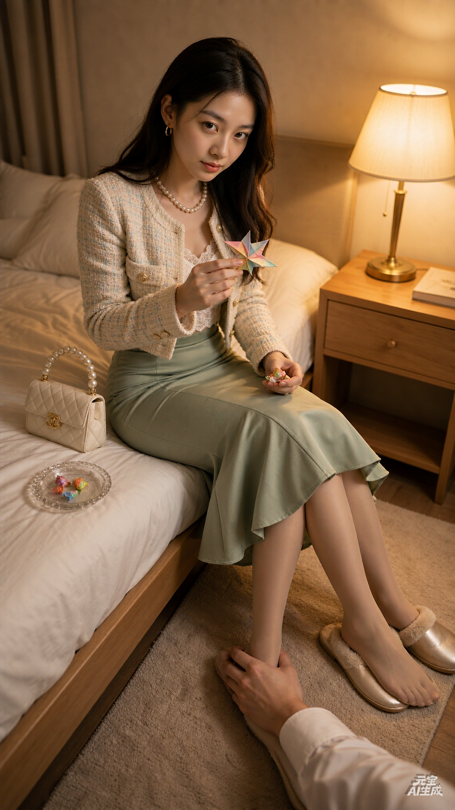

## 终稿提示词

```text
第2张 · 他走近坐床沿·视点 1.05 米、隔 1.0 米看她侧坐在床沿把糖纸折成一只小蝴蝶、抬眼朝他晃

三张输入图分工：第一张定本轮整套穿搭的版型配色面料、丝袜、绒拖与随这套衣服落下的深茶棕偏分长发；第二张定她的五官骨相；第三张定本张的侧坐姿态骨架与重心；光位、场景、关系视角、构图调子、神态落点与可见动作逐项落满画面。全画一位清晰成年女性人物，一具完整身体轮廓，左右各一只手臂、各五根手指，两只手各自从肩经肘腕到指尖连成一条链、各只做一个动作；两只脚各自连续，胸大腰细腿长靠合身剪裁写实呈现。

9:16 竖版满画幅，画面从顶到底由人物、糖纸小蝴蝶、玻璃糖碟、床沿与一片暖黄灯光填满，四条边即裁切边，人物与道具完整落在画内。象牙白粗花呢短款小香风开衫，圆领，前排金色小圆扣，四个贴袋，长袖袖口各一粒金扣，衣长齐腰；内搭白色蕾丝细肩带吊带束身衣，蕾丝花纹一路铺到下摆蕾丝边；鼠尾草绿缎面高腰鱼尾中长裙，前中一道开衩，裙长到小腿，鱼尾摆一层一层散开；双层珍珠项链贴着锁骨，奶白菱格珍珠链小包搁在床沿脚边。一层浅香槟薄透连裤丝袜从腿根连包到脚趾，脚趾由同色袜面完整包住、五趾在袜面里各自分明，袜面从小腿到脚背连成平顺同一片；两只香槟缎面软底包趾绒拖都实实穿在两只脚上，丝袜脚背连进拖口，鞋口一圈细短绒贴着丝袜脚背，一只绒拖半挂在叠放下层那只脚的脚尖上、脚趾在袜面里透出五趾轮廓。奶白短圆甲，细哑金小耳圈各一只。深茶棕偏分长发，额前一层薄空气碎刘海，松而大的长微卷一路披过胸，低头时几缕从肩头滑下来扫过锁骨；四张同一顶。

她的右手从右肩经肘腕到指尖连成一条链，唯一落点是拇指、食指与中指三指把剥下来的那张彩糖纸折成一只四角小蝴蝶，五指把四只纸角扶得平平的，橙红与浅青的纸面在灯下各反一点细亮；左手从肩经肘腕到指尖连成一条链，唯一落点是捏着那颗已经剥开糖纸的水果硬糖搁在自己膝头，五指虚虚拢着糖粒，糖面一点透亮。侧坐在床沿，双腿斜向右侧叠放，脊线从后颈经腰窝到点地的脚踝拉成一道柔缓的 S，肩往他这侧送过来半寸，髋留在后，重心稳在坐骨与两只绒拖之间。她先垂眼看掌心那只小蝴蝶一拍，随即抬眼把目光递过来，下颌收一点，眼尾压下来，眉梢提起一半就停住。

场景是入夜的卧室床头一角：燕麦色短绒地毯的织纹在暖光里浮出一层细绒，那双香槟缎面包趾绒拖实实穿在她叠放的两只脚上、随斜向右侧的腿一起落进画里；地毯上搁着那只玻璃糖碟，碟里还剩几颗裹彩纸的水果硬糖；浅木床头柜上摊着那本翻开的旧书，书页压着一小片糖纸；暖黄床头小灯罩着一圈布边，灯光柔柔地铺到床沿与地毯绒面上。画面下缘落着他走近坐下时搁在床沿边的一截手腕与袖口，素手皮肤本色，就在她半挂的绒拖那一侧。

暖黄灯光落在她折纸的三根指尖、糖纸蝴蝶四只角的彩亮、膝头那颗糖的透亮、发顶那道偏分缝与绒拖口连到脚踝的浅香槟丝光上；卧室深处那一小片墙色化成柔软暖黄，安静得像一句话说到一半。成图自带工具水印原样留在右下角。
```

## 一句点评

他走近坐床沿隔1.0米看她侧坐把糖纸折成一只小蝴蝶
