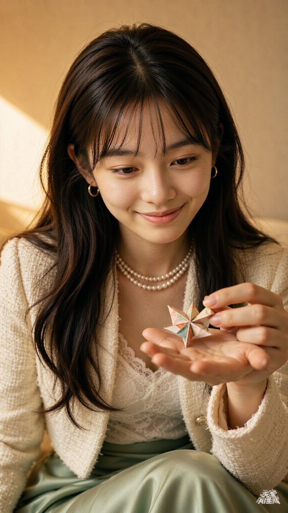

## 终稿提示词

```text
第4张 · 他凑近·视点 0.3 米、隔 0.3 米看她凑到眼前把糖纸小蝴蝶平贴进你摊开的掌心

一张输入图分工：这张底图定她的五官骨相；本轮象牙白粗花呢短款小香风开衫、白色蕾丝细肩带吊带、鼠尾草绿缎面鱼尾中长裙与深茶棕偏分长发由本段文字锚点写死。本张是 0.3 米近景，文字落在他这一眼正对着的她那张脸上，暖黄床头灯光与指尖的细亮都贴着这张脸走。全画一位清晰成年女性人物，脸年轻柔和、神态松弛。画面是一张一气连成的连续近景：她整张脸占满画面上半，额前一层薄空气碎刘海、眼尾、睫毛、鼻梁侧影、嘴角与一小片柔和下颌线从上到下连续落进画里；她的右手从画面右下角伸进来、近大远小，五指各各分明，拇指与食指刚刚松开一只糖纸折的四角小蝴蝶，把蝴蝶平搁在画面下缘正中你摊开掌心的一小片素色掌面上，糖纸四只角在暖光里各反一点橙红与浅青的细亮，中指、无名指、小指三指并拢轻曲，指腹贴着搁蝴蝶那手的腕侧，腕子松松的，奶白短圆甲在暖光里反出一点细亮。深茶棕长发从画面上半一路垂到右下那只手，象牙白粗花呢开衫的一线圆领与鼠尾草绿缎面裙的一小片折光在画底各亮各的；上下同一片柔软暖黄背景、同一道从画面左侧斜落的床头暖光、同一片柔和皮肤，整幅一次成像落在同一个焦平面上，横贯画面的只有那一道斜落的暖光与垂下来的长发，整幅从额前碎发一直连到摊开的掌心，中间由垂落的长发与同一道暖光连成一片。

她的眼尾弯下来，从垂在额前的薄碎刘海缝里正对这一眼，睫毛一眨一眨扫过那道浅影；下唇尖抵住一粒暖光亮点，眼尾先弯、视线压着掌心那只糖纸蝴蝶往下沉半分，嘴角提起一个等你先开口的弧度，带一点「甜不甜呀」的小得意，又留一点等你先说话的软。细哑金小耳圈在耳垂那一点反一粒极小的亮，双层珍珠项链的一粒珠面贴着锁骨那一线亮起来。

发型仍是深茶棕偏分长发，额前一层薄空气碎刘海，松而大的长微卷一路披过胸，发梢被暖光勾出一线绒光；四张同一顶。

场景是入夜的近前：背景是一整片柔软暖黄，画面左侧一片清亮床头灯光斜落，照亮眼尾、下唇角、耳圈、糖纸蝴蝶四角与搁在掌心的那截指尖。画面下缘正中留你摊开掌心的一小片素色掌面托在那只糖纸蝴蝶底下，你那截自然素色的手腕与一线衬衫袖口贴着画底，接住她递来的蝴蝶。成图自带工具水印原样留在右下角。
```

## 一句点评

他凑近隔0.3米看她把糖纸蝴蝶平贴进你摊开的掌心
