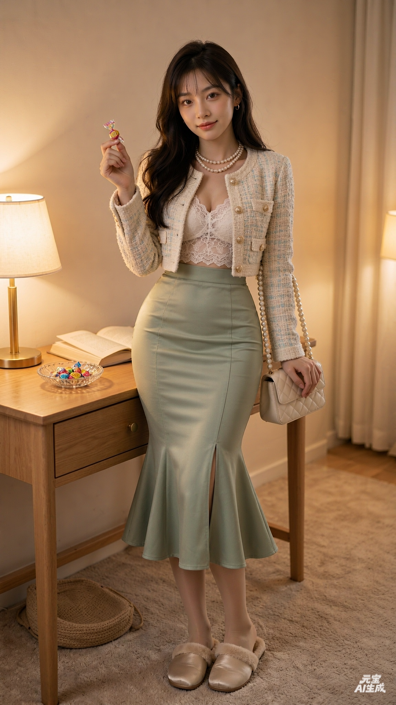
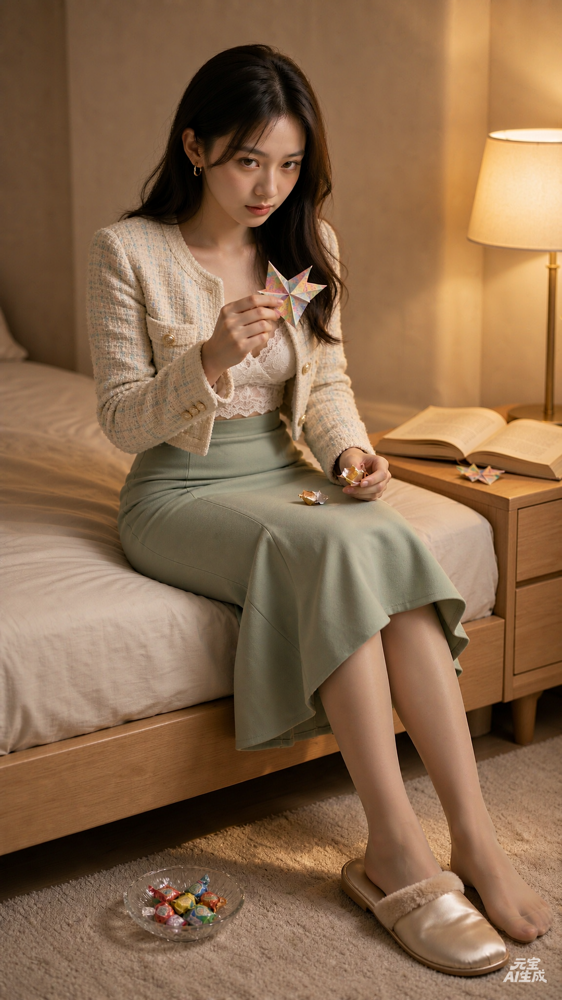

# R035 · 继续推进剧情 入夜床头分一颗水果糖

- 轮次目录：`20261127af_candy-butterfly`
- 日期：2026-11-27
- 来源：`yuanbao`
- 穿搭：`SPR-0145`
- 发型：未标注
- 场景标签：卧室
- 四张线稿：`full_single_P021`、full_single_P045`、full_single_P033`、full_single_P046`
- 画幅：1080×1920（9:16），纯画面

## 四张

| 序 | 机位 | 图 | 终稿提示词 |
|---|---|---|---|
| 01 | front |  | [01_front.md](01_front.md) |
| 02 | side |  | [02_side.md](02_side.md) |
| 03 | seat |  | [03_seat.md](03_seat.md) |
| 04 | close |  | [04_close.md](04_close.md) |

## 这一段说了什么

1. 入夜啦，我蹲床头数了半碟糖。这颗最亮归我，糖纸折的蝴蝶归你，你敢抢我就含着不说话。
2. 喏，糖纸我折好了，四只角压得平不平？你坐近些看，灯就这一盏，我举着等你一拍就够。
3. 我跪近一点递，你那只手腕搁着就好。蝴蝶轻得很，落你手心就归你了，收回来算我小气。
4. 接住啦？明早陪我去巷口铺子称二两水果糖，敢说牙疼我就挑最酸的，一路塞你手里。

## 现场记录

- 01_front：他倚着卧室门框隔1.3米看她站在床头柜边回身拈起一颗水果糖朝他晃
- 02_side：他走近坐床沿隔1.0米看她侧坐把糖纸折成一只小蝴蝶
- 03_seat：他俯身隔0.55米看她单膝跪起把糖纸小蝴蝶朝画外递过来
- 04_close：他凑近隔0.3米看她凑到眼前把糖纸小蝴蝶平托到画框下缘

> 原图 PNG 永不转码、永不覆盖；预览用 `` 缩放原图。
