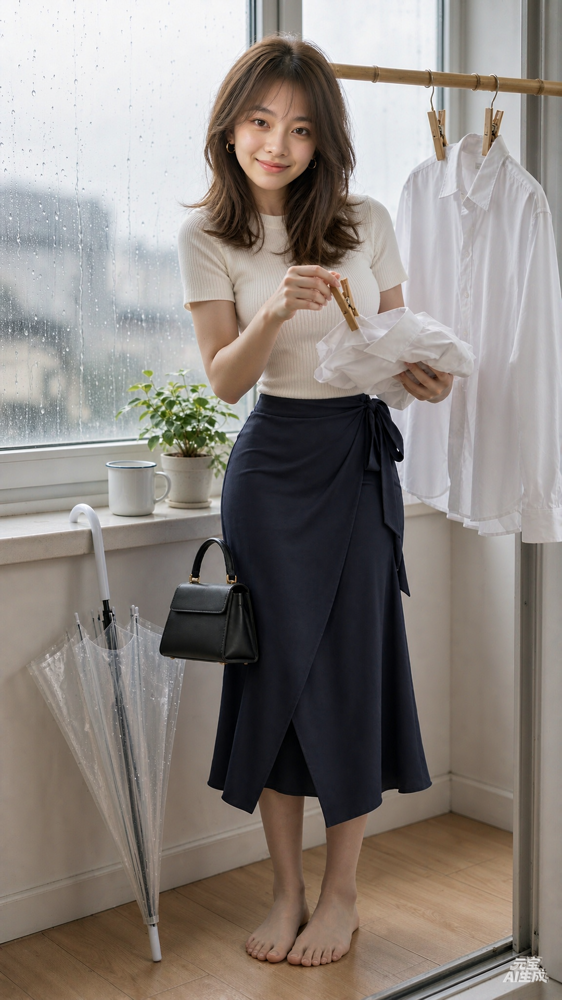

## 终稿提示词

```text
第1张 · 他倚着阳台门框站·视点 1.2 米、隔 1.3 米看她站在竹晾衣竿边把一件白棉衬衫从竹夹上取下来、回过身朝他晃

三张输入图分工：第一张定本轮整套穿搭的版型配色面料、丝袜与随这套衣服落下的雾感亚麻棕偏分中长发；第二张定她的五官骨相；第三张线稿只定本张的躯干重心、脊线肩髋与两腿骨架，手臂走向完全由下文逐只链写承接；她的两条手臂各按本段文字写的唯一落点从肩经肘腕连到指尖，全画共两条手臂、两只手；光位、场景、关系视角、构图调子、神态落点与可见动作逐项落满画面。全画一位清晰成年女性人物，一具完整身体轮廓，左右各一只手臂、各五根手指，两只手各自从肩经肘腕到指尖连成一条链、各只做一个动作；两只脚各自连续，胸大腰细腿长靠合身剪裁写实呈现。她的两条手臂各自从肩经肘、腕到指尖在画内完整收口，两条腿各自从髋经膝、踝到脚趾在画内完整收口，一具身体轮廓从发顶连到两只赤足一气连成；画面里只落她自己这一位人物，他的视点由首行机位与这一眼的取景方向交待。

9:16 竖版满画幅，画面从顶到底由人物、竹晾衣竿、一件白棉衬衫、靠墙收拢的透明雨伞、窗玻璃雨痕与一片雨后柔白天光填满，四条边即裁切边，人物与道具完整落在画内。白色方领短袖罗纹针织上衣，方领横平，短袖贴着上臂，罗纹细密，衣长齐腰；藏青缎面高腰系结不规则中长裙，腰侧一道同色缎带系成软结垂下来，前中一片斜叠不规则裙摆，裙长到小腿，缎面在光里浮出一层深蓝折光；黑色方形手提小包挎在左腕。一层浅茶薄透连裤丝袜从腿根连包到脚趾，脚趾由同色袜面完整包住、五趾在袜面里各自分明，袜面从小腿到脚背连成平顺同一片，两只赤足脚掌平踩浅木地板。奶白短圆甲，细哑金小耳圈各一只。雾感亚麻棕偏分中长发，额前一层薄空气碎刘海，发尾自然内扣微卷，层次松软，耳侧几缕细软碎发垂到锁骨；四张同一顶。

她的右手从右肩经肘腕到指尖连成一条链，唯一落点是拇指与食指捏住一枚竹晾衣夹、把夹口从白棉衬衫领上轻轻松开，五指把竹夹举在窗光里，竹节纹路一节一节分得清；左手从肩经肘腕到指尖连成一条链，唯一落点是托着那件刚松开的白棉衬衫领口、把衬衫接住抱在胸前，五指指腹实实在在压住棉布，衬衫袖子软软垂下来。她站在浅木地板上，上身朝他这侧回过来一点，脊线从后颈经腰窝到两只赤足拉成一道柔缓的弧，重心稳在前脚掌与托衬衫的手之间。她先看自己指尖那枚竹夹一拍，随即抬眼把目光递过来，下颌微收一点，眼尾抬起来，下唇含住一点又松开，嘴角挑起一线。

场景是雨后的阳台窗边：一根竹晾衣竿横在窗前，竿上还夹着两枚竹夹，浅木地板的木纹在柔白天光里浮出一层细亮；靠墙收拢着一把透明雨伞，伞面几颗雨珠顺着塑料骨往下淌；窗玻璃上一道一道雨痕把天光切成一格一格，窗台搁着一只白搪瓷杯与一小盆绿萝，绿萝叶子还沾着水。画面右下角是浅木地板接阳台门框的那一线柔白天光。远景里这一眼看清的是她捏竹夹的五根指尖、发顶那道偏分缝、白棉衬衫领口的棉布折痕、藏青缎面裙腰侧那个软结与赤足上那层浅茶丝光；阳台深处那一小片墙色化成柔和冷白。

雨后云开的柔白天光落在她的眼尾、下唇角、捏竹夹的指尖、竹夹的竹节纹、白棉衬衫领口与细哑金小耳圈上。成图自带工具水印原样留在右下角。
```

## 一句点评

他倚着阳台门框隔1.3米看她站在竹晾衣竿边把白棉衬衫从竹夹上取下来
