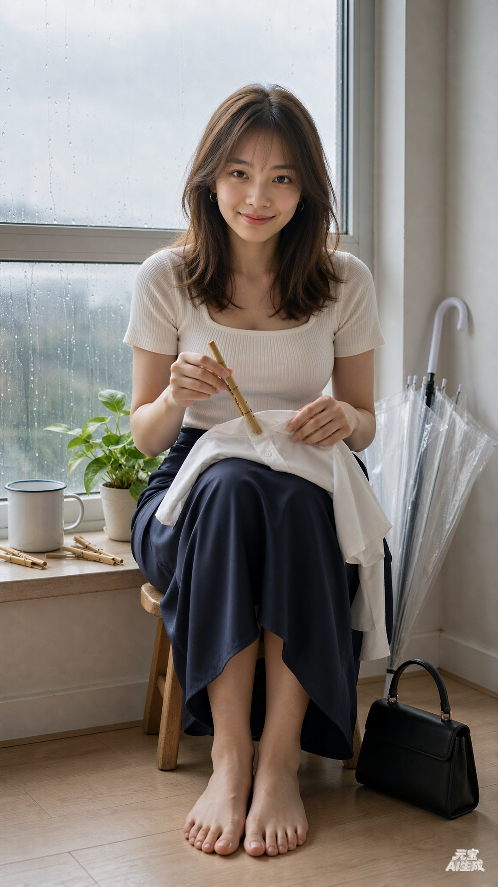

## 终稿提示词

```text
第2张 · 他走近坐窗边矮凳·视点 1.05 米、隔 1.0 米看她抱膝坐在矮凳上把白棉衬衫摊在膝头、拿一枚竹夹别住领口

三张输入图分工：第一张定本轮整套穿搭的版型配色面料、丝袜与随这套衣服落下的雾感亚麻棕偏分中长发；第二张定她的五官骨相；第三张线稿只定本张的躯干重心、脊线肩髋与两腿抱膝骨架，手臂走向完全由下文逐只链写承接；她的两条手臂各按本段文字写的唯一落点从肩经肘腕连到指尖，全画共两条手臂、两只手；光位、场景、关系视角、构图调子、神态落点与可见动作逐项落满画面。全画一位清晰成年女性人物，一具完整身体轮廓，左右各一只手臂、各五根手指，两只手各自从肩经肘腕到指尖连成一条链、各只做一个动作；两只脚各自连续，胸大腰细腿长靠合身剪裁写实呈现。她的两条手臂各自从肩经肘、腕到指尖在画内完整收口，两条腿各自从髋经膝、踝到脚趾在画内完整收口，一具身体轮廓从发顶连到两只赤足一气连成；画面里只落她自己这一位人物，他的视点由首行机位与这一眼的取景方向交待。

9:16 竖版满画幅，画面从顶到底由人物、膝头摊开的白棉衬衫、一枚竹夹、窗玻璃雨痕、白搪瓷杯与一片雨后柔白天光填满，四条边即裁切边，人物与道具完整落在画内。白色方领短袖罗纹针织上衣，方领横平，短袖贴着上臂，罗纹细密，衣长齐腰；藏青缎面高腰系结不规则中长裙，腰侧一道同色缎带系成软结垂下来，前中一片斜叠不规则裙摆顺着抱膝的腿堆出几道软褶，缎面浮出一层深蓝折光；黑色方形手提小包搁在矮凳脚边。一层浅茶薄透连裤丝袜从腿根连包到脚趾，脚趾由同色袜面完整包住、五趾在袜面里各自分明，袜面从小腿到脚背连成平顺同一片，两只赤足脚掌平踩浅木地板。奶白短圆甲，细哑金小耳圈各一只。雾感亚麻棕偏分中长发，额前一层薄空气碎刘海，发尾自然内扣微卷，低头时几缕从肩头滑下来扫过锁骨；四张同一顶。

她的右手从右肩经肘腕到指尖连成一条链，唯一落点是拇指与食指捏着一枚竹晾衣夹、把夹口正正别在摊开膝头的白棉衬衫领口上，五指把竹夹扶得稳稳的，竹节纹路一节一节分得清；左手从肩经肘腕到指尖连成一条链，唯一落点是按住白棉衬衫的一只袖口把衬衫在膝头铺平，五指指腹压住棉布，袖口一道细折光。抱膝坐在窗边矮凳上，两膝并拢微微斜向右侧，脊线从后颈经腰窝到点地的脚踝拉成一道柔缓的弧，肩往他这侧送过来半寸，髋留在后，重心稳在坐骨与两只赤足之间。她先垂眼看领口那枚竹夹一拍，随即抬眼把目光递过来，下颌收一点，眼尾压下来，眉梢提起一半就停住。

场景是雨后的阳台窗边：浅木地板的木纹在柔白天光里浮出一层细亮，窗玻璃上一道一道雨痕把天光切成一格一格；窗台搁着那只白搪瓷杯、一小盆绿萝与两三枚闲着的竹夹，绿萝叶子还沾着水；靠墙收拢着那把透明雨伞，伞面几颗雨珠顺着塑料骨往下淌。画面下缘是浅木地板接着矮凳木边，就在她赤足那一侧。

雨后云开的柔白天光落在她别竹夹的两根指尖、竹夹的竹节纹、白棉衬衫领口的棉布折痕、膝头那片深蓝缎面软褶与赤足上那层浅茶丝光上；窗外的天色化成一片柔和冷白，安静得像一句话说到一半。成图自带工具水印原样留在右下角。
```

## 一句点评

他走近坐窗边矮凳隔1.0米看她抱膝把竹夹别住衬衫领口
