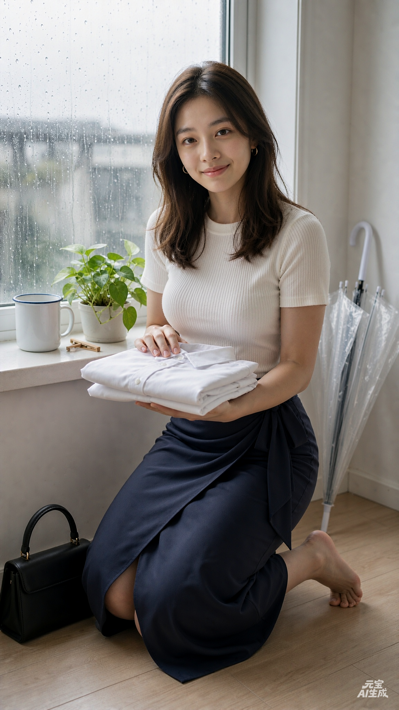

## 终稿提示词

```text
第3张 · 他俯身·视点 0.5 米、隔 0.55 米看她单膝立起把叠好的白棉衬衫平捧在两只掌心、抬眼朝他晃

三张输入图分工：第一张定本轮整套穿搭的版型配色面料、丝袜与随这套衣服落下的雾感亚麻棕偏分中长发；第二张定她的五官骨相；第三张线稿只定本张的躯干重心、脊线肩髋与单膝立起的两腿骨架，手臂走向完全由下文逐只链写承接；她的两条手臂各按本段文字写的唯一落点从肩经肘腕连到指尖，全画共两条手臂、两只手；光位、场景、关系视角、构图调子、神态落点与可见动作逐项落满画面。全画一位清晰成年女性人物，一具完整身体轮廓，左右各一只手臂、各五根手指，两只手各自从肩经肘腕到指尖连成一条链、各只做一个动作；两只脚各自连续，胸大腰细腿长靠合身剪裁写实呈现。她的两条手臂各自从肩经肘、腕到指尖在画内完整收口，两条腿各自从髋经膝、踝到脚趾在画内完整收口，一具身体轮廓从发顶连到两只赤足一气连成；画面里只落她自己这一位人物，他的视点由首行机位与这一眼的取景方向交待；全画只一件叠好的白棉衬衫，平捧在她两只掌心之间。

9:16 竖版满画幅，画面从顶到底由人物、叠好的白棉衬衫、窗玻璃雨痕、白搪瓷杯、浅木地板与一小片雨后柔白天光填满，四条边即裁切边，人物与道具完整落在画内。白色方领短袖罗纹针织上衣，方领横平，短袖贴着上臂，罗纹细密，衣长齐腰；藏青缎面高腰系结不规则中长裙，腰侧一道同色缎带系成软结垂下来，前中一片斜叠不规则裙摆随着单膝立起在膝侧堆出几道软褶，缎面浮出一层深蓝折光；黑色方形手提小包搁在浅木地板边。一层浅茶薄透连裤丝袜从腿根连包到脚趾，脚趾由同色袜面完整包住、五趾在袜面里各自分明，袜面从小腿到脚背连成平顺同一片，两只赤足脚掌平踩浅木地板。奶白短圆甲，细哑金小耳圈各一只。雾感亚麻棕偏分中长发，额前一层薄空气碎刘海，发尾自然内扣微卷，俯身时几缕从肩头滑下来扫过锁骨；四张同一顶。

她的右手从右肩经肘腕到指尖连成一条链，唯一落点是托住那件叠得齐齐的白棉衬衫底层，五指平摊把衬衫托稳，衬衫折痕一道一道压得平平的，领口那枚竹夹正正别在衬衫上沿；左手从肩经肘腕到指尖连成一条链，唯一落点是压住衬衫折好的领口，五指指腹贴着棉布，两只手一上一下把衬衫平捧在胸前、正朝画外递过去。左膝落地跪稳，右腿屈起、赤足脚掌平踩浅木地板踩稳，脊线从后颈经腰窝到跪着的膝头拉成一道柔缓的弧，肩往前送、髋留在后，重心落在跪着的膝与踩地的赤足之间。她先看掌心那件衬衫一拍，随即抬眼把目光递过来，眼尾压下来正对这一眼，下唇含住一点又松开，嘴角挑起极轻的一线。

场景是雨后的阳台窗边：浅木地板的木纹在柔白天光里浮出一层细亮，窗玻璃上一道一道雨痕把天光切成一格一格；窗台搁着那只白搪瓷杯、一小盆绿萝与两三枚闲着的竹夹，绿萝叶子还沾着水；靠墙收拢着那把透明雨伞，伞面几颗雨珠顺着塑料骨往下淌。画面右下角是浅木地板的边沿与一小片柔白天光，接住她抬眼那一线目光。

雨后云开的柔白天光落在她眼尾、下唇角、托衬衫的五根指尖、白棉衬衫一道道折痕、领口那枚竹夹的竹节纹、藏青缎面裙摆几道软褶与赤足上那层浅茶丝光上；画面四周收拢成一层柔和冷白，把中央那片光托出来，安静得像整间屋子都放轻了呼吸。成图自带工具水印原样留在右下角。
```

## 一句点评

他俯身隔0.55米看她单膝立起把叠好的白衬衫平捧在掌心
