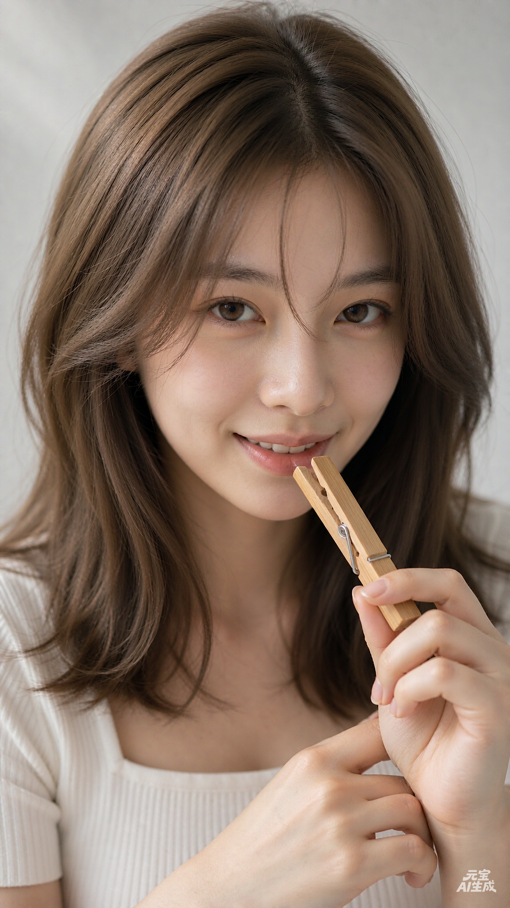

## 终稿提示词

```text
第4张 · 他凑近·视点 0.3 米、隔 0.3 米看她凑到眼前把那枚竹晾衣夹举到这一眼正前

三张输入图分工：第一张定本轮整套穿搭的版型配色面料与随这套衣服落下的雾感亚麻棕偏分中长发；第二张定她的五官骨相；第三张线稿只定本张的躯干重心与脊线、画面上半由她的脸与两条手臂占满，手臂走向完全由下文逐只链写承接；她的两条手臂各按本段文字写的唯一落点从肩经肘腕连到指尖，全画共两条手臂、两只手；光位、场景、关系视角、构图调子、神态落点与可见动作逐项落满画面。全画一位清晰成年女性人物，脸年轻柔和、神态松弛。她两条手臂各自从肩经肘、腕到指尖在画内完整收口，一具身体轮廓从发顶连到画底一气连成；画面里只落她自己这一位人物，他的视点由首行机位与这一眼的取景方向交待。画面是一张一气连成的连续近景：她整张脸占满画面上半，额前一层薄空气碎刘海、眼尾、睫毛、鼻梁侧影、嘴角与一小片柔和下颌线从上到下连续落进画里；她的右手从画面右下角伸进来、近大远小，五指各各分明，拇指与食指轻轻捏着一枚竹晾衣夹，把竹夹举到这一眼正前，竹节纹路一节一节分得清，夹口两片竹片合得平平的；她的左手从画面左下角伸进来、五指轻拢托在右手腕下，两条手臂各自一气连成，右手中指、无名指、小指三指并拢轻曲，腕子松松的，奶白短圆甲在天光里反出一点细亮。雾感亚麻棕偏分中长发从画面上半一路垂到右下那只手，白色方领罗纹针织上衣的一线方领与藏青缎面裙的一小片深蓝折光在画底各亮各的；上下同一片柔和冷白背景、同一道从画面左侧斜落的雨后柔白天光、同一片柔和皮肤，整幅一次成像落在同一个焦平面上，横贯画面的只有那一道斜落的天光与垂下来的长发，整幅从额前碎发一直连到画面下缘，中间由垂落的长发与同一道天光连成一片；左右合计两条手臂、十根手指，数与位一一对应她自身躯干两侧，那枚竹夹只由右手拇指与食指捏着。

她的眼尾弯下来，从垂在额前的薄碎刘海缝里正对这一眼，睫毛一眨一眨扫过那道浅影；下唇尖抵住一粒天光亮点，眼尾先弯、视线压着指尖那枚竹夹往下沉半分，嘴角提起一个等你先开口的弧度，带一点「香不香呀」的小得意，又留一点等你先说话的软。细哑金小耳圈在耳垂那一点反一粒极小的亮，锁骨那一线皮肤在天光里柔柔亮起来。

发型仍是雾感亚麻棕偏分中长发，额前一层薄空气碎刘海，发尾自然内扣微卷，层次松软，发梢被天光勾出一线绒光；四张同一顶。

场景是雨后的近前：背景是一整片柔和冷白，画面左侧一片清亮雨后柔白天光斜落，照亮眼尾、下唇角、耳圈、竹夹的竹节纹与她捏竹夹的那截指尖。画面下缘正中是那一小片柔白天光与她托右腕的指尖，接住这一眼。成图自带工具水印原样留在右下角。
```

## 一句点评

他凑近隔0.3米看她把那枚竹夹举到这一眼正前
