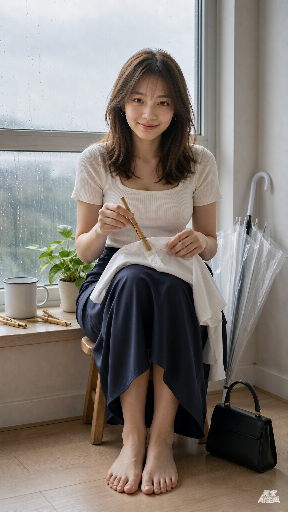

# R036 · 推进恋剧情 雨后阳台收下他晾的白衬衫

- 轮次目录：`20261127ag_rain-window-shirt`
- 日期：2026-11-27
- 来源：`yuanbao`
- 穿搭：`SPR-0200`
- 发型：未标注
- 场景标签：洗漱
- 四张线稿：`full_sexy_P003`、full_sexy_P030`、full_sexy_P028`、full_sexy_P042`
- 画幅：1080×1920（9:16），纯画面

## 四张

| 序 | 机位 | 图 | 终稿提示词 |
|---|---|---|---|
| 01 | front |  | [01_front.md](01_front.md) |
| 02 | side |  | [02_side.md](02_side.md) |
| 03 | seat |  | [03_seat.md](03_seat.md) |
| 04 | close |  | [04_close.md](04_close.md) |

## 这一段说了什么

1. 雨停啦，我先把你晾的那件衬衫收下来。别急着夸我勤快，我是闻着上面皂味才上阳台的，哼。
2. 喏，领口这枚竹夹我替你别好了，算盖个章。你坐近些看仔细点，歪了我可要重夹三遍哦。
3. 我跪近一点捧着，衬衫叠得齐齐的。你那句谢谢先存着，我要换一句更好听的，想好了再给你。
4. 凑近些看，这枚小夹子亮不亮？明晚陪我去给绿萝换个陶盆，敢说麻烦我就连土搬你书桌上。

## 现场记录

- 01_front：他倚着阳台门框隔1.3米看她站在竹晾衣竿边把白棉衬衫从竹夹上取下来
- 02_side：他走近坐窗边矮凳隔1.0米看她抱膝把竹夹别住衬衫领口
- 03_seat：他俯身隔0.55米看她单膝立起把叠好的白衬衫平捧在掌心
- 04_close：他凑近隔0.3米看她把那枚竹夹举到这一眼正前

> 原图 PNG 永不转码、永不覆盖；预览用 `` 缩放原图。
