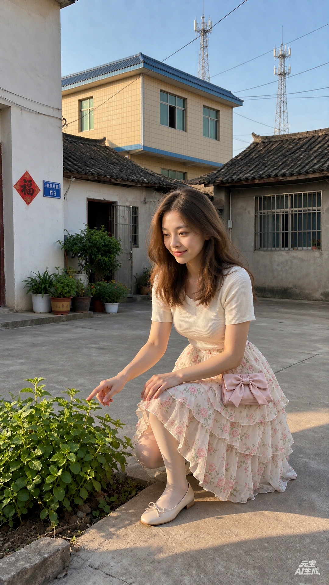

## 终稿提示词

```text
第2张 · 他蹲在老平房门槛·视点 0.65 米、隔 0.4 米看她单膝跪在墙根指尖碰那盆薄荷的叶子
9:16 满幅竖构图，人物与道具铺满整幅、四条边即裁切边。第一张图提供整套穿搭与这一轮的发型，第二张图提供她的五官骨相，第三张线稿图提供这一眼的躯干重心、脊线肩髋与两腿骨架；手臂走向完全由下文逐只写死的唯一落点从肩经肘腕连到指尖承接。画面里只落她自己这一位人物，全画只一位成年人物，画面四边以内只收她一人的轮廓与她手里那件小道具。左右各一只手臂各五根手指，两条手臂各自从肩连续到指尖，两只手各自从肩连续到指尖，两条腿各自连续，全画共两条手臂、两只手、两条腿；每只手按「哪只手→从肩经肘腕到指尖一条链→唯一落点」逐只写，同一只手只出现一次、只做一个动作。她穿奶油白细罗纹针织短袖上衣，下身奶油白底粉色小玫瑰碎花雪纺层叠中长半裙、三层荷叶边散到小腿中段，腰侧系一只粉色缎面大蝴蝶结小包，雾感亚麻棕偏分松长发一路披过肩胛、发尾带松软大卷；按人物设定 24 小时穿着一层浅茶薄透连裤丝袜，从腿根连包到脚趾，脚趾由同色袜面完整包住、五趾在袜面里各自分明，袜面从小腿到脚背连成平顺同一片，脚上米白蝴蝶结平底鞋穿在丝袜外面、丝袜脚背连进鞋口。
她单膝跪在墙根软土边，左膝着地、右腿屈起踩稳水泥地，右手从右肩经右肘右腕到指尖伸出去，食指尖轻轻落在最胖那盆薄荷的叶尖上；左手从左肩经左肘左腕到指尖搭在自己右膝头把身子稳住。她从肩头回过半张脸，眼尾从下往抬起递向这一眼，嘴角挑起极轻的一线，这点笑意长出一个可见动作：点着叶尖的食指尖又轻轻点了第二下。场景是午后村里的水泥院坝：米黄色三层自建楼房、米黄瓷砖圆角楼带一道蓝色波浪檐、灰瓦坡顶老平房、一格格铝合金窗与铁栅栏小窗、一座通信铁塔与斜拉的细电线、左侧白墙上一张红双喜、门边一块蓝底白字小牌、墙根几盆绿植、远处淡淡山影；一道斜落的夕阳硬光把院坝劈成明亮与楼影两半，暖白夕光与楼影在同一片水泥地上交界。她跪在明亮与楼影交界那一线，右膝到右脚趾连成一条完整可见的折线、鞋底贴地完整收在画内，斜光顺着屈起的腿线铺过去，浅茶袜面从小腿到脚背泛起一道细密折光，取景落点落在袜面、脚背与腿线那一片光上。画面干净、神态松弛、脸年轻柔和。
```

## 一句点评

单膝跪墙根指尖碰薄荷叶回过半张脸
