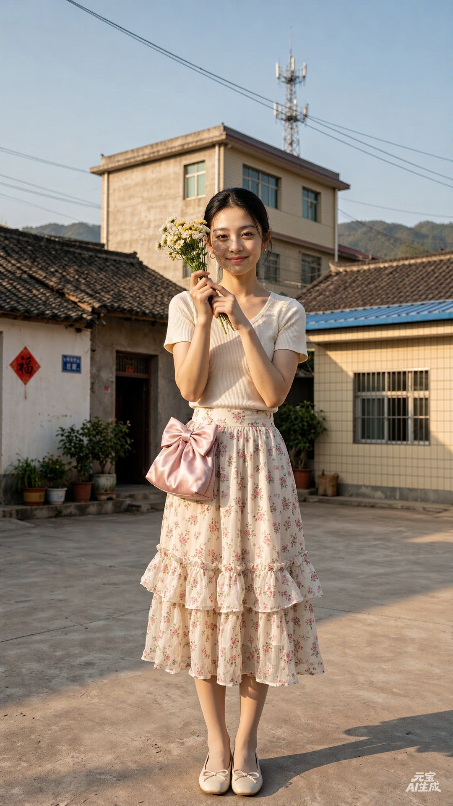

## 终稿提示词

```text
第4张 · 他俯身凑到她面前·视点 0.5 米、隔 0.3 米看她把一小把路边野花举到这一眼前、指尖点着停住
9:16 满幅竖构图，人物与道具铺满整幅、四条边即裁切边。这一张是极近景特写，这一张输入图提供她的五官骨相，整幅一次成像落在同一个焦平面上，上下同一片暖白光一气连成。画面里只落她自己这一位人物，全画只一位成年人物，画面四边以内只收她一人的轮廓与她手里那件小道具。左右各一只手臂各五根手指，两条手臂各自从肩连续到指尖，两只手各自从肩连续到指尖，两条腿各自连续，全画共两条手臂、两只手、两条腿；每只手按「哪只手→从肩经肘腕到指尖一条链→唯一落点」逐只写，同一只手只出现一次、只做一个动作。她穿奶油白细罗纹针织短袖上衣，下身奶油白底粉色小玫瑰碎花雪纺层叠中长半裙、三层荷叶边散到小腿中段，腰侧系一只粉色缎面大蝴蝶结小包，雾感亚麻棕偏分松长发一路披过肩胛、发尾带松软大卷；按人物设定 24 小时穿着一层浅茶薄透连裤丝袜，从腿根连包到脚趾，脚趾由同色袜面完整包住、五趾在袜面里各自分明，袜面从小腿到脚背连成平顺同一片，脚上米白蝴蝶结平底鞋穿在丝袜外面、丝袜脚背连进鞋口。
画顶紧贴眉骨、画底紧贴下颌线，只取眼尾到嘴角那半张脸，举花那只手从肩经肘腕到指尖完整落在画内、另一只手收在胸前只露指尖到腕，雾感亚麻棕长发从耳侧垂下来、发梢被斜光勾出一线绒光。右手从右肩经右肘右腕到指尖把一小把奶白与淡黄的野花举到这一眼正前，花茎稳稳夹在拇指与食指之间；左手从左肩经左肘左腕到指尖收在胸前、指尖轻轻搭着右手腕。她眼尾压下来，从垂发缝里正对这一眼，嘴角挑起一点点就停住，这点得意长出一个可见动作：举花那只手的食指尖朝前轻轻点了一下，点完停在原处。场景是午后村里的水泥院坝：米黄色三层自建楼房、米黄瓷砖圆角楼带一道蓝色波浪檐、灰瓦坡顶老平房、一格格铝合金窗与铁栅栏小窗、一座通信铁塔与斜拉的细电线、左侧白墙上一张红双喜、门边一块蓝底白字小牌、墙根几盆绿植、远处淡淡山影；一道斜落的夕阳硬光把院坝劈成明亮与楼影两半，暖白夕光与楼影在同一片水泥地上交界。暖白夕光斜斜切过她眼尾、下唇角与指尖那几瓣花，画面干净、神态松弛、脸年轻柔和。
```

## 一句点评

把一小把路边野花举到这一眼正前点着不肯收
