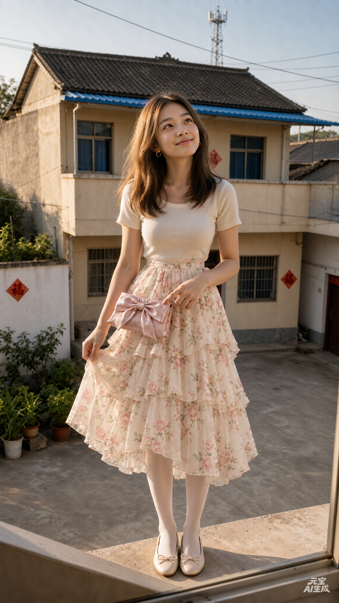
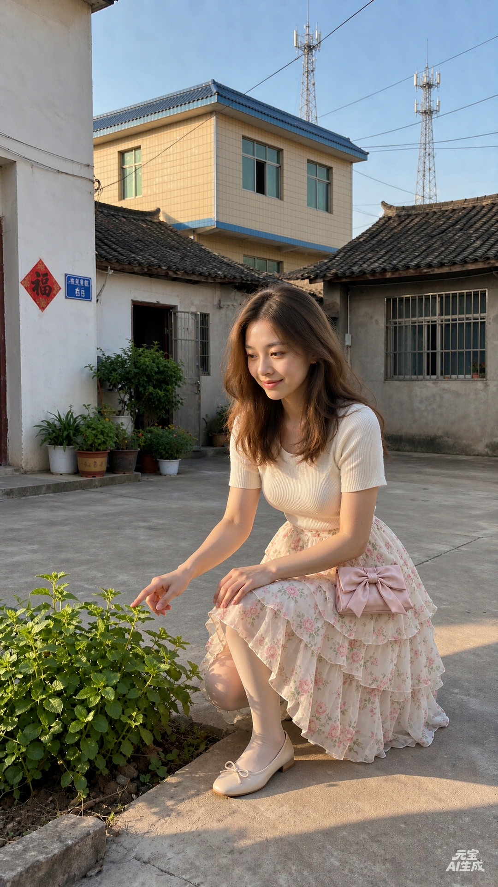
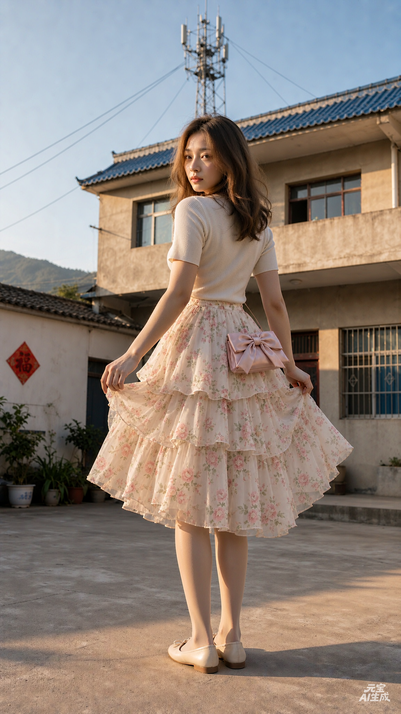
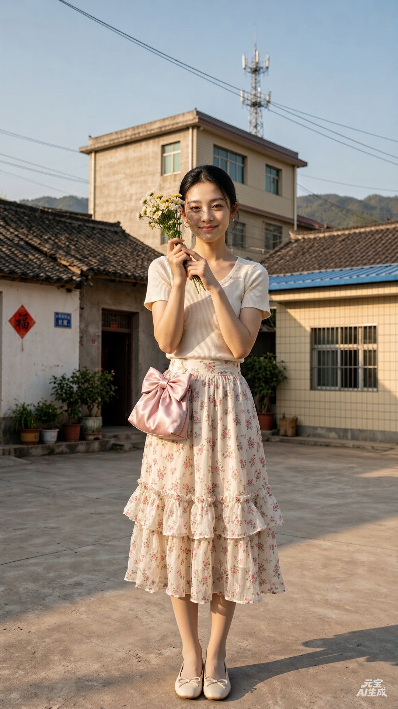

# R038 · 唐唐我带你回村

- 轮次目录：`20261127ah_back-to-village`
- 日期：2026-11-27
- 来源：`yuanbao`
- 穿搭：`SPR-0031`
- 发型：未标注
- 场景标签：其它
- 四张线稿：`full_sexy_P003_diag`、full_sexy_P035_side`、full_sexy_P001_front`、full_sexy_P001_front`
- 画幅：1080×1920（9:16），纯画面

## 四张

| 序 | 机位 | 图 | 终稿提示词 |
|---|---|---|---|
| 01 | front |  | [01_front.md](01_front.md) |
| 02 | side |  | [02_side.md](02_side.md) |
| 03 | seat |  | [03_seat.md](03_seat.md) |
| 04 | close |  | [04_close.md](04_close.md) |

## 这一段说了什么

1. 你带我回来啦，这院子比照片上还亮，我站光里给你看，别在楼上光看着呀。
2. 墙根这几盆我替你认过了，最胖那盆是薄荷，蹲这儿风正好，你过来扶我一把嘛。
3. 你看这道太阳斜斜切下来，把我裙子边和腿上都镶了一圈，好看到我自己都想多看一眼。
4. 这把野花我掐的，举你眼前了，接不接？不接我就一直举着，举到你笑为止。

## 现场记录

- 01_front：她站在院坝明亮那半仰头朝二楼这一眼笑
- 02_side：单膝跪墙根指尖碰薄荷叶回过半张脸
- 03_seat：站在斜落夕照里回身让三层荷叶边多停一拍
- 04_close：把一小把路边野花举到这一眼正前点着不肯收

> 原图 PNG 永不转码、永不覆盖；预览用 `` 缩放原图。
