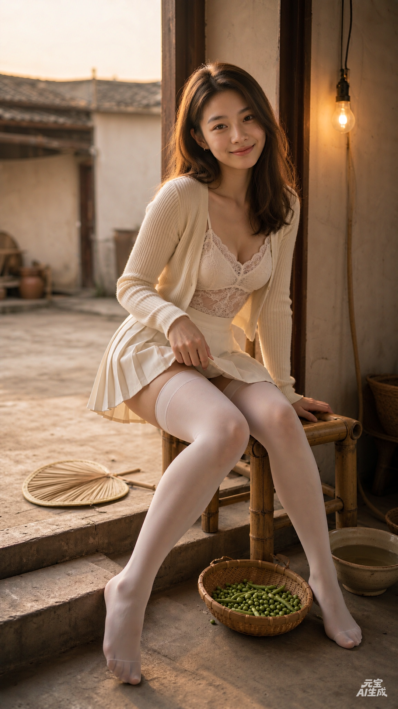

## 终稿提示词

```text
第1张 · 他坐在堂屋竹椅上·视点 1.1 米、隔 2.6 米看她侧身坐到矮竹凳上回身朝这一眼笑
9:16 满幅竖构图，人物与道具铺满整幅、四条边即裁切边。第一张图提供整套穿搭与这一轮的发型，第二张图提供她的五官骨相，第三张线稿图提供这一眼的躯干重心、脊线肩髋与两腿骨架；手臂走向完全由下文逐只写死的唯一落点从肩经肘腕连到指尖承接。画面里只落她自己这一位人物，全画只一位成年人物，画面四边以内只收她一人的轮廓、她那只矮竹凳与她手边那几件小道具；画外人由首行机位与这一眼的取景方向交待。左右各一只手臂各五根手指，两条手臂各自从肩连续到指尖，两只手各自从肩连续到指尖，两条腿各自连续，全画共两条手臂、两只手、两条腿；每只手按「哪只手→从肩经肘腕到指尖一条链→唯一落点」逐只写，同一只手只出现一次、只做一个动作。她穿奶油白细针织长袖短开衫、前襟敞着、袖口一小圈细罗纹，内搭象牙白蕾丝吊带、心形领细肩带，下身象牙白百褶迷你裙、裙摆齐大腿中段，雾感亚麻棕偏分中长发一路披过肩胛、发尾带松软微卷；按人物设定 24 小时穿着一层象牙白匀透连裤丝袜，从腿根连包到脚趾，脚趾由同色袜面完整包住、五趾在袜面里各自分明，袜面从小腿到脚背连成平顺同一片；两只米白软底平底鞋穿在丝袜外面、丝袜脚背连进鞋口，四张同一双。
她侧身坐到矮竹凳上，脊线从后颈经腰窝拉成一道柔缓的弧，左脚稳稳踩实水泥门槛石、右脚脚尖已经朝这一眼的方向轻轻点出去半步；右手从右肩经右肘右腕到指尖捏着百褶裙摆一角轻轻提起，左手从左肩经左肘左腕到指尖搭在竹凳边把身子稳住。她回过脸朝这一眼笑，眼尾弯起、下唇含住一点又松开，这点笑意长出一个可见动作：搭在竹凳边那只手的食指朝凳面轻轻勾了一下。场景是村里老平房堂屋门口：一道被磨得发亮的水泥门槛石、一张矮竹凳、竹凳角搁着一把旧蒲扇、脚边一只竹编小篮里摊着几颗带壳的青毛豆、门槛内一只粗陶碗盛着晾凉的井水、屋里一盏刚拧亮的小灯泡、门外院坝那片夕光退成薄薄一线蜜色、远处山影淡下去；暖黄灯光与门外剩的那点蜜色在门槛石上交成一道软边。暖黄灯光落在她百褶裙的褶棱、小腿与脚背那片袜面上，取景落点落在袜面、脚背与腿线那一片光与折光上。人物头顶到两只鞋底完整收在画内。画面干净、神态松弛、脸年轻柔和。
```

## 一句点评

她侧身坐到矮竹凳上回身朝这一眼笑右脚先点出半步
