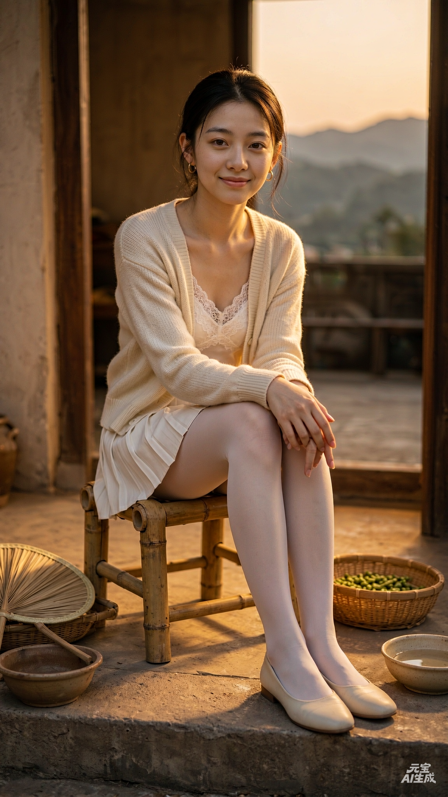

## 终稿提示词

```text
第4张 · 他凑到她面前·视点 0.4 米、隔 0.3 米看她把下巴微抬、指尖点在自己膝头上停住
9:16 满幅竖构图，人物与道具铺满整幅、四条边即裁切边。这一张是极近景，这一张输入图提供她的五官骨相，整幅一次成像落在同一个焦平面上、上下同一片暖黄光一气连成。画面里只落她自己这一位人物，全画只一位成年人物，画面四边以内只收她一人的轮廓、她那只矮竹凳与她手边那几件小道具；画外人由首行机位与这一眼的取景方向交待。左右各一只手臂各五根手指，两条手臂各自从肩连续到指尖，两只手各自从肩连续到指尖，两条腿各自连续，全画共两条手臂、两只手、两条腿；每只手按「哪只手→从肩经肘腕到指尖一条链→唯一落点」逐只写，同一只手只出现一次、只做一个动作。她穿奶油白细针织长袖短开衫、前襟敞着、袖口一小圈细罗纹，内搭象牙白蕾丝吊带、心形领细肩带，下身象牙白百褶迷你裙、裙摆齐大腿中段，雾感亚麻棕偏分中长发一路披过肩胛、发尾带松软微卷；按人物设定 24 小时穿着一层象牙白匀透连裤丝袜，从腿根连包到脚趾，脚趾由同色袜面完整包住、五趾在袜面里各自分明，袜面从小腿到脚背连成平顺同一片；两只米白软底平底鞋穿在丝袜外面、丝袜脚背连进鞋口，四张同一双。
画顶到她发顶、画底落在搭出去那只脚的鞋尖之后并留出一线水泥门槛石做底，脸占画高约四成，雾感亚麻棕中长发从耳侧垂下来、发梢被灯光勾出一线绒光。她把下巴微抬，眼尾压下来从垂发缝里正对这一眼，嘴角挑起一点点就停住；右手从右肩经右肘右腕到指尖搭在自己膝头，左手从左肩经左肘左腕到指尖收在胸前、指尖轻轻贴着右手腕。这点小得意长出一个可见动作：搭在膝头那只手的食指尖朝前轻轻点了一下，点完停在原处。场景是村里老平房堂屋门口：一道被磨得发亮的水泥门槛石、一张矮竹凳、竹凳角搁着一把旧蒲扇、脚边一只竹编小篮里摊着几颗带壳的青毛豆、门槛内一只粗陶碗盛着晾凉的井水、屋里一盏刚拧亮的小灯泡、门外院坝那片夕光退成薄薄一线蜜色、远处山影淡下去；暖黄灯光与门外剩的那点蜜色在门槛石上交成一道软边。画底前缘那一小片暖光里，搭出去那只脚的象牙白袜面软软亮着一道折光，取景落点落在袜面、脚背与腿线那一片光与折光上。画面干净、神态松弛、脸年轻柔和。
```

## 一句点评

双手交叠搭在膝头下巴微抬眼尾压下来正对这一眼
