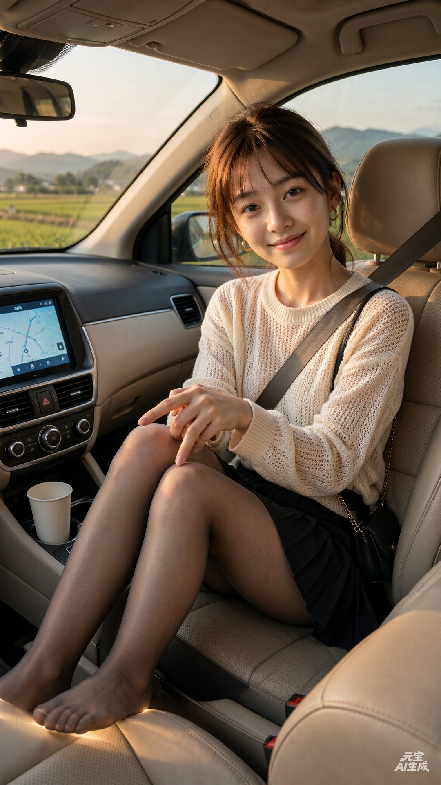

## 终稿提示词

```text
第4张 · 他凑到她面前·视点 0.4 米、隔 0.3 米看她把下巴微抬、指尖点在自己膝头上停住
9:16 满幅竖构图，人物与道具铺满整幅、四条边即裁切边。这一张是 0.3 米近身近景、满身取景，这一张输入图提供她的五官骨相，整幅一次成像落在同一个焦平面上、上下同一片蜜色斜光一气连成。画面里只落她自己这一位人物，全画只一位成年人物，画面四边以内只收她一人的轮廓、她身下那张副驾座椅与她手边那几件车内小道具；画外人由首行机位与这一眼的取景方向交待。左右各一只手臂各五根手指，两条手臂各自从肩连续到指尖，两只手各自从肩连续到指尖，两条腿各自连续，全画共两条手臂、两只手、两条腿；每只手按「哪只手→从肩经肘腕到指尖一条链→唯一落点」逐只写，同一只手只出现一次、只做一个动作。她穿象牙白镂空针织长袖上衣、小圆领、袖口一小圈细罗纹，下身黑色百褶迷你裙、裙摆齐大腿中段，左肩斜挎一只黑色小方包、细链贴在髋侧；雾感亚麻棕偏分中长发带一层薄空气刘海、一路披过肩胛、发尾带松软微卷。按人物设定 24 小时穿着一层烟灰薄透连裤丝袜，袜面从腰胯平顺连下经大腿、膝、小腿到脚背连成同一片，从腿根连包到脚趾，脚趾由同色袜面完整包住、五趾在袜面里各自分明；两只脚都以烟灰薄透袜面完整包住脚趾、五趾在袜面里各自分明、脚背整片受光，四张同一层丝袜。
画顶到她发顶、画底落在搭上车机台那只脚的袜面脚趾尖之后并留出一线中控台软塑料面做底，整幅头顶到两只脚底完整收口，脸占画高约三成，上半张脸与脚跟搁在车机台上缘那只脚同处一个焦平面，雾感亚麻棕中长发从耳侧垂下来、薄空气刘海被侧窗斜光勾出一线绒光。她把下巴微抬，眼尾压下来从垂发缝里正对这一眼，嘴角挑起一点点就停住；右手从右肩经右肘右腕到指尖搭在自己膝头，左手从左肩经左肘左腕到指尖收在胸前、指尖轻轻贴着右手腕。这点小得意长出一个可见动作：搭在膝头那只手的食指尖朝前轻轻点了一下，点完停在原处。场景是傍晚停稳在村路边的小车副驾：浅米色织物座椅、一条深灰色安全带斜过她肩前落到髋侧、车机台上嵌着一块正面亮着淡蓝导航线的中控屏、屏下一条细长空调出风口与一小排圆形旋钮、杯架里立着一只白纸杯、变速挡杆露出一小截、副驾手套箱上缘一道软塑料弧；侧车窗半开，窗外掠过成排稻田、几根细电线杆与远处淡下去的山影，傍晚蜜色斜光从侧窗斜切进来，中控屏那点淡蓝冷光与蜜色在机台面上交成一道软边。画底前缘那一小片蜜光里，搭在台面那只脚的烟灰袜面软软亮着一道折光，取景落点落在袜面、脚背与腿线那一片光与折光上。画面干净、神态松弛、脸年轻柔和。
```

## 一句点评

双手交叠搭膝食指尖点着停住下巴微抬正对这一眼
