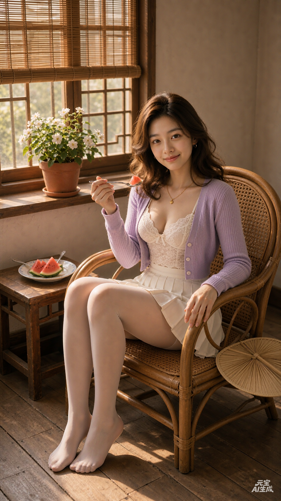

## 终稿提示词

```text
第1张 · 他站在窗边·视点 1.2 米、隔 1.5 米看她刚在藤椅里坐定回身朝这一眼笑、小银勺挖起最中间那一口
9:16 满幅竖构图，人物与道具铺满整幅、四条边即裁切边。第一张图提供整套穿搭，第二张图提供她的五官骨相，第三张线稿图提供这一眼的躯干重心、脊线肩髋与两腿骨架；手臂走向完全由下文逐只写死的唯一落点从肩经肘腕连到指尖承接。画面里只落她自己这一位人物，全画只一位成年人物，画面四边以内只收她一人的轮廓、那张老藤椅与她手边那几件道具；画外人由首行机位与这一眼的取景方向交待。左右各一只手臂各五根手指，两条手臂各自从肩连续到指尖，两只手各自从肩连续到指尖，两条腿各自连续，全画共两条手臂、两只手、两条腿；每只手按「哪只手→从肩经肘腕到指尖一条链→唯一落点」逐只写，同一只手只出现一次、只做一个动作。
她梳一头松而大的雾感棕系偏分中长卷发，发缝自眉峰斜向三七分开、蓬松发根顺着耳廓外缘淌过下颌，大卷自耳下松松散到锁骨以下三寸、发尾外翻带一层雾面绒光，额前一缕斜扫眉尾的弧刘海把眼尾整片让在光里，耳侧两撮细碎发被木格窗的蜜色斜光透出浅栗边、一缕贴在颊边一缕绕向颈侧，卷势向肩前拢开、把白蕾丝心形领与淡藕荷紫敞襟整片露在斜光里，后颈线条顺着卷隙一路收到肩背，四张同一顶发型。
她穿淡藕荷紫薄针织长袖短开衫、前襟敞着、袖口一小圈细罗纹、门襟系一条同色细缎带，内搭白色蕾丝束身吊带连衣伞裙、心形领细肩带、收腰、裙摆蓬松齐大腿中段、白色蕾丝覆一层细网。按人物设定 24 小时穿着一层浅茶薄透连裤丝袜，袜面从腰胯平顺连下经大腿、膝、小腿到脚背连成同一片，整条腿从大腿根到脚趾通体同一层薄透丝光、膝弯处一道连续折光顺着小腿一路铺到脚背，从腿根连包到脚趾，两只脚都只穿这一层、脚趾由同色袜面完整包住、五趾在袜面里各自分明、脚背整片受光，四张同一层。
她侧身坐进老藤椅，脊线从后颈经腰窝拉成一道柔缓的弧，两只脚都落在浅棕旧木地板上、脚尖轻轻点了一下；右手从右肩经右肘右腕到指尖捏着小银勺、勺尖托着刚从白瓷碟里挖起的那一口西瓜举在肩侧，左手从左肩经左肘左腕到指尖搭在藤椅扶手把身子稳住。她回过脸朝这一眼笑，眼尾笑意压到将笑未笑、下唇松开那一瞬下颌微收、捏勺那只手的肩往后沉半寸，这点笑意长出一个可见动作：搭在扶手那只手的食指朝藤编面轻轻勾了一下。场景是老屋木格窗下：一张浅蜜色老藤椅、圆弧靠背与一道扶手，浅棕旧木地板，半卷竹帘垂在木格窗上半截，窗台一盆开着小白花的茉莉，一张矮木几上白瓷碟盛着两瓣井水镇过的西瓜、一把小银勺搁在碟边，一把竹编团扇搭在藤椅扶手上；傍晚蜜色斜光从木格窗与竹帘缝里斜切进来，在木地板上铺出一道软边。蜜色斜光落在她白色蕾丝裙摆、小腿与脚背那片袜面上，取景落点落在袜面、脚背与腿线那一片光与折光上。人物头顶到两只丝袜脚尖完整收在画内。画面干净、神态松弛、脸年轻柔和。
```

## 一句点评

她刚在老藤椅里坐定回过脸朝这一眼笑小银勺挖起井水镇西瓜最中间那一口
