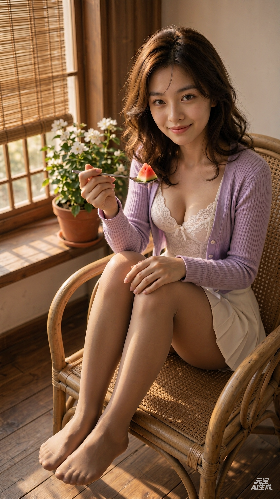

## 终稿提示词

```text
第3张 · 他撑起身子·视点 0.9 米、隔 0.95 米看她把两只脚收进藤椅面上、身子往前倾送来那一勺
9:16 满幅竖构图，人物与道具铺满整幅、四条边即裁切边。第一张图提供整套穿搭，第二张图提供她的五官骨相，第三张线稿图提供这一眼的躯干重心、脊线肩髋与两腿骨架；手臂走向完全由下文逐只写死的唯一落点从肩经肘腕连到指尖承接。画面里只落她自己这一位人物，全画只一位成年人物，画面四边以内只收她一人的轮廓、那张老藤椅与她手边那几件道具；画外人由首行机位与这一眼的取景方向交待。左右各一只手臂各五根手指，两条手臂各自从肩连续到指尖，两只手各自从肩连续到指尖，两条腿各自连续，全画共两条手臂、两只手、两条腿；每只手按「哪只手→从肩经肘腕到指尖一条链→唯一落点」逐只写，同一只手只出现一次、只做一个动作。
她梳一头松而大的雾感棕系偏分中长卷发，发缝自眉峰斜向三七分开、蓬松发根顺着耳廓外缘淌过下颌，大卷自耳下松松散到锁骨以下三寸、发尾外翻带一层雾面绒光，额前一缕斜扫眉尾的弧刘海把眼尾整片让在光里，耳侧两撮细碎发被木格窗的蜜色斜光透出浅栗边、一缕贴在颊边一缕绕向颈侧，卷势向肩前拢开、把白蕾丝心形领与淡藕荷紫敞襟整片露在斜光里，后颈线条顺着卷隙一路收到肩背，四张同一顶发型。
她穿淡藕荷紫薄针织长袖短开衫、前襟敞着、袖口一小圈细罗纹、门襟系一条同色细缎带，内搭白色蕾丝束身吊带连衣伞裙、心形领细肩带、收腰、裙摆蓬松齐大腿中段、白色蕾丝覆一层细网。按人物设定 24 小时穿着一层浅茶薄透连裤丝袜，袜面从腰胯平顺连下经大腿、膝、小腿到脚背连成同一片，整条腿从大腿根到脚趾通体同一层薄透丝光、膝弯处一道连续折光顺着小腿一路铺到脚背，从腿根连包到脚趾，两只脚都只穿这一层、脚趾由同色袜面完整包住、五趾在袜面里各自分明、脚背整片受光，四张同一层。
她把两只脚都收进老藤椅面上盘着、身子往前倾一点，两条小腿从膝到脚背连成一条平顺的线落在椅面前端那一小片蜜光里，十趾在浅茶袜面里各自分明；右手从右肩经右肘右腕到指尖捏着小银勺、把勺尖那一口西瓜朝这一眼送过来，左手从左肩经左肘左腕到指尖搭在自己膝头、五指松开贴着白色蕾丝裙面。她偏过头把眼尾递到这一眼，眼尾那点得意压着笑意、下颌微收让目光从卷发隙里斜挑出来，这点得意长出一个可见动作：搭在膝头那只手的手腕朝外旋了半寸，白色蕾丝裙摆在斜光里跟着多停一拍。场景是老屋木格窗下：一张浅蜜色老藤椅、圆弧靠背与一道扶手，浅棕旧木地板，半卷竹帘垂在木格窗上半截，窗台一盆开着小白花的茉莉，一张矮木几上白瓷碟盛着两瓣井水镇过的西瓜、一把小银勺搁在碟边，一把竹编团扇搭在藤椅扶手上；傍晚蜜色斜光从木格窗与竹帘缝里斜切进来，在木地板上铺出一道软边。蜜色斜光把两条腿从膝到脚背整片照亮，浅茶袜面在光里泛出一道长长的折光，取景落点落在袜面、脚背与腿线那一片光与折光上。两条腿与两只丝袜脚尖各自完整收在画内。画面干净、神态松弛、脸年轻柔和。
```

## 一句点评

把两只脚收进藤椅面身子往前倾把那一勺朝这一眼送过来
