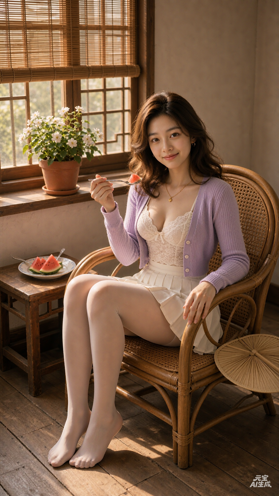
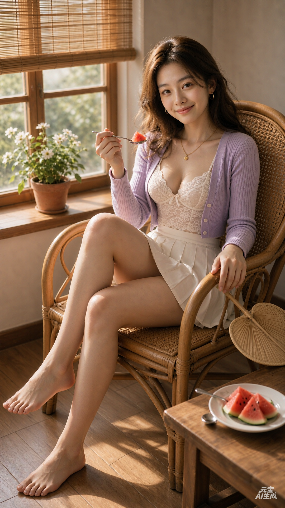
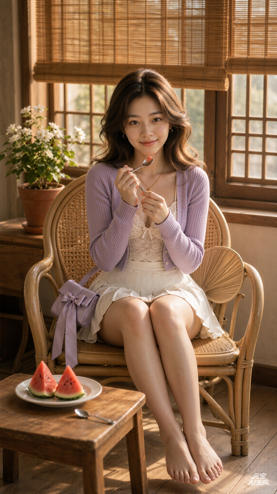

# R042 · 木格窗下那一勺西瓜

- 轮次目录：`20261127ak_window-watermelon`
- 日期：2026-11-27
- 来源：`yuanbao`
- 穿搭：`SPR-0073`
- 发型：未标注
- 场景标签：其它
- 四张线稿：`full_sexy_P027_front`、full_single_P044_side`、full_sexy_P018_diag`、full_single_P079_front`
- 画幅：1080×1920（9:16），纯画面

## 四张

| 序 | 机位 | 图 | 终稿提示词 |
|---|---|---|---|
| 01 | front |  | [01_front.md](01_front.md) |
| 02 | side |  | [02_side.md](02_side.md) |
| 03 | seat |  | [03_seat.md](03_seat.md) |
| 04 | close |  | [04_close.md](04_close.md) |

## 这一段说了什么

1. 最中间那一口我挖下来了，先举着给你看，急什么呀，藤椅我坐定了才轮到你。
2. 脚晃一下你就跟着看，竹帘缝这束光都替我偏心，哼，我偏不急着递。
3. 两只脚都收上来了，勺子也送过来了，你再不开口，这口甜我就自己吃。
4. 看清楚了没呀，就停在半寸外，说句好听的，不然我连茉莉都不让你闻。

## 现场记录

- 01_front：她刚在老藤椅里坐定回过脸朝这一眼笑小银勺挖起井水镇西瓜最中间那一口
- 02_side：一条腿屈起搭在另一条腿上轻轻晃悬起那只脚的脚背落进竹帘缝那道斜光里
- 03_seat：把两只脚收进藤椅面身子往前倾把那一勺朝这一眼送过来
- 04_close：把小银勺举到这一眼正前停在半寸外下巴微抬眼尾压下来正对这一眼

> 原图 PNG 永不转码、永不覆盖；预览用 `` 缩放原图。
