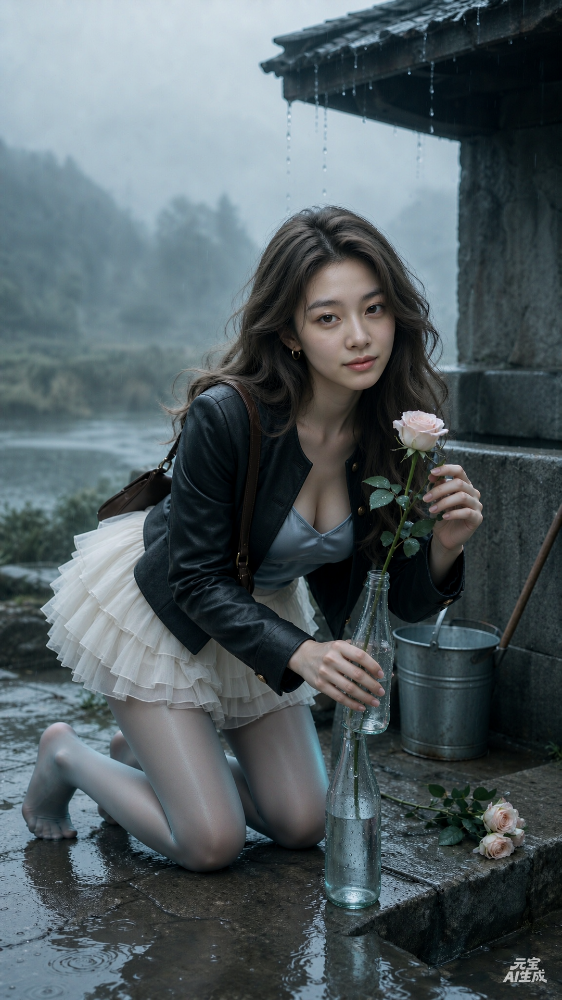

## 终稿提示词

```text
第3张 · 他撑起身子·视点 0.9 米、隔 1.1 米看她把那枝野蔷薇插进瓶口、转正朝这一眼
9:16 满幅竖构图，人物与道具铺满整幅、四条边即裁切边。第一张图提供整套穿搭，第二张图提供她的五官骨相，第三张线稿图提供这一眼的躯干重心、脊线肩髋与两腿骨架；手臂走向完全由下文逐只写死的唯一落点从肩经肘腕连到指尖承接。画面里只落她自己这一位人物，全画只一位成年人物，画面四边以内只收她一人的轮廓、井台与她手边那几件道具；画外人由首行机位与这一眼的取景方向交待。左右各一只手臂各五根手指，两条手臂各自从肩连续到指尖，两只手各自从肩连续到指尖，两条腿各自连续，全画共两条手臂、两只手、两条腿；每只手按「哪只手→从肩经肘腕到指尖一条链→唯一落点」逐只写，同一只手只出现一次、只做一个动作。
她梳一头雾感冷棕系松而大的长卷发、棕里压一层灰青，自眉峰外侧一笔深偏分缝斜落、左多右少覆过额角，额前两缕长弧刘海贴着鬓骨往耳后散，耳侧各垂一绺细碎发丝贴过敞着的黑皮夹克翻领边，水波纹大卷从颧线以下一缕压一缕落到锁骨下十公分、发尾外翻散成雾边搭在灰蓝缎心形领与冷白纱肩线上，颈侧空出一截让后颈与耳廓的线接住冷青白天光，每缕卷脊一道细冷青高光、卷谷压灰，发丝落点清楚，四张同一顶发型。

她穿黑色短款皮质夹克、翻领、袖口一排小金扣、前襟敞着，内搭灰蓝缎面细肩带吊带、心形领，下身象牙白多层细纱蓬蓬短裙、裙摆蓬松齐大腿中段、细纱一层压一层在冷天光里泛出冷白。按人物设定 24 小时穿着一层冷调薄透连裤丝袜，袜面从腰胯平顺连下经大腿、膝、小腿到脚背连成同一片，整条腿从大腿根到脚趾通体同一层薄透丝光、膝弯处一道连续折光顺着小腿一路铺到脚背，脚踝与小腿前缘有一道织物折光把袜面与腿肤色分出一层可辨边界，从腿根连包到脚趾，两只脚都只穿这一层，脚趾由同色袜面完整包住、五趾在袜面里各自分明、脚背整片受光，四张同一层；灰青天光与青灰地面积水反光顺着腿线落到袜面折光上，那片折光是冷青灰色的。
她把两只脚都收进湿木板上并着、身子往前倾一点，两条小腿从膝到脚背连成一条平顺的线落在木板前端那一小片冷白天光里，十趾在冷调薄透袜面里各自分明；右手从右肩经右肘右腕到指尖扶着那只透明玻璃汽水瓶、瓶口里插着一小枝带雨珠的野蔷薇，左手从左肩经左肘左腕到指尖捏着花枝的末梢把花转正朝这一眼。她偏过头把眼尾递到这一眼，眼尾那点得意收住、下颌微抬半分让视线从睫毛底下压向这一眼，唇角只留一丝没说出口的坏，这点得意长出一个可见动作：扶瓶那只手的手腕朝外旋了半寸，象牙白细纱裙摆在冷天光里跟着多停一拍。场景是雨后清晨的村口老井台：青灰石井沿、檐角还在往下滴水、一把铁皮水舀搁在井沿、石阶上一小枝带雨珠的野蔷薇、青灰地面积着一汪浅浅的积水反光、远处山雾缓缓浮着、脚底下一块被雨打湿的旧木板；天光是雨后灰青散射光混一层冷青白，从云缝与檐角漫下来，把白纱裙摆、湿木板的水痕与青灰石面照出一层冷亮，画面四边以内是同一片冷青灰调子，人脸、衣料、丝袜、水光都被这层冷天光洗过。冷青白天光把两条腿从膝到脚背整片照亮，冷调袜面在光里泛出一道长长的冷青灰折光，取景落点落在袜面、脚背与腿线那一片冷色光与折光上。人物头顶到两只丝袜脚尖完整收在画内。画面干净、神态松弛、脸年轻柔和。
```

## 一句点评

跪在湿石地上把带雨珠的粉玫瑰举到脸侧右手扶着玻璃汽水瓶转正朝这一眼
