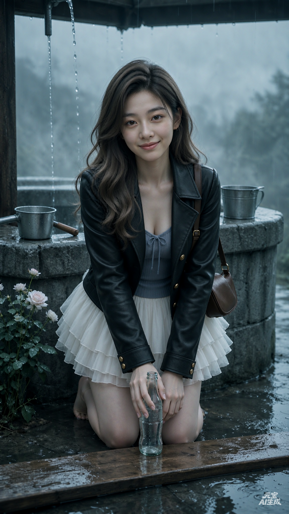

## 终稿提示词

```text
第4张 · 他凑到她面前·视点 0.4 米、隔 0.3 米看她把玻璃瓶举到这一眼正前、食指点着瓶身停住
9:16 满幅竖构图，人物与道具铺满整幅、四条边即裁切边。这一张是 0.3 米近身近景，整幅一次成像落在同一个焦平面上、上下同一片冷青灰天光一气连成。第一张图提供整套穿搭，第二张图提供她的五官骨相，第三张线稿图提供这一眼的躯干重心、脊线肩髋与两腿骨架；手臂走向完全由下文逐只写死的唯一落点从肩经肘腕连到指尖承接。画面里只落她自己这一位人物，全画只一位成年人物，画面四边以内只收她一人的轮廓、井台与她手边那几件道具；画外人由首行机位与这一眼的取景方向交待。左右各一只手臂各五根手指，两条手臂各自从肩连续到指尖，两只手各自从肩连续到指尖，两条腿各自连续，全画共两条手臂、两只手、两条腿；每只手按「哪只手→从肩经肘腕到指尖一条链→唯一落点」逐只写，同一只手只出现一次、只做一个动作。
她梳一头雾感冷棕系松而大的长卷发、棕里压一层灰青，自眉峰外侧一笔深偏分缝斜落、左多右少覆过额角，额前两缕长弧刘海贴着鬓骨往耳后散，耳侧各垂一绺细碎发丝贴过敞着的黑皮夹克翻领边，水波纹大卷从颧线以下一缕压一缕落到锁骨下十公分、发尾外翻散成雾边搭在灰蓝缎心形领与冷白纱肩线上，颈侧空出一截让后颈与耳廓的线接住冷青白天光，每缕卷脊一道细冷青高光、卷谷压灰，发丝落点清楚，四张同一顶发型。

她穿黑色短款皮质夹克、翻领、袖口一排小金扣、前襟敞着，内搭灰蓝缎面细肩带吊带、心形领，下身象牙白多层细纱蓬蓬短裙、裙摆蓬松齐大腿中段、细纱一层压一层在冷天光里泛出冷白。按人物设定 24 小时穿着一层冷调薄透连裤丝袜，袜面从腰胯平顺连下经大腿、膝、小腿到脚背连成同一片，整条腿从大腿根到脚趾通体同一层薄透丝光、膝弯处一道连续折光顺着小腿一路铺到脚背，脚踝与小腿前缘有一道织物折光把袜面与腿肤色分出一层可辨边界，从腿根连包到脚趾，两只脚都只穿这一层，脚趾由同色袜面完整包住、五趾在袜面里各自分明、脚背整片受光，四张同一层；灰青天光与青灰地面积水反光顺着腿线落到袜面折光上，那片折光是冷青灰色的。
画顶到她发顶、画底落在湿木板前端那两只脚的丝袜脚趾尖之后并留出一线湿木板纹理做底，整幅头顶到两只脚底完整收口，脸占画高约三成。她把下巴微抬，眼尾那点压下来的得意再提半分、嘴角挑住的那一线对准瓶身反出的冷青光，视线越过瓶口落向画底自己脚背那道冷折光；右手从右肩经右肘右腕到指尖捏着那只透明玻璃汽水瓶、把瓶身举到这一眼正前，左手从左肩经左肘左腕到指尖收在胸前、指尖轻轻贴着右手腕。这点小得意长出一个可见动作：右手腕朝这一眼轻轻送了半寸，瓶口那一枝野蔷薇停在原处。场景是雨后清晨的村口老井台：青灰石井沿、檐角还在往下滴水、一把铁皮水舀搁在井沿、石阶上一小枝带雨珠的野蔷薇、青灰地面积着一汪浅浅的积水反光、远处山雾缓缓浮着、脚底下一块被雨打湿的旧木板；天光是雨后灰青散射光混一层冷青白，从云缝与檐角漫下来，把白纱裙摆、湿木板的水痕与青灰石面照出一层冷亮，画面四边以内是同一片冷青灰调子，人脸、衣料、丝袜、水光都被这层冷天光洗过。画底前缘那一小片冷白天光里，湿木板上那两只脚的冷调袜面软软亮着一道冷青灰折光，取景落点落在袜面、脚背与腿线那一片冷色光与折光上。人物头顶到两只丝袜脚尖完整收在画内。画面干净、神态松弛、脸年轻柔和。
```

## 一句点评

跪在湿旧木板上两只手一起把玻璃瓶立在身前下巴微抬眼尾压下来正对这一眼
