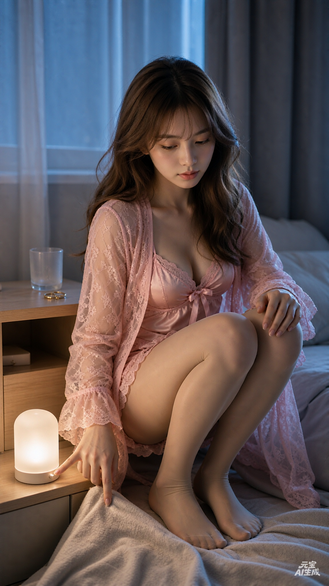

## 终稿提示词

```text
第4张 · 他凑到她面前·视点 0.4 米、隔 0.3 米看她把食指尖点在小夜灯圆钮上、熄灯前正对这一眼
9:16 满幅竖构图，人物与道具铺满整幅、四条边即裁切边。这一张是 0.3 米近身近景，整幅一次成像落在同一个焦平面上、上下同一片暖白与冷蓝交界的夜里光一气连成。第一张图提供整套穿搭，第二张图提供她的五官骨相，第三张线稿图提供这一眼的躯干重心、脊线肩髋与两腿骨架；手臂走向完全由下文逐只写死的唯一落点从肩经肘腕连到指尖承接。画面里只落她自己这一位人物，全画只一位成年人物，画面四边以内只收她一人的轮廓、床与她手边那几件道具；画外人由首行机位与这一眼的取景方向交待。左右各一只手臂各五根手指，两条手臂各自从肩连续到指尖，两只手各自从肩连续到指尖，两条腿各自连续，全画共两条手臂、两只手、两条腿；每只手按「哪只手→从肩经肘腕到指尖一条链→唯一落点」逐只写，同一只手只出现一次、只做一个动作。
她梳一头雾感雾棕偏分中长松卷长发，顶缝走一条松而软的偏分缝，额前几缕齐眉弧刘海斜搭在眉尾与鬓角之间，耳侧两缕细碎发顺着颊线垂下、其中一缕擦过刚摘耳圈后空着的耳垂，发长过肩落到锁骨下约一掌，整头是大而松的波浪卷、卷峰蓬松，大半发量顺着偏分方向松松披到肩前与颈侧、发尾一小簇散在樱粉蕾丝睡袍敞领与肩线上、最外一缕搭过肩头垂向薄毯边，低亮暖白那侧照出发顶与耳侧碎发的棕雾绒光，冷蓝那侧沿发尾外缘勾一道细冷边，颈侧空出一截让心形领与小缎带结露全，四张同一顶发型。

她穿樱粉薄透蕾丝长袖短睡袍、前襟敞着、袖口与下摆三层细荷叶边，内搭同色樱粉缎面心形领吊带短睡裙、胸前一道细抽褶与一枚小缎带结，下身同色蕾丝荷叶边短裤，整身软甜。按人物设定 24 小时穿着一层浅香槟薄透连裤丝袜，袜面从腰胯平顺连下经大腿、膝、小腿到脚背连成同一片，整条腿从大腿根到脚趾通体同一层薄透丝光、膝弯处一道连续折光顺着小腿一路铺到脚背，脚踝与小腿前缘有一道织物折光把袜面与腿肤色分出一层可辨边界，从腿根连包到脚趾，两只脚都只穿这一层，脚趾由同色袜面完整包住、五趾在袜面里各自分明、脚背整片受光，四张同一层；低亮暖白灯光与窗帘缝那一线冷蓝夜色顺着腿线落到袜面折光上，那片折光是暖白与冷蓝交界的一层细光。
画顶到她发顶、画底落在浅灰薄毯上那两只丝袜脚趾尖之后并留出一线薄毯织纹做底，整幅头顶到两只脚底完整收口，脸占画高约三成。她把下巴微抬，眼尾压下来从垂发缝里正对这一眼、停半拍，嘴角那点挑意压在熄灯前的最高点，下颌线随微抬绷出一线冷蓝高光；右手从右肩经右肘右腕到指尖伸出食指尖、轻轻点在床头那只磨砂玻璃小夜灯的圆钮上、点完停住，左手从左肩经左肘左腕到指尖收在胸前、指尖轻轻贴着薄毯边。这点小得意长出一个可见动作：右手腕朝这一眼轻轻送了半寸，食指尖仍点在圆钮上。场景是回城后深夜的卧室：床头一张浅木矮柜、柜面搁着一只磨砂玻璃小水杯与一枚刚摘下的细哑金小耳圈、一只帆布小提包靠在床尾矮凳边、床上一床浅灰薄毯与两只蓬松的枕、半合的纱帘、床头一盏低亮暖白纸罩小灯、窗帘缝里漏进城里夜色的一线冷蓝、远处窗外几点模糊灯火；光是这盏低亮暖白小灯与那一线冷蓝夜色交界，暖白落在脸、蕾丝与手背上，冷蓝顺着腿线铺到袜面与薄毯织纹上，画面四边以内是同一片暖白与冷蓝交界的夜里调子，人脸底图自带的暖调只管骨相五官、成图色温落在这一片交界光上。画底前缘那一小片冷暖交界的光里，薄毯上那两只脚的浅香槟袜面软软亮着一道细折光，取景落点落在袜面、脚背与腿线那一片光与折光上。人物头顶到两只丝袜脚尖完整收在画内。画面干净、神态松弛、脸年轻柔和。
```

## 一句点评

坐在床沿俯身右手食指尖点在磨砂玻璃小夜灯的圆钮上熄灯前正对这一眼
