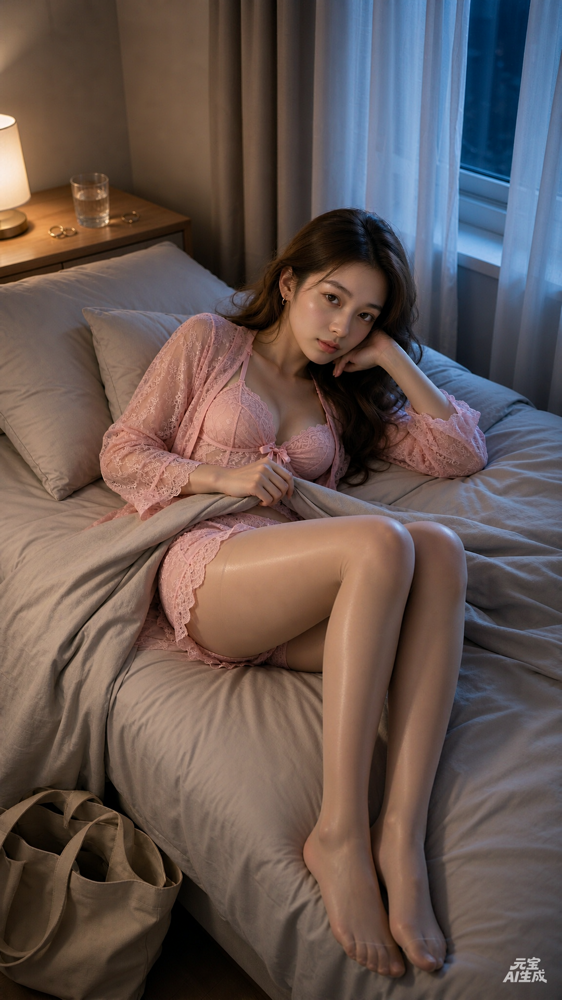

# R044 · 回城里睡觉了

- 轮次目录：`20261127am_city-bedtime`
- 日期：2026-11-27
- 来源：`yuanbao`
- 穿搭：`LNG-0005`
- 发型：未标注
- 场景标签：沙发、卧室
- 四张线稿：`full_single_P071_diagonal`、full_sexy_P065_diagonal`、full_sexy_P059_diagonal`、full_single_P066_diagonal`
- 画幅：1080×1920（9:16），纯画面

## 四张

| 序 | 机位 | 图 | 终稿提示词 |
|---|---|---|---|
| 01 | front |  | [01_front.md](01_front.md) |
| 02 | side |  | [02_side.md](02_side.md) |
| 03 | seat |  | [03_seat.md](03_seat.md) |
| 04 | close |  | [04_close.md](04_close.md) |

## 这一段说了什么

1. 回城这一路你都没怎么说话，进门我先替你把灯拧亮一点点，困归困，这一眼你得先给我。
2. 坐床沿啦，城里这床比村里软，我这层袜子还好好穿着呢，你一催我就把被角卷走。
3. 躺好了呀，灯就留这一小粒，你还看手机我就把眼罩扣你眼睛上，哼，我说到做到。
4. 熄灯前这一眼归我，指尖还点着呢，说句好听的，明早那袋旧书我才分你一半扛。

## 现场记录

- 01_front：她坐在床沿回过脸朝这一眼笑右手扶着米白帆布小提包的细带
- 02_side：把一条腿屈起搭在另一条上悬起那只脚落进暖白与冷蓝交界的光里右手把细哑金小耳圈举到纸罩灯前
- 03_seat：侧躺进浅灰薄毯两腿叠着微微屈一只手枕在脸下偏过头把眼尾递到这一眼
- 04_close：坐在床沿俯身右手食指尖点在磨砂玻璃小夜灯的圆钮上熄灯前正对这一眼

> 原图 PNG 永不转码、永不覆盖；预览用 `` 缩放原图。
