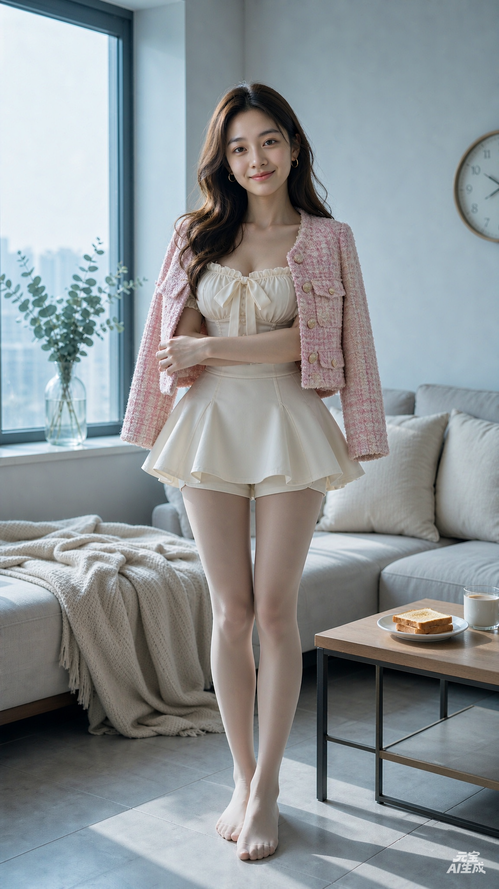

## 终稿提示词

```text
第2张 · 他俯身迎上去·视点 0.6 米、隔 0.5 米看她走近一步把两只手臂朝这一眼环拢
9:16 满幅竖构图，人物与道具铺满整幅、四条边即裁切边。第一张图提供整套穿搭，第二张图提供她的五官骨相，第三张线稿图提供这一眼的躯干重心、脊线肩髋与两腿骨架；手臂走向完全由下文逐只写死的唯一落点从肩经肘腕连到指尖承接。画面里只落她自己这一位人物，全画只一位成年人物，画面四边以内只收她一人的轮廓、客厅与她手边那几件道具；画外人由首行机位与这一眼的取景方向交待。左右各一只手臂各五根手指，两条手臂各自从肩连续到指尖，两只手各自从肩连续到指尖，两条腿各自连续，全画共两条手臂、两只手、两条腿；每只手按「哪只手→从肩经肘腕到指尖一条链→唯一落点」逐只写，同一只手只出现一次、只做一个动作。
她梳一头雾感雾棕偏分中长松卷发，发缝在左眉峰上方松松偏开、发根蓬起一层，发长过肩落到胸前，整头是大而松的波浪卷、从耳后往肩前一缕缕垂落，额角两片薄雾浅弧刘海停在眉骨上方，耳侧两缕细碎发贴着颧骨弯到下颌角、被冷青白天光勾出一线浅亮边，发尾几绺外翻松松搭在樱粉开衫肩线与奶油白方领领口边、颈侧空出一截让锁骨与缎带结露全，四张同一顶发型。

她穿奶油白方领吊带伞裙式短连衣裙、胸前一道细抽褶与一枚小缎带结、裙摆蓬到腿根上方，外搭一件樱粉提花短款小开衫、长袖袖口微收，整身软甜。按人物设定 24 小时穿着一层浅杏薄透连裤丝袜，袜面从腰胯平顺连下经大腿、膝、小腿到脚背连成同一片，整条腿从大腿根到脚趾通体同一层薄透丝光、膝弯处一道连续折光顺着小腿一路铺到脚背，脚踝与小腿前缘有一道织物折光把袜面与腿肤色分出一层可辨边界，从腿根连包到脚趾，两只脚都只穿这一层浅杏薄透连裤丝袜、木地板上这一层就是她脚上全部的鞋袜，脚趾由同色袜面完整包住、五趾在袜面里各自分明、脚背整片受光，浅杏袜面在冷青白天光里泛出一层可辨的织物哑光、与腿肤色之间留下一道细亮的分层，四张同一层；清晨薄雾的冷青白天光透过落地长窗，窗玻璃冷反光、青灰地板反光与白亮天光顺着腿线落到袜面折光上，那片折光是冷青白里一道细亮的织物光。
她朝这一眼走近一步，一只脚前迈半步踩进冷青白的窗格光里、另一只脚稳稳落在后面，两只手臂从肩朝这一眼环拢成一个松松的圈、两只手的指尖停在她身前那一小片白亮天光里；右手从右肩经右肘右腕到指尖朝这一眼环过来、指尖轻轻搭在自己左小臂上，左手从左肩经左肘左腕到指尖朝这一眼环过来、指尖轻轻搭在自己右小臂上。她眼尾从下往抬起递向这一眼、下颌微收，嘴角挑起极轻的一线、冷青白光在颊侧笑窝压出一小块短影，眼尾那点得意正对前迈半步的脚尖方向，这点小得意长出一个可见动作：环拢的右手指尖在自己左小臂上轻轻点了一下、点完停住。场景是回城后第二天清晨的城里公寓客厅：一扇朝东的落地长窗、窗格把冷青白天光在浅木地板上拉出长条格影，沙发扶手上搭一条燕麦色粗针织毯、一只米白布艺抱枕搁在沙发上，茶几上一只白瓷小碟放两片烤吐司、一只玻璃杯装温牛奶，窗台一只细口玻璃瓶插两枝尤加利叶，墙上一只圆挂钟；光是清晨薄雾的冷青白天光，白亮天光落在脸、开衫提花与手背上，窗玻璃冷反光与青灰地板反光顺着腿线铺到袜面与地板格影上，画面四边以内是同一片冷青白的清晨调子，人脸底图自带的暖调只管骨相五官、成图色温落在这一片冷青白天光上。窗玻璃冷反光顺着前迈那条腿的小腿一路铺到脚背，浅杏袜面连成平顺同一片、在前缘泛起一道细密折光，取景落点落在袜面、脚背与腿线那一片光与折光上。人物头顶到两只丝袜脚尖完整收在画内。画面干净、神态松弛、脸年轻柔和。
```

## 一句点评

朝这一眼走近一步两只手臂在身前环拢双手交叠一只脚前迈半步
