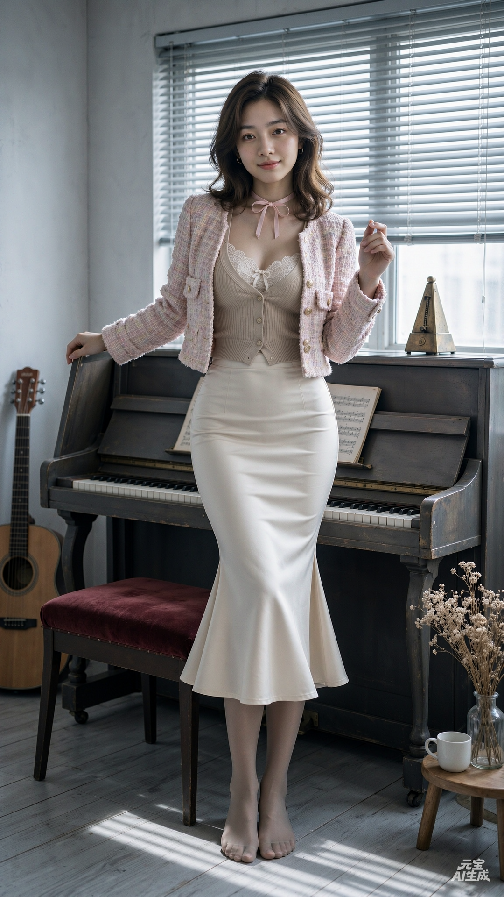

## 终稿提示词

```text
第1张 · 他倚着琴房门框·视点 1.5 米、隔 2.4 米看她站在钢琴边回身朝这一眼抬手
9:16 满幅竖构图，人物与道具铺满整幅、四条边即裁切边。第一张图提供整套穿搭，第二张图提供她的五官骨相，第三张线稿图提供这一眼的躯干重心、脊线肩髋与两腿骨架；手臂走向完全由下文逐只写死的唯一落点从肩经肘腕连到指尖承接。画面里只落她自己这一位人物，全画只一位成年人物，画面四边以内只收她一人的轮廓、琴房与她手边那几件道具；画外人由首行机位与这一眼的取景方向交待。左右各一只手臂各五根手指，两条手臂各自从肩连续到指尖，两只手各自从肩连续到指尖，两条腿各自连续，全画共两条手臂、两只手、两条腿；每只手按「哪只手→从肩经肘腕到指尖一条链→唯一落点」逐只写，同一只手只出现一次、只做一个动作。
她梳一头雾感雾棕偏分中长卷发，发缝自眉尾一侧松松偏开、左侧多一分蓬量顺着颧骨往肩前落下，发干是松而大的低起伏 S 卷、发尾到锁骨下三寸收成几缕散而不乱的卷瓣，额前两缕斜扫眉峰的雾感碎刘海随偏分长短错开，耳侧各垂一缕细碎发贴着耳廓外缘掠过米杏开衫领口，右侧一缕卷尾落在提花开衫肩头、左侧一缕卷尾搭过暗红丝绒琴凳边沿压出一道实影，冷白直射天光里发顶起一层浅栗雾光、卷谷留一线青灰冷反光，颈侧露出象牙白细吊带那一截蕾丝边，四张同一顶发型。

她穿一件米杏色提花短款小开衫、长袖袖口微收、门襟一排细珍珠扣，内搭象牙白蕾丝细吊带，下身一条奶油白缎面鱼尾中长裙贴身收腰、裙摆顺到小腿中段散开，整身软亮合身。按人物设定 24 小时穿着一层浅灰茶薄透连裤丝袜，这一层从腰胯到脚趾是一整片可辨的织物、与腿肤色之间留有一道细亮的分层边界，袜面从腰胯平顺连下经大腿、膝、小腿到脚背连成同一片，整条腿从大腿根到脚趾通体同一层薄透丝光、膝弯处一道连续折光顺着小腿一路铺到脚背，脚踝与小腿前缘有一道织物折光把袜面与腿肤色分出一层可辨边界，从腿根连包到脚趾，两只脚都只穿这一层浅灰茶薄透连裤丝袜、浅灰木地板上这一层就是她脚上全部的鞋袜，脚趾由同色袜面完整包住、五趾在袜面里各自分明、脚背整片受光，两只脚的脚背与脚趾由这一层浅灰茶织物完整包覆、在冷白天光里泛出一层均匀的织物哑光，十颗脚趾在冷白长条光里由浅灰茶袜面各自包出圆润的趾形、一颗一颗数得清，两只脚赤足踩在浅灰木地板上、这一层浅灰茶薄透连裤丝袜就是脚上全部的鞋袜，浅灰茶袜面在冷白天光里泛出一层可辨的织物哑光、与腿肤色之间留下一道细亮的分层，四张同一层；午后薄云里透下来的冷白直射天光，百叶帘冷白长条光、青灰地板冷反光与冷白天光顺着腿线落到袜面折光上，那片折光是冷白里一道细亮的织物光。
她站在掀开的琴盖旁回过身朝这一眼，两只脚并着踩在浅灰木地板的百叶帘长条光里；右手从右肩经右肘右腕到指尖扶着掀起的琴盖边沿、五指松松贴着胡桃木纹，左手从左肩经左肘左腕到指尖朝这一眼抬到肩前一寸、五指轻轻并着停住。她笑意只挂在眼尾、下颌微抬半分，这点小得意落在勾完指尖停住的这一瞬、目光压着脚背那道细折光往这一眼送：抬着那只手的指尖朝这一眼轻轻勾了一下、勾完停住。场景是回城后第二天午后的老公寓琴房：一架深灰棕旧立式钢琴、琴盖掀开露出象牙白琴键，谱架上一页摊开的琴谱，琴顶一只黄铜节拍器，暗红丝绒琴凳，窗上半卷的百叶帘把午后冷白直射天光切成长条，浅灰木地板上映出一道道明暗条纹，墙角斜靠一把旧吉他，琴边小圆凳上一只白瓷杯，琴盖一角一只细口玻璃瓶插两枝干燥满天星；光是午后薄云里透下来的冷白直射天光，冷白天光落在脸、米杏提花开衫与象牙白琴键上，把奶油白缎面裙照成冷白、把米杏提花开衫照成浅灰杏、把深灰棕钢琴照出一层灰，百叶帘长条光与青灰地板反光顺着腿线铺到袜面与地板条纹上，画面四边以内是同一片冷白直射的午后调子，人脸底图自带的暖调只管骨相五官、成图色温落在这一片冷白直射光上。冷白直射光把两条腿从膝到脚背整片照亮，浅灰茶袜面在长条光里泛出一道长长的细折光，取景落点落在袜面、脚背与腿线那一片光与折光上。人物头顶到两只丝袜脚尖完整收在画内。画面干净、神态松弛、脸年轻柔和。
```

## 一句点评

她站在深灰棕旧立式钢琴旁回身朝这一眼笑一只手扶掀起的琴盖另一只手抬到肩前轻轻勾一下
