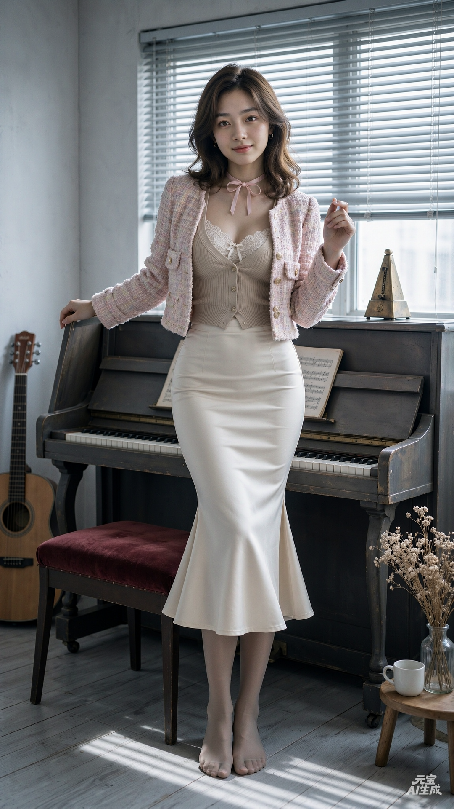
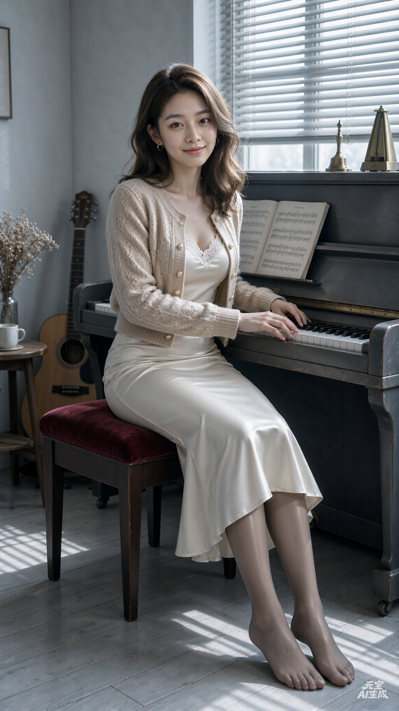
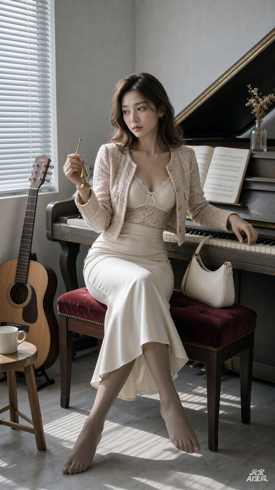
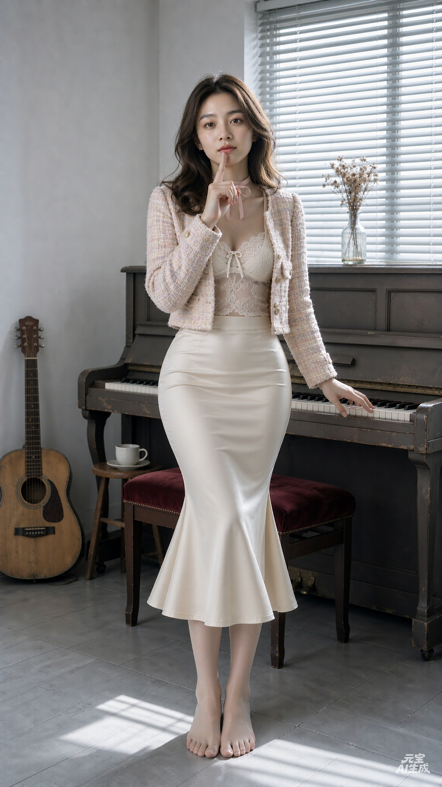

# R047 · 琴房这一首

- 轮次目录：`20261127ao_piano-nook`
- 日期：2026-11-27
- 来源：`yuanbao`
- 穿搭：`SPR-0137`
- 发型：未标注
- 场景标签：其它
- 四张线稿：`full_single_P073_diagonal`、full_single_P074_diagonal`、full_single_P074_side`、full_single_P073_front`
- 画幅：1080×1920（9:16），纯画面

## 四张

| 序 | 机位 | 图 | 终稿提示词 |
|---|---|---|---|
| 01 | front |  | [01_front.md](01_front.md) |
| 02 | side |  | [02_side.md](02_side.md) |
| 03 | seat |  | [03_seat.md](03_seat.md) |
| 04 | close |  | [04_close.md](04_close.md) |

## 这一段说了什么

1. 抱完啦，跟我到琴房来嘛，这架老钢琴等了一上午，你倚门框就好，这一页我先替你翻。
2. 这个音我自己按的，好听吧，别光盯着我手呀，谱子还摊着呢，弹完这一句你得说想我。
3. 节拍器我捏着先不摆，你急什么，这条腿晃一下你就分神，午后这道光都替我数着拍子呢。
4. 嘘，别出声，这一眼归我，食指点完唇就停住，你把我接住了，整首才肯弹完给你。

## 现场记录

- 01_front：她站在深灰棕旧立式钢琴旁回身朝这一眼笑一只手扶掀起的琴盖另一只手抬到肩前轻轻勾一下
- 02_side：坐上暗红丝绒琴凳把两只手落到象牙白琴键上一根食指按下一枚白键
- 03_seat：侧坐琴凳一条腿搭另一条上悬着手里捏着黄铜节拍器的细摆锤
- 04_close：站定右手一根食指竖在唇前左手停在琴键上方下巴微抬正对这一眼

> 原图 PNG 永不转码、永不覆盖；预览用 `` 缩放原图。
