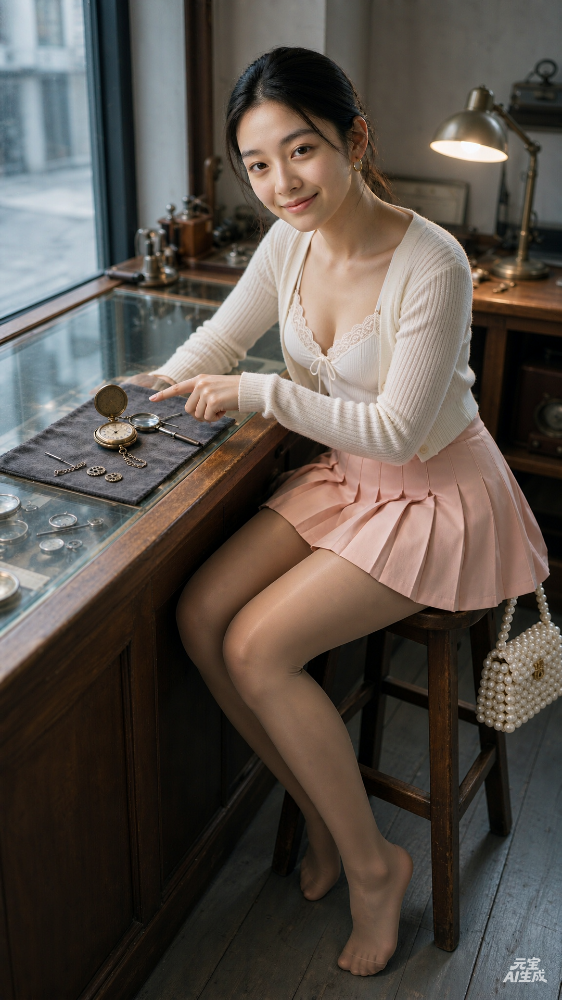

## 终稿提示词

```text
第2张 · 他（坐在柜台前木高凳旁的这一侧）· 视点高度 1.05 米、隔 0.5 米看她在做什么。

9:16 满幅画面，宽 1080 高 1920，人物与柜台道具铺满整幅，四条边即裁切边，人物头顶到脚底完整收在画内。

第一张图只定整套穿搭的版型配色面料，第二张图只定骨相五官，第三张图的线稿只定本张的躯干重心、脊线肩髋与两腿骨架；手臂走向完全由下文逐只链写承接。三张参考图与这段文字拼成一份资料，各写各的那一段。

她穿奶白罗纹针织长袖上衣，小圆领，前襟一排细扣，袖口一圈细罗纹；珊瑚粉高腰百褶迷你裙，轻薄百褶纱一层一层散开，裙摆落在大腿中段；一只奶白串珠小提包搁在柜角。她 24 小时穿着一层浅茶薄透连裤丝袜，从腿根连包到脚趾，脚趾由同色袜面完整包住、五趾在袜面里各自分明，袜面从小腿到脚背连成平顺同一片，脚踝与小腿前缘有一道织物折光把袜面与腿肤色分出一层可辨边界。她的两只脚只穿这一层浅茶薄透丝袜，一只脚踩在木高凳横档上，另一只脚脚尖点在老木地板上。

她梳栗茶棕及锁骨内扣直发，三七偏左分缝，发身顺直仅发尾半圈钝角内卷，八字微透薄刘海在眉尾散开露出额心，耳侧两缕细碎发自然垂在颧骨前，发顶蓬松；俯身时一缕发尾越过肩头垂到柜面上方。

巷口老修表铺：深木柜台上嵌一整片玻璃，玻璃下压着深灰绒布，绒布正中摊着一块铜壳旧怀表，表盖半开、表盘朝上、细银链绕成一小圈，旁边一枚放大镜、一把细镊子、三只拆开的小齿轮；柜沿一道黄铜包边，柜角立着白瓷灯罩工作灯；薄暮灰青天光从铺子门口斜进来，柜台那盏暖白工作灯在铜壳怀表与她指尖上落一小团暖白，灰青与暖白在同一片画面里交界；玻璃柜台面的冷反光与青灰木地板反光顺着腿线落到袜面折光上，工作灯的暖白反光落在脚背、表壳与她鼻尖上。

她坐在木高凳上朝柜台柔柔折下身，脊线从后颈经腰窝到踩在横档上的脚踝拉成一道柔缓的弧，两腿一屈一垂，膝头并着。右手从肩经肘腕到指尖一条链，食指伸成一根、指尖停在铜壳怀表正上方一寸的空气里，指腹朝下，与表盖之间留一线亮；左手从肩经肘腕到指尖一条链，五指张开撑在柜沿黄铜包边上，指节微微弯着把身子稳住。画面里只落她自己这一位人物，画外人由首行机位与这一眼的取景方向交待、画面四边以内只收她一人的轮廓与她手里那些道具；两条手臂各自从肩经肘腕连到指尖、两条腿各自从髋连到脚趾，全画共两条手臂、两只手、十根手指、两条腿，数与位一一对应她自身躯干两侧。

她眼皮微垂，瞳仁落在怀表铜壳上，嘴角轻轻往上提一点点，像刚发现什么好玩的小秘密，鼻尖被工作灯照出一小片暖光；这一眼的取景落点落在她悬着的指尖、表盘那一圈细刻度，以及从膝头顺到脚背那一道平顺的浅茶折光上。
```

## 一句点评

悬在表盖上方那一寸比时间还慢
