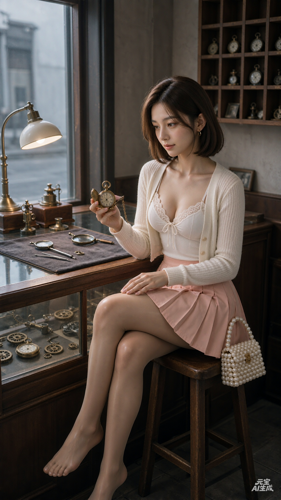

## 终稿提示词

```text
第3张 · 他（略俯身站在柜台斜侧）· 视点高度 1.30 米、隔 1.0 米看她在做什么。

9:16 满幅画面，宽 1080 高 1920，人物与柜台道具铺满整幅，四条边即裁切边，人物头顶到脚底完整收在画内。

第一张图只定整套穿搭的版型配色面料，第二张图只定骨相五官，第三张图的线稿只定本张的躯干重心、脊线肩髋与两腿骨架；手臂走向完全由下文逐只链写承接。三张参考图与这段文字拼成一份资料，各写各的那一段。

她穿奶白罗纹针织长袖上衣，小圆领，前襟一排细扣，袖口一圈细罗纹；珊瑚粉高腰百褶迷你裙，轻薄百褶纱在坐处铺开一小片，裙摆落在大腿中段；一只奶白串珠小提包搁在膝侧木凳上。她 24 小时穿着一层浅茶薄透连裤丝袜，从腿根连包到脚趾，脚趾由同色袜面完整包住、五趾在袜面里各自分明，袜面从小腿到脚背连成平顺同一片，脚踝与小腿前缘有一道织物折光把袜面与腿肤色分出一层可辨边界。她的两只脚只穿这一层浅茶薄透丝袜，两腿斜斜叠放，上面那只脚的脚背整片落进柜台漏过来的那道亮里。

她梳栗茶棕及锁骨内扣直发，三七偏左分缝，发身顺直仅发尾半圈钝角内卷，八字微透薄刘海在眉尾散开露出额心，耳侧两缕细碎发自然垂在颧骨前，发顶蓬松；侧头时一缕发尾扫过她托表那只手的手腕。

巷口老修表铺：深木柜台一整片玻璃下压着深灰绒布，绒布上还留着表链绕过的那一圈浅痕，旁边一枚放大镜、一把细镊子、几只小齿轮；柜角白瓷灯罩工作灯，墙上木格子里排着几只旧表壳；薄暮灰青天光从铺子门口斜进来，柜台那盏暖白工作灯在铜壳怀表与她掌心落一小团暖白，灰青与暖白在同一片画面里交界；玻璃柜台面的冷反光与青灰木地板反光顺着腿线落到袜面折光上，工作灯的暖白反光落在脚背与铜壳表盖上。

她侧坐在木高凳上，髋留在后、肩往前送，脊线拉成一道柔缓的弧，两腿斜叠、膝头朝这一侧。右手从肩经肘腕到指尖一条链，掌心摊开托着那块铜壳旧怀表，表盖半开、细银链从指缝垂下一小截，表壳贴到她脸颊边；左手从肩经肘腕到指尖一条链，五指并拢搭在自己膝头，指腹压着百褶纱一道细褶。画面里只落她自己这一位人物，画外人由首行机位与这一眼的取景方向交待、画面四边以内只收她一人的轮廓与她手里那些道具；两条手臂各自从肩经肘腕连到指尖、两条腿各自从髋连到脚趾，全画共两条手臂、两只手、十根手指、两条腿，数与位一一对应她自身躯干两侧。

她眼尾从掌缘上方微微挑起、下眼睑轻收，唇角只提一侧一点点的弧度，像刚猜到怀表停在的那一刻要替你报出来，视线先落在表盘再从掌缘上方递到这一眼；这一眼的取景落点落在她掌心那枚铜壳、脸颊边那一线暖白，以及从膝弯顺到脚背那一道平顺的浅茶折光上。
```

## 一句点评

铜壳贴到脸颊就暖了
