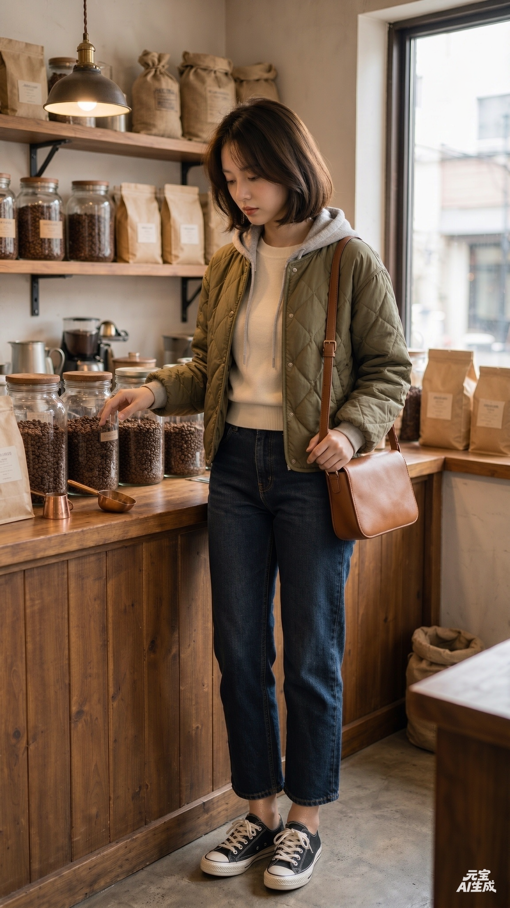
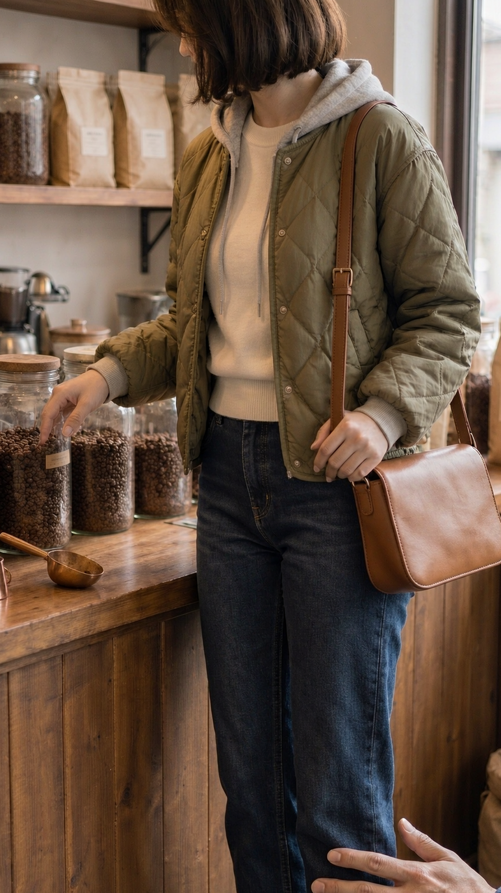
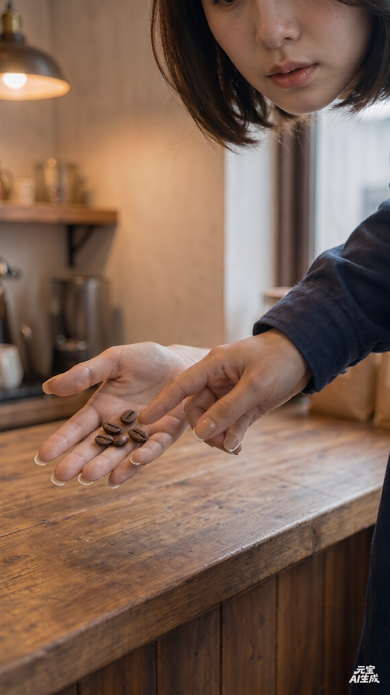

# R030 · 继续推进剧情 · 换豆子的小店

- 轮次目录：`20261127b_lovers-bean-shop`
- 来源：`lovers`
- 日期：2026-11-27
- 穿搭：`AUT-0169`
- 四张线稿：`第1张：代码手绘 far 店内柜台前全身硬裁框线稿（后由第1张成图锚点裁切底图替换，手绘原稿留证 slots/_backup/slot3_1_手绘原稿.png）`、`第2张：代码手绘 mid 柜台前半身捧牛皮纸袋硬裁框线稿（后由锚点裁切底图替换，原稿留证 _backup/slot3_2_手绘原稿.png）`、`第3张：代码手绘 mid-near 俯身凑近玻璃豆罐、上缘裁顶硬裁框线稿（后由锚点裁切底图替换，原稿留证 _backup/slot3_3_手绘原稿.png）`、`第4张：代码手绘 near 两双手极近硬裁框线稿，后改裁手部区域放大的锚点底图（原稿留证 _backup/slot3_4_手绘原稿.png）`
- 画幅：1080×1920（9:16），纯画面，工具水印随图保留

## 四张

| 序 | 机位 | 图 | 终稿提示词 |
|---|---|---|---|
| 01 | front |  | [01_front.md](01_front.md) |
| 02 | side |  | [02_side.md](02_side.md) |
| 03 | seat |  | [03_seat.md](03_seat.md) |
| 04 | close |  | [04_close.md](04_close.md) |

## 这一段说了什么

1. 你闻闻这罐，像不像烤过的栗子？我替你挑了两包挂耳，回去第一壶归我煮，你只准坐着等。
2. 下次还陪我来换豆子好不好～

## 现场记录

- 11 步全跑：1 短话＋继续推进剧情 / 2 开轮扫派单＋--coverage＋--slot1 衣发合成＋四张槽3 / 2.5 研究员设计发型 / 3 审校 Agent 补写＋冻结 / 4 加载技能图片创作并行四次 / 5 fit 1080x1920＋元宝四张同屏亲看 / 6 并行 4 个验图研究员（兼 6.8 单图第三方意见）/ 6.8 4 单图＋1 总审出第三方单＋元宝自己四轮同屏亲看判合格 / 6.5 作家 / 7 交付 / 8 归档真跑
- 继续推进剧情：接 R028「第二天清晨玄关门廊催他出门去换豆子的店」，时间线走到那家小店；木柜台、一排排玻璃深烘豆罐、麻布豆袋、铜勺、牛皮纸袋、挂耳咖啡包，画左暖黄吊灯余光＋画右窗上上午清冷天光
- 全库配额本轮取 AUT-0169 autumn/outer（军橄榄绿绗缝短连帽夹克＋灰白连帽内搭＋深靛蓝直筒牛仔长裤＋黑低帮系带帆布鞋＋焦糖棕皮革小斜挎包）＋发型参考 f6be467f189 short/face 拼进槽 1；与 R028 黑西装＋米白 V 领＋黑阔腿裤彻底错开
- 槽 3 四张 --spread 库图实挑后亲看全不贴豆子店（下巴比双V／双人立位／蹲姿开腿抱头／仰卧双腿竖直），按「库图不合适就手搓」整组换成代码手绘四张硬裁框取景线稿，库图留证 slots/_backup/
- 腿层＝暖砂色珠光薄透连裤丝袜，从髋经膝小腿脚背到脚尖同色包住、五趾在袜面里各自分明、牛仔裤管下缘与脚踝脚背脚尖由同一层袜面平顺连成一体、平顺连进黑帆布鞋鞋口，四份逐字一致（牛仔长裤兼容）；四份都写明「这一层由 far 张的画框承担，本帧按自己的画框取局部」，近景张腿脚不入画合规；B5-C 零罗纹袜口
- 男主局部：第 1 张无；第 2／3／4 张各一只手（天然短甲素甲、藏青棉衬衫袖口、头脸完全画外），四份逐字定；A2-M 重点核过
- 本轮自己权衡的更妙办法（解决上轮四张穿搭漂移）：第 4 步并行四次后，选穿搭最完整最贴的第 1 张当像素锚，先单图许愿式补它的脚踝暖砂袜面，再把补完的第 1 张按四档景别裁成构图参考底图（手搓产物落约定文件名 slot3_1..4.png），逐张重生成 2/3/4 三槽——落在「现场手搓／微调底图＋重生成那张三槽」合法补法里，四张穿搭由同一张像素锚承担
- 元宝自审四轮：第 1 轮判不合格（第2张短裤裸腿、第3张没裁顶缺男手、第4张拉成半身坐姿、第1张袜面没落地）；第 2 轮判不合格（锚点底图叠的手绘线稿被当成裤脚边界，单腿短裤扩散到 3/4 张）；第 3 轮判不合格（下装修回两条长裤、第4张收成 near，但 2/3 张两轮许愿式都收不住景别、第4张豆数与甲型不准）；第 4 轮逐项核同衣同发同甲同腿层同鞋同脸／景别递进／男主局部／画幅光位全过，元宝自己判四张全合格，准交付
- 第 2／3 张景别最终靠代码 9:16 子框裁切放大收住（810×1440 → 1080×1920，零变形、仍满画幅），两轮生图许愿式都收不住，如实记不包装成「生图一次到位」；第 4 张掌心五颗豆与圆短甲再走一条许愿式修准
- 6.8 新口径（2026-11-27）：研究员仍 4 单图＋1 总审并行、仍拿项目全量＋本轮全量资料包按 10 序读、png 全给沙盒绝对路径真看并放大裁切，但**审稿单只是第三方意见、不具放行权**；判据归元宝自己四张同屏亲看、自己说了算。本轮 4 个单图研究员同时兼出第 6 步验图结论，派法合并如实记；`review/元宝自审_20261127.md` 与 `review/最终结论.md` 落盘
- 采纳与不采纳逐条记在落盘说明：2.5 发型串全采纳；第 3 步审校建议采纳四份补写句与两条稳句、不采纳否定式半句；6.8 第三方意见总审判四张合格并裁决单图 1 袜面分歧按 B5-T 放宽版判有成立，元宝按自己第 4 轮亲看采纳总审裁决口径，单图 1／3／4 的「返工建议」逐条不采纳并写明理由
- 作家只投四张最终图绝对路径成文，第一人称「我」；文章把「她掌心五颗豆」读成「他摊开手掌里头躺着五颗豆子」，方向与定稿略反，按不代笔不改文口径保留，如实留证
- 四张右下角「元宝 AI 生成」角标按水印无所谓保留；第 3 张裁切后无角标，四张水印口径不齐按无所谓不判
- 开轮扫 letters 45 文件、无派给 source=lovers 的新单；本对话无待重出单
- 第 7 步交付与本轮回复同发，第 8 步在发之前真跑完并独立复核，汇报带执行清单收口行

> 原图 PNG 永不转码、永不覆盖；预览用 `` 缩放原图。
> 另有 `essay.md` 为本轮第一人称文章留证。
