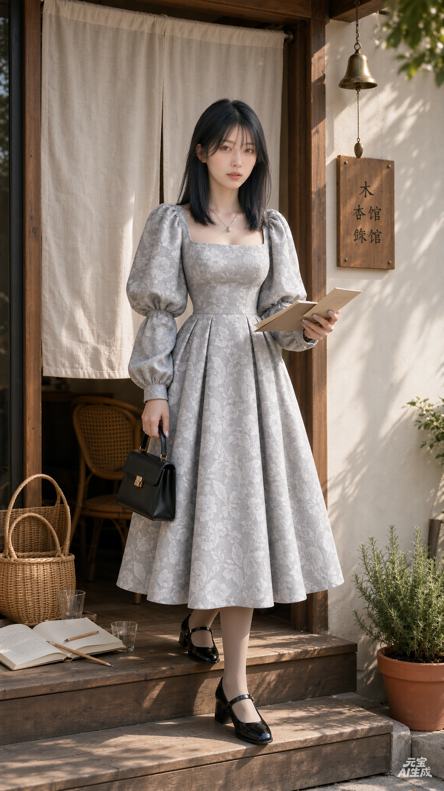
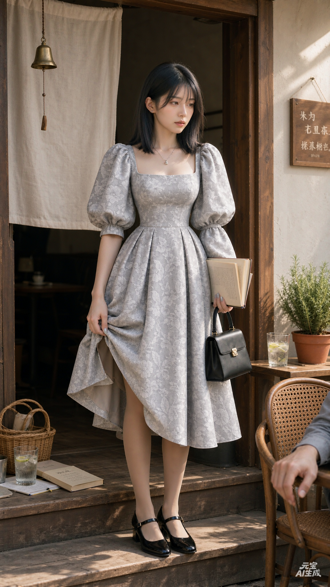
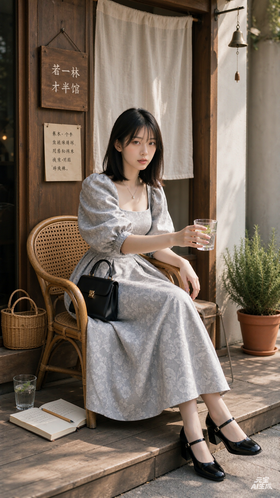
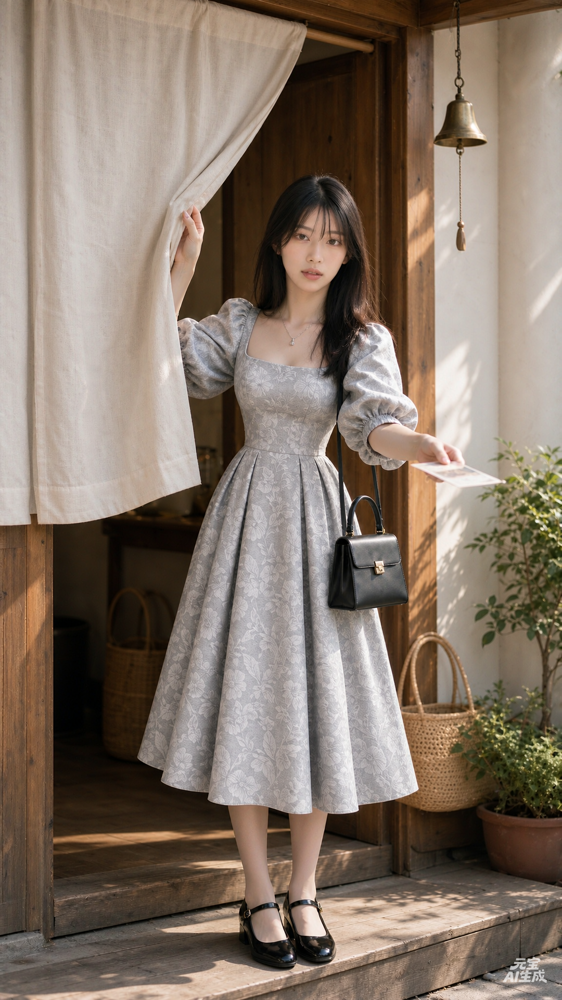

# R037 · 巷口新馆子木门廊 · 过膝长裙裙里丝展示张

- 轮次目录：`20261127d_lovers-porch-date`
- 来源：`lovers`
- 日期：2026-11-27
- 穿搭：`WIN-0218`
- 四张线稿：`代码手搓`、`代码手搓·展示张`、`代码手搓`、`代码手搓`
- 画幅：1080×1920（9:16），纯画面，工具水印随图保留

## 四张

| 序 | 机位 | 图 | 终稿提示词 |
|---|---|---|---|
| 01 | front |  | [01_front.md](01_front.md) |
| 02 | side |  | [02_side.md](02_side.md) |
| 03 | seat |  | [03_seat.md](03_seat.md) |
| 04 | close |  | [04_close.md](04_close.md) |

## 这一段说了什么

1. 两片，猜错啦～罚你今天陪我把那家新开的走完😘 我九张图修到午后才肯出门，裙子偏挑了最长那条，你坐阶上别踩着裙摆；等下掀帘那张你得替我拍好，糊了我可不依。
2. 这家店卡背面印了只打盹的猫，你猜我给它起了什么名？

## 现场记录

- 本轮下装 WIN-0218 裙摆过膝到小腿中段＝长裙，按 LEG_SHOW.md 那一层是裙里丝，不叫裤里丝；触发轮。
- 本轮是否触发：触发；展示张＝第 2 张；动作＝提起裙摆（右手捏自己右侧裙摆边只提一小截），露出膝下到膝上一截浅茶棕裙里丝给画外的他看。
- 四张槽 3 全部第 2 步代码现场手搓：--pick-poses 3 --fresh --spread 库挑的 upper80v2_P007/front、pair60_P052/diagonal、full_sexy_P045/side 逐张亲看全不贴动作，双人那张还会把男主整只画进来，原图留 slots/_backup/库挑_slot3_*.png；第 2 张是展示张，按 LEG_SHOW.md 只有代码手搓一条来源。
- 槽 1 首挑 WIN-0015 是 mini 膝上裙，亲读后不合过膝长裙动线未采用，原合成图留 slots/_backup/slot1_短裙WIN-0015_未采用.png；按 POSE_LIBRARY.md 用同批 --costume WIN-0218 重拼，发型参考沿用 f682c3547d9 semilong/face。
- 第 4 步加载技能图片创作后图生图并行四次一次成，第 5 步 fit_1080x1920.py 等比一次到 1080×1920；本轮 0 次改图、0 次重生成，out/1..4.png 即四张首版终稿。
- 6.8：4 单图＋1 总审并行出第三方意见单（5 份全判合格）＋元宝自己四张同屏亲看、逐张放大、六勾与 P0 与触发轮 F 组三勾逐勾勾满，第 1 轮即判四张全合格，准交付。
- 6.8 采纳与不采纳：9 份第三方意见单判合格采纳；总审提「图 1 画左门帘暗部同脸叠影有第二人风险」不采纳返工——元宝放大门帘区只见低对比布褶与木框、无五官成形的第二张脸，不动图不局部解冻；图 1 下缘多一条阶沿、图 3 的 78cm 平视读感、图 4 门帘遮宽与递卡手轻并拢、图 2 布外缘像两层，均按不误伤不采纳动图，逐条见 review/元宝自审_20261127.md。
- 6.5 作家只拿四张 out/*.png 绝对路径成文，落 essay/作文.md；作家读图明显跑偏（写成傍晚、白瓷杯、两根白柱子、草地院子），与本轮四张午后门廊、银灰提花长裙、玻璃杯冰薄荷茶、木门帘、藤椅、店卡完全不符，属读图失败／自造画面细节。按 ESSAY.md 不代笔不改视角不追加再读一遍改一版，不重写不替换，原文照装代码块一并如实留证。
- 水印按「水印无所谓」口径保留，四张右下角「元宝 AI 生成」角标一致。
- 术语从本轮起按上一轮改项目轮新口径：裤装＝裤里丝，裙装＝裙里丝；长裙轮展示张提起裙摆露出的那一截是裙里丝。

> 原图 PNG 永不转码、永不覆盖；预览用 `` 缩放原图。
> 另有 `essay.md` 为本轮第一人称文章留证。
