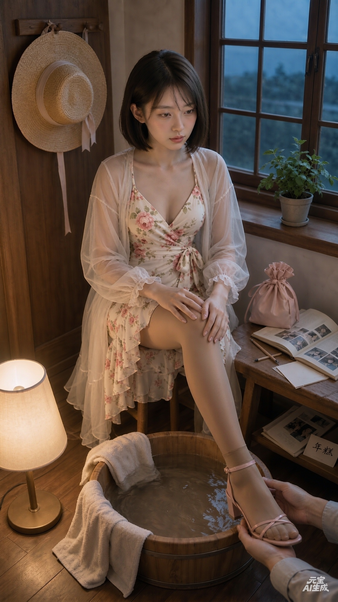
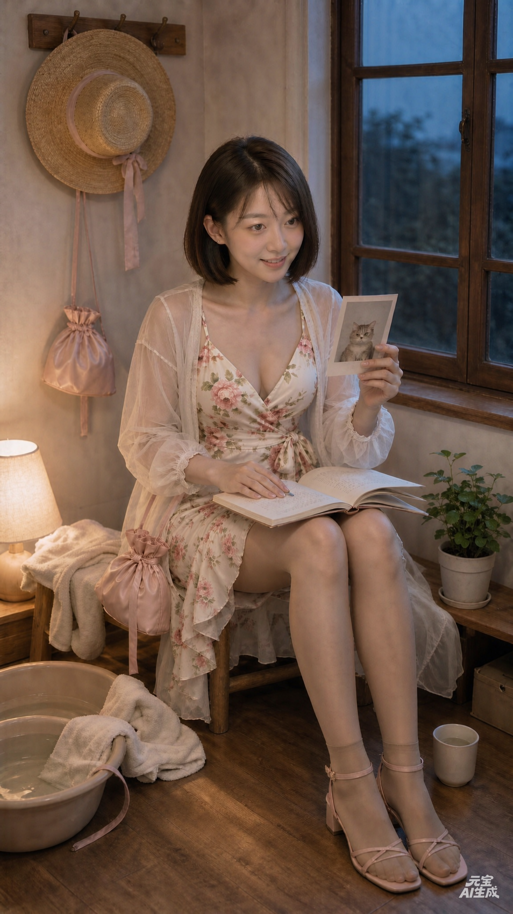

# R045 · 暮色矮凳·木盆温水与年糕

- 轮次目录：`20261127f_lovers-dusk-footstool`
- 来源：`lovers`
- 日期：2026-11-27
- 穿搭：`SUM-0114`
- 四张线稿：`代码手搓·展示张`、`代码手搓`、`代码手搓`、`代码手搓`
- 画幅：1080×1920（9:16），纯画面，工具水印随图保留

## 四张

| 序 | 机位 | 图 | 终稿提示词 |
|---|---|---|---|
| 01 | front |  | [01_front.md](01_front.md) |
| 02 | side |  | [02_side.md](02_side.md) |
| 03 | seat |  | [03_seat.md](03_seat.md) |
| 04 | close |  | [04_close.md](04_close.md) |

## 这一段说了什么

1. 叫年糕啦～窗台那只比豆包还赖，我拍了三张它连眼皮都没抬😘 水别兑太烫，今天第三家排了四十分钟，腿还酸着呢，说好轮到你给我捏的；九张图我自己修，你只管把毛巾递过来，别又偷看我探店本。
2. 你猜我把年糕那张摆探店本第几页？

## 现场记录

- 本轮触发长裙轮展示张：下装是米白底粉玫瑰印花前短后长不规则荷叶边长裙，那一层是裙里丝（不是裤里丝）；展示张＝第 1 张，动作＝提起裙摆（右手捏自己左侧那一小段布边上提一小截），露出膝下到膝上一截裙里丝，B5-C 无罗纹收口、两腿各自连续、被提那侧脚仍穿凉鞋踩实地板；槽 3 来源＝代码手搓·展示张，其余三张代码手搓。
- 四张槽 3 全部第 2 步代码现场手搓：库挑 upper80v2_P071/front、pair60_P047/diagonal、full_sexy_P018/side、full_single_P052/high 逐张亲看全不贴，原图留 slots/_backup/；四张骨架明显不同，手搓产物不进 used.json。
- 改图链：首版四张脚踝带白色罗纹短袜口、图2 两只手、图3 举成文字卡、图4 地上多第二张卡 → 第 6 步微调槽 1 压白罗纹横边＋重搓展示张线稿＋四份局部解冻同批重生成（动作读偏退回首版）→ 四张各一条单图许愿式修净白袜口与道具 → 图 2 两轮许愿式擦第二只手未奏效、第四轮改坏鞋底后回退第三轮，局部解冻第 2 份定稿与意图卡第 9 节如实写实写「他一双手托着她抬起那只脚」，四份公共八段逐字不动 → 6.8 四单图＋一总审后图 3 再单图许愿式擦净地板第二本本子与压照 → 元宝自己四张同屏亲看全合格。
- 6.8 审稿单权衡：采纳图3 地板第二本本子 P1 与总审「第 2 份定稿已三方同步不再解冻」；不采纳图4 鼻尖高光（四张脸部对照为柔过渡、暖灯直射侧脸的自然结果，不破骨相与同一张脸）、图4 花形金扣（图1 同位置同款，四张自统一，改要动公共锚点反破逐字一致）、图1 毛巾体积与折影软提示、图2 水下袜色与指尖共线提示。已知读法差异：图1 露出那一截偏膝上、面积略大，非开衩非掀片、裙摆其余完整闭合，F 组三勾不破。
- 男主局部：第 1 张无／第 2 张画右下他一双手托脚／第 3 张无／第 4 张画右下他一截浅灰棉长裤膝头；四处头脸全在画外。
- 6.5 作家投递物只有四张 out 路径，成文《黄昏里那只矮脚凳》写成旧脚凳与父母外婆的回忆散文，把四张图读成四张无人物物件照，未接通本轮四张画面与同一段安静，篇幅约七百字；按 ESSAY.md「写出来的东西不对如实记、不补材料、不追加再读一遍改一版」，不重派不代笔，原文逐字留证并如实记入本轮项目汇报。
- 归档脚本读取入口为项目根 prompts/第N张.md，本轮已把 media/round_20261127_dusk_footstool/prompts/ 下四份终稿同步到该入口（md5 逐份一致），确保入仓的是本轮定稿；根 prompts/ 不作现行四份定稿路径。
- 四张最终图均 1080×1920 等比规范真图，水印按「水印无所谓」口径保留。

> 原图 PNG 永不转码、永不覆盖；预览用 `` 缩放原图。
> 另有 `essay.md` 为本轮第一人称文章留证。
