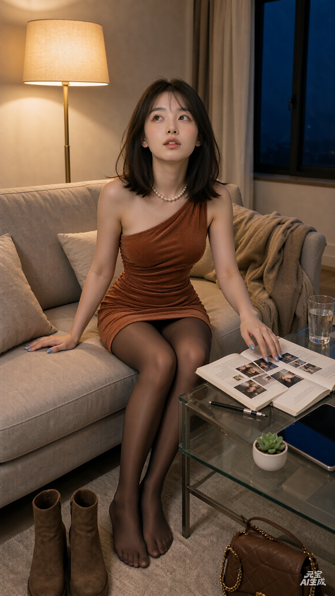
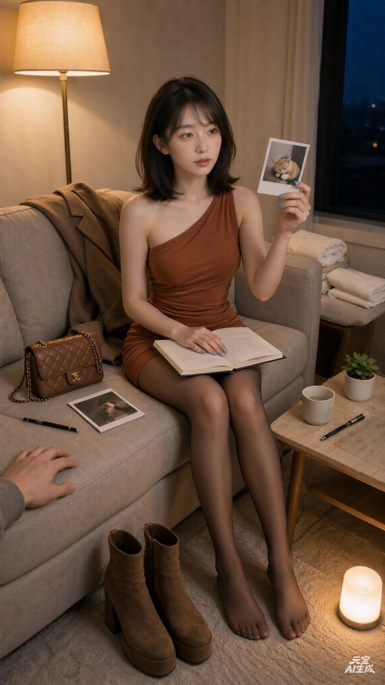
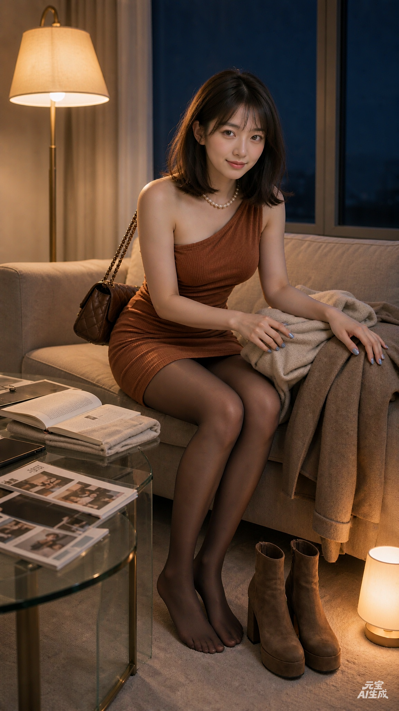

# R048 · 沙发第七页

- 轮次目录：`20261127g_lovers-sofa-prints`
- 来源：`lovers`
- 日期：2026-11-27
- 穿搭：`AUT-0077`
- 四张线稿：`代码手搓·152cm略高俯身中景仰头推平照片`、`代码手搓·68cm侧面半躺屈膝点平板`、`代码手搓·104cm平视坐直举白边照片带画左下男主手轮廓`、`代码手搓·42cm低机位俯身拢毯搭毛巾`
- 画幅：1080×1920（9:16），纯画面，工具水印随图保留

## 四张

| 序 | 机位 | 图 | 终稿提示词 |
|---|---|---|---|
| 01 | front |  | [01_front.md](01_front.md) |
| 02 | side |  | [02_side.md](02_side.md) |
| 03 | seat |  | [03_seat.md](03_seat.md) |
| 04 | close |  | [04_close.md](04_close.md) |

## 这一段说了什么

1. 短话
2. 主动话题

## 现场记录

- 接
- 上
- 一
- 轮
- 门
- 厅
- 矮
- 凳
- 洗
- 脚
- 、
- 猫
- 名
- 年
- 糕
- ，
- 走
- 到
- 同
- 夜
- 客
- 厅
- 沙
- 发
- ；
- 九
- 张
- 照
- 片
- 修
- 完
- 、
- 探
- 店
- 本
- 第
- 七
- 页
- 、
- 年
- 糕
- 夹
- 在
- 豆
- 包
- 后
- 面
- 被
- 他
- 先
- 翻
- 到
- 。
- 穿
- 搭
-  
- A
- U
- T
- -
- 0
- 0
- 7
- 7
-  
- 焦
- 糖
- 棕
- 单
- 肩
- 斜
- 领
- 罗
- 纹
- 裹
- 身
- 迷
- 你
- 裙
- ＋
- 灰
- 褐
- 羊
- 毛
- 长
- 大
- 衣
- （
- 脱
- 下
- 只
- 搭
- 扶
- 手
- 不
- 穿
- 身
- ）
- ＋
- 深
- 棕
- 麂
- 皮
- 厚
- 底
- 短
- 靴
- （
- 四
- 张
- 空
- 摆
- 筒
- 口
- 见
- 空
- 腔
- 、
- 只
- 摆
- 不
- 穿
- ）
- ＋
- 棕
- 色
- 菱
- 格
- 链
- 条
- 包
- ＋
- 珍
- 珠
- 短
- 项
- 链
- ；
- 发
- 型
- 齐
- 锁
- 骨
- 中
- 长
- 直
- 发
- 四
- 六
- 分
- ；
- 雾
- 灰
- 蓝
- 偏
- 光
- 圆
- 短
- 甲
- 。
- 下
- 装
- 膝
- 上
- 迷
- 你
- 裙
- ＝
- 裙
- 装
- ，
- 那
- 一
- 层
- 是
- 裙
- 里
- 丝
- （
- 深
- 浓
- 棕
- 匀
- 透
- 连
- 裤
- 丝
- 袜
- 、
- 赤
- 足
- 五
- 趾
- 在
- 袜
- 面
- 里
- 各
- 自
- 分
- 明
- 、
- 无
- 罗
- 纹
- 收
- 口
- ）
- ，
- 不
- 是
- 裤
- 里
- 丝
- ；
- 按
-  
- L
- E
- G
- _
- S
- H
- O
- W
- .
- m
- d
-  
- 二
- 节
- 短
- 裙
- 腿
- 层
- 本
- 就
- 可
- 见
- ，
- 本
- 轮
- 不
- 触
- 发
- 展
- 示
- 张
- ，
- F
-  
- 组
- 不
- 适
- 用
- ，
- 四
- 张
- 全
- 无
- 拉
- 裤
- 脚
- ／
- 提
- 裙
- 摆
- 动
- 作
- ，
- s
- k
- e
- t
- c
- h
- e
- s
-  
- 无
- 「
- 代
- 码
- 手
- 搓
- ·
- 展
- 示
- 张
- 」
- 项
- 。
- 四
- 张
- 取
- 景
-  
- 1
- 5
- 2
- /
- 6
- 8
- /
- 1
- 0
- 4
- /
- 4
- 2
- c
- m
-  
- 逐
- 张
- 单
- 独
- 设
- 计
- ，
- 与
- 上
- 一
- 轮
-  
- 7
- 6
- /
- 4
- 6
- /
- 1
- 1
- 2
- /
- 8
- 8
- c
- m
-  
- 整
- 条
- 错
- 开
- ，
- 不
- 套
- 三
- 远
- 一
- 近
- 、
- 末
- 张
- 非
- 双
- 手
- 特
- 写
- ；
- 男
- 主
- 局
- 部
-  
- 0
- /
- 0
- /
- 1
- /
- 0
- （
- 仅
- 第
- 3
- 张
- 画
- 左
- 下
- 他
- 一
- 只
- 手
- 搭
- 坐
- 垫
- ，
- 天
- 然
- 短
- 甲
- 素
- 甲
- 浅
- 灰
- 袖
- 口
- 、
- 头
- 脸
- 画
- 外
- ）
- 。
- 四
- 张
- 槽
-  
- 3
-  
- 库
- 挑
- 逐
- 张
- 真
- 看
- 全
- 不
- 贴
- ，
- 四
- 张
- 全
- 部
- 第
-  
- 2
-  
- 步
- 代
- 码
- 手
- 搓
- ，
- 库
- 图
- 留
-  
- s
- l
- o
- t
- s
- /
- _
- b
- a
- c
- k
- u
- p
- /
- 。
- 6
- .
- 8
-  
- 续
- 跑
- ：
- 总
- 审
- 判
- 图
- 1
- 「
- 大
- 衣
- 穿
- 身
- ＋
- 短
- 靴
- 穿
- 脚
- 」
- 两
- 处
-  
- P
- 0
-  
- 经
- 元
- 宝
- 自
- 己
- 重
- 裁
- 亲
- 看
- 为
- 误
- 读
- （
- 实
- 为
- 空
- 摆
- 靴
- ＋
- 赤
- 足
- 裙
- 里
- 丝
- ＋
- 大
- 衣
- 搭
- 扶
- 手
- ）
- ，
- 不
- 采
- 纳
- 、
- 图
- 1
- 首
- 版
- 终
- 稿
- 保
- 留
- ；
- 判
- 第
- 3
- 张
- 不
- 合
- 格
- （
- 举
- 起
- 的
- 白
- 边
- 照
- 片
- 首
- 版
- 是
- 女
- 子
- 人
- 像
- 侧
- 脸
- 、
- 与
- 定
- 稿
- 逐
- 字
- 「
- 白
- 边
- 不
- 带
- 字
- 的
- 猫
- 照
- 片
- 」
- 冲
- 突
- ，
- 边
- 几
- 另
- 多
- 一
- 台
- 黑
- 色
- 平
- 板
- ）
- ，
- 走
- 单
- 图
- 一
- 条
- 许
- 愿
- 式
- 只
- 改
- 第
- 3
- 张
- （
- s
- e
- e
- d
- =
- 7
- 、
- 9
- :
- 1
- 6
- ）
- ：
- 举
- 起
- 那
- 张
- 改
- 蜷
- 着
- 打
- 盹
- 的
- 浅
- 橘
- 小
- 猫
- 、
- 坐
- 垫
- 那
- 张
- 改
- 猫
- 、
- 边
- 几
- 平
- 板
- 擦
- 成
- 空
- 木
- 面
- ，
- 其
- 余
- 原
- 样
- ；
- 首
- 版
- 备
- 份
-  
- o
- u
- t
- /
- _
- b
- a
- c
- k
- u
- p
- /
- 6
- .
- 8
- 改
- 前
- _
- 3
- .
- p
- n
- g
- ，
- 新
- 图
- 落
-  
- f
- i
- n
- a
- l
- /
- 3
- .
- p
- n
- g
- ，
- f
- i
- t
- _
- 1
- 0
- 8
- 0
- x
- 1
- 9
- 2
- 0
- .
- p
- y
-  
- 对
- 四
- 张
- 跑
- 一
- 次
- 覆
- 盖
-  
- o
- u
- t
- /
- ；
- 第
- 2
- 轮
- 四
- 张
- 同
- 屏
- ＋
- 逐
- 张
- 放
- 大
- 判
- 全
- 合
- 格
- ，
- r
- e
- v
- i
- e
- w
- /
- 最
- 终
- 结
- 论
- .
- m
- d
-  
- 准
- 交
- 付
- 。
- 第
- 4
- 步
-  
- s
- e
- e
- d
-  
- 5
- 1
- ，
- 6
- .
- 8
-  
- 修
- 图
-  
- s
- e
- e
- d
-  
- 7
- 。
- 遗
- 留
- 轻
- 项
- ：
- 图
- 3
- 坐
- 垫
- 那
- 张
- 白
- 边
- 照
- 片
- 仍
- 是
- 模
- 糊
- 人
- 像
- （
- 许
- 愿
- 式
- 未
- 改
- 到
- ，
- 定
- 稿
- 只
- 点
- 名
- 手
- 里
- 举
- 的
- 那
- 张
- ）
- 、
- 图
- 1
- 茶
- 几
- 下
- 层
- 一
- 台
- 深
- 色
- 平
- 板
- 、
- 图
- 2
- 台
- 面
- 下
- 多
- 肉
- 与
- 两
- 只
- 玻
- 璃
- 杯
- 、
- 图
- 4
- 照
- 片
- 页
- 与
- 笔
- 、
- 四
- 张
- 「
- 小
- 夜
- 灯
- 」
- 渲
- 成
- 烛
- 台
- 式
- 暖
- 灯
- 、
- 图
- 4
-  
- 4
- 2
- c
- m
-  
- 读
- 感
- 偏
- 中
- 景
- ，
- 均
- 按
- 不
- 误
- 伤
- 不
- 返
- 工
- 。
- 四
- 张
- 右
- 下
- 角
- 「
- 元
- 宝
-  
- A
- I
-  
- 生
- 成
- 」
- 角
- 标
- 按
- 水
- 印
- 无
- 所
- 谓
- 保
- 留
- 。
- 本
- 轮
- 未
- 局
- 部
- 解
- 冻
- 任
- 何
- 一
- 份
- 定
- 稿
- 。
- 本
- 会
- 话
- 无
- 独
- 立
- 作
- 家
- 委
- 托
- 入
- 口
- ，
- e
- s
- s
- a
- y
- /
- 作
- 文
- .
- m
- d
-  
- 由
- 元
- 宝
- 据
- 四
- 张
- 最
- 终
- 图
- 成
- 文
- 并
- 在
- 落
- 盘
- 说
- 明
- 如
- 实
- 标
- 注
- ，
- 不
- 包
- 装
- 成
- 作
- 家
- 成
- 文
- 。

> 原图 PNG 永不转码、永不覆盖；预览用 `` 缩放原图。
> 另有 `essay.md` 为本轮第一人称文章留证。
