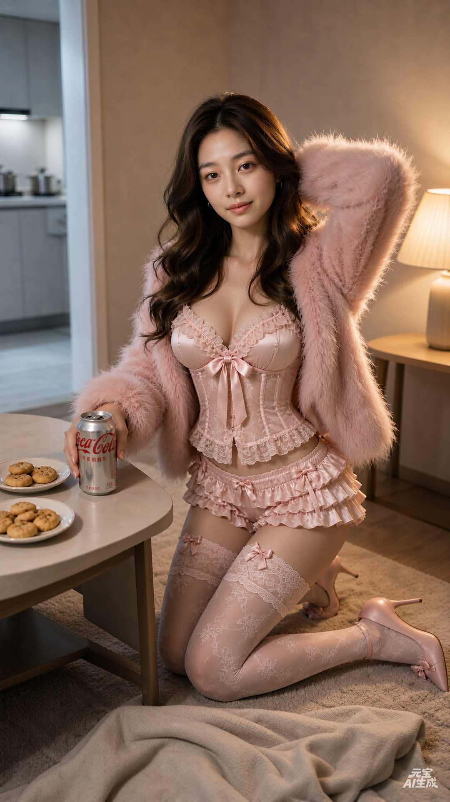

## 终稿提示词

```text
第1张 · 他半躺·眼高约 0.9 米、隔 1.3 米看她把可乐罐挪开后从茶几边俯身过来

第一张图定穿搭版型配色面料，第二张图定骨相五官，第三张图定本张姿势骨架与机位；脸、衣、姿势由各自底图承担，文字腾给光位、场景、关系视角、构图调子、神态落点。本张栗棕中分蓬松披肩大波浪由独立发型参考图与文字锚共同承担，槽 2 人脸底图只留五官与骨相、不锁发际线。

9:16 满幅画面，宽 1080 高 1920，四条边即裁切边，人物与道具铺满整幅、完整落在画内。全画只她一位清晰成年女性、一具身体轮廓；画外的人只以他自己在画面下缘那一小片浅灰薄毯上的手背与半截小臂交代，一眼看过去屋里就她一个人。左右各一只手臂各五根手指、两只手各自从肩连续到指尖，两只脚各自连续，胸大腰细腿长靠合身剪裁写实呈现。

穿搭逐项实写：樱粉缎面细肩带束身上衣，杯沿一圈细蕾丝花边、胸前系一枚大缎面蝴蝶结，束身衣自上而下收出竖向鱼骨线、下摆一圈细蕾丝荷叶边；同色樱粉缎面层叠荷叶边短裤，腰头两枚小缎带蝴蝶结，裤摆三层软褶停在大腿根；外搭一件樱粉长毛绒羽毛短外套，敞襟不系、毛绒蓬松地覆在两肩与上臂；樱粉印花连裤丝袜从腿根整段连包到脚趾，袜面有浅白藤蔓与细菱格平面织纹，大腿上段两枚平面缎带小蝴蝶结与一圈平面蕾丝花边作装饰、是平面织纹不是松紧收口，脚踝与腿上平滑、无罗纹螺纹松紧收口、无横向袜边分界，脚趾上有一层樱粉袜面、五趾轮廓在袜面里各自分明；两只奶白软底包趾绒拖穿在丝袜外面，鞋口短绒包住脚背、丝袜脚背连进鞋口，四张同一双；奶白短圆甲、细哑金锁骨链垂一粒小珍珠、小珍珠耳钉。发型是栗棕中分蓬松披肩大波浪，发根蓬松，中分缝干净，松而大的一缕缕波浪过肩一路披到后背中段以下，不扎不盘，俯身时从两侧滑下来扫过锁骨，四张同一顶。

姿势照第三张图：她刚把那罐喝了一半的可乐放到茶几角，站姿 S 形前倾、上身朝他压下来，重心落在前脚，后脚脚尖轻点短绒地毯，脊线从后颈经腰窝到后脚的踝拉出一道舒展的斜线，羽毛外套的两片前襟随前倾向外让开，层叠裤摆垂出一道软弧，两只奶白绒拖都好好穿在脚上。全画仅此一双手，每只手全篇只出现一次、只做一个动作：右臂从右肩经肘向前下探、经腕压平，指尖一条连续链沿身体右侧完整可见，唯一落点是右手五指轻轻搭在茶几沿、指腹把那罐可乐往画外推了半寸就停住；左臂从左肩经肘向侧收、经腕抬到腰侧，唯一落点是左手五指拢着羽毛外套的下摆边、只做这一个撩开下摆的动作。

镜头是他的眼睛：他夜宵刚过、半躺在浅灰薄毯上还没坐起来，视点实数眼高 0.9 米，与她相隔 1.3 米，略仰看过去，这一眼先撞上她俯下来的栗棕大波浪发梢与胸前那枚缎面蝴蝶结，再顺着束身鱼骨线走到腰侧、层叠裤摆、整段樱粉印花丝袜与两只奶白绒拖，最后落到画面下缘自己那一小片没来得及收回去的手背。这一眼看不见她的睫毛与耳后细汗，看不见茶几角那碟没吃完的小酥饼上有几块，厨房门缝那一线冷白虚在画左把这一眼框住。

场景是深夜客厅：茶几一角半罐可乐、一小碟小酥饼、折起的薄毯边，短绒地毯吃到画底，沙发边一盏纸罩小台灯从右侧斜铺暖黄，只亮在她右肩、发梢与胸前的缎面上；厨房一线冷白从画左门缝漏进来，冷暖在她俯身那道脊线上交界，其余化进柔软暖灰。

神态落点在眼先落在他搁在薄毯上的手背、再抬起来递到他眼睛里，下唇含住一点又慢慢松开，带一点「又偷喝可乐呀」的小得意，并从那里长出一个可见动作：搭在茶几沿那五指在罐身上极轻地一点就收回，像先替他把这口气收走，等他认一句撑才肯走近。
```

## 一句点评

她把可乐罐推远后俯身过来
