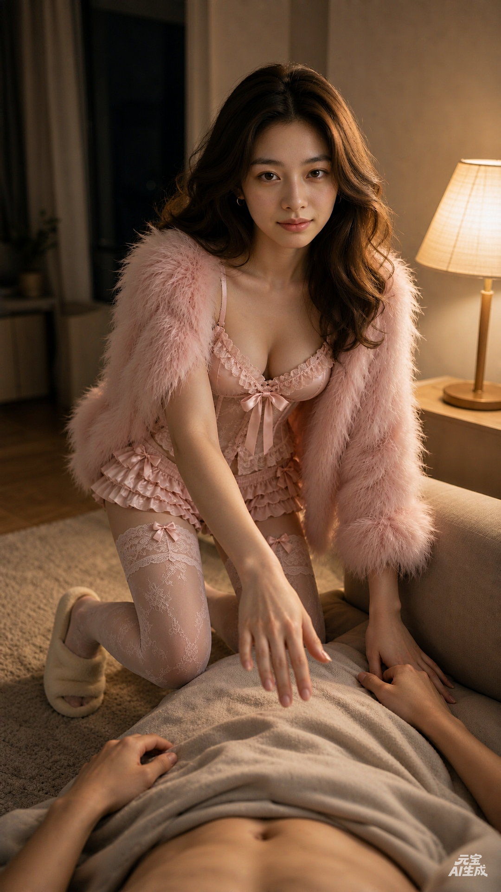

## 终稿提示词

```text
第2张 · 他半躺·眼高约 0.9 米、隔 1.0 米看她单膝跪上沙发沿把掌心悬到他胃腹上方

第一张图定穿搭版型配色面料，第二张图定骨相五官，第三张图定本张姿势骨架与机位；脸、衣、姿势由各自底图承担，文字腾给光位、场景、关系视角、构图调子、神态落点。本张栗棕中分蓬松披肩大波浪由独立发型参考图与文字锚共同承担，槽 2 人脸底图只留五官与骨相、不锁发际线。

9:16 满幅画面，宽 1080 高 1920，四条边即裁切边，人物与道具铺满整幅、完整落在画内。全画只她一位清晰成年女性、一具身体轮廓；画外的人只以他自己在画面下缘那一小片浅灰薄毯与搁在上面的手背交代，一眼看过去屋里就她一个人。左右各一只手臂各五根手指、两只手各自从肩连续到指尖，两只脚各自连续，胸大腰细腿长靠合身剪裁写实呈现。

穿搭逐项实写：樱粉缎面细肩带束身上衣，杯沿一圈细蕾丝花边、胸前系一枚大缎面蝴蝶结，束身衣自上而下收出竖向鱼骨线、下摆一圈细蕾丝荷叶边；同色樱粉缎面层叠荷叶边短裤，腰头两枚小缎带蝴蝶结，裤摆三层软褶停在大腿根；外搭一件樱粉长毛绒羽毛短外套，敞襟不系、毛绒蓬松地覆在两肩与上臂；樱粉印花连裤丝袜从腿根整段连包到脚趾，袜面有浅白藤蔓与细菱格平面织纹，大腿上段两枚平面缎带小蝴蝶结与一圈平面蕾丝花边作装饰、是平面织纹不是松紧收口，脚踝与腿上平滑、无罗纹螺纹松紧收口、无横向袜边分界，脚趾上有一层樱粉袜面、五趾轮廓在袜面里各自分明；两只奶白软底包趾绒拖穿在丝袜外面，鞋口短绒包住脚背、丝袜脚背连进鞋口，四张同一双；奶白短圆甲、细哑金锁骨链垂一粒小珍珠、小珍珠耳钉。发型是栗棕中分蓬松披肩大波浪，发根蓬松，中分缝干净，松而大的一缕缕波浪过肩一路披到后背中段以下，不扎不盘，俯身时从两侧滑下来扫过锁骨，四张同一顶。

姿势照第三张图：她单膝跪上沙发沿，另一条腿屈起来踩稳短绒地毯，上身朝他柔柔折下来，脊线从后颈经腰窝到跪着那条膝拉成一道稳弧，羽毛外套的两片前襟顺着俯身垂开，层叠裤摆随屈腿叠出软褶，两只奶白绒拖一只踩实、一只半挂在脚尖将掉未掉。全画仅此一双手，每只手全篇只出现一次、只做一个动作：右臂从右肩经肘向前下探、经腕翻成掌心朝下，指尖一条连续链沿身体右侧完整可见，唯一落点是右手五指微张、掌心悬在他胃腹上方半寸、先不落下去；左臂从左肩经肘向下撑、经腕压平，唯一落点是左手五指撑在他腰侧那片浅灰薄毯上、把身子稳住，只做这一个撑住的动作。

镜头是他的眼睛：他半躺在浅灰薄毯上，视点实数眼高 0.9 米，与她相隔 1.0 米，平看略仰过去，这一眼先撞上她垂下来的栗棕大波浪发梢与胸前缎面蝴蝶结，再顺着悬着的那只手走到掌心底下自己那一小片胃腹，最后落到画面下缘自己搁在薄毯上的手背。这一眼看不见她悬着那五指指腹的细纹，看不见茶几角那罐可乐的拉环，厨房门缝那一线冷白退成画左极薄的一窄条。

场景是深夜客厅：沙发边一盏纸罩小台灯从右侧斜铺暖黄，光正好落到她悬着的那只手、他胃腹那一小片与她跪着的膝头，薄毯织纹在暖光里浮出细绒，短绒地毯吃到画底，其余化进柔软暖灰。

神态落点在眼先落在自己悬着的掌心、再抬起来递到他眼睛里，眉梢只提起一半就停住，像在问「这儿是不是胀」，并从那里长出一个可见动作：悬着那只手极慢地往下落半寸又停住，五指轻轻收拢一点再张开，等他先出声才肯真贴上去。
```

## 一句点评

单膝跪悬着掌心问他胀不胀
