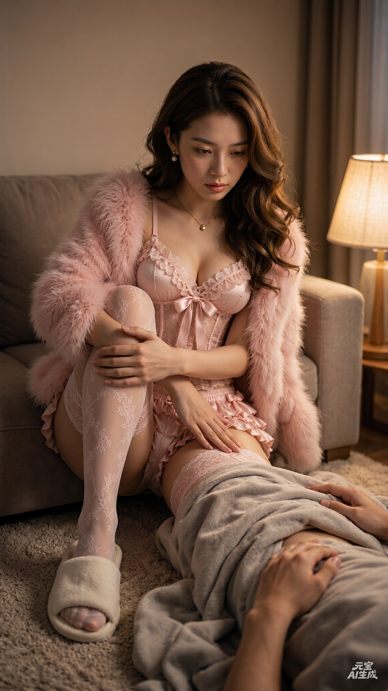

## 终稿提示词

```text
第3张 · 他半躺·眼高约 0.85 米、隔 0.55 米看她掌心贴实顺时针替他揉胃

第一张图定穿搭版型配色面料，第二张图定骨相五官，第三张图定本张姿势骨架与机位；脸、衣、姿势由各自底图承担，文字腾给光位、场景、关系视角、构图调子、神态落点。本张栗棕中分蓬松披肩大波浪由独立发型参考图与文字锚共同承担，槽 2 人脸底图只留五官与骨相、不锁发际线。

9:16 满幅画面，宽 1080 高 1920，四条边即裁切边，人物与道具铺满整幅、完整落在画内。全画只她一位清晰成年女性、一具身体轮廓；画外的人只以他自己在画面下缘那一小片浅灰薄毯与搁在上面的手背交代，一眼看过去屋里就她一个人。左右各一只手臂各五根手指、两只手各自从肩连续到指尖，两只脚各自连续，胸大腰细腿长靠合身剪裁写实呈现。

穿搭逐项实写：樱粉缎面细肩带束身上衣，杯沿一圈细蕾丝花边、胸前系一枚大缎面蝴蝶结，束身衣自上而下收出竖向鱼骨线、下摆一圈细蕾丝荷叶边；同色樱粉缎面层叠荷叶边短裤，腰头两枚小缎带蝴蝶结，裤摆三层软褶停在大腿根；外搭一件樱粉长毛绒羽毛短外套，敞襟不系、毛绒蓬松地覆在两肩与上臂；樱粉印花连裤丝袜从腿根整段连包到脚趾，袜面有浅白藤蔓与细菱格平面织纹，大腿上段两枚平面缎带小蝴蝶结与一圈平面蕾丝花边作装饰、是平面织纹不是松紧收口，脚踝与腿上平滑、无罗纹螺纹松紧收口、无横向袜边分界，脚趾上有一层樱粉袜面、五趾轮廓在袜面里各自分明；两只奶白软底包趾绒拖穿在丝袜外面，鞋口短绒包住脚背、丝袜脚背连进鞋口，四张同一双；奶白短圆甲、细哑金锁骨链垂一粒小珍珠、小珍珠耳钉。发型是栗棕中分蓬松披肩大波浪，发根蓬松，中分缝干净，松而大的一缕缕波浪过肩一路披到后背中段以下，不扎不盘，俯身时从两侧滑下来、有一缕越过锁骨垂到画面中段的他手背上，四张同一顶。

姿势照第三张图：她侧坐在沙发沿，一腿屈起贴着薄毯、一腿斜放，上身朝他再压低一点，脊线从后颈经腰窝到屈起的膝收成一道柔弧，羽毛外套两片前襟垂开，层叠裤摆随侧坐叠出软褶，两只奶白绒拖都好好穿在脚上。全画仅此一双手，每只手全篇只出现一次、只做一个动作：右臂从右肩经肘向前下探、经腕贴平，指尖一条连续链沿身体右侧完整可见，唯一落点是右手四指并拢、掌心贴实他胃腹、正顺时针画着一小圈，拇指轻压一下再松开；左臂从左肩经肘向侧收、经腕搭在自己屈起的膝上，唯一落点是左手五指拢着垂下来的那一缕大波浪发尾、只做这一个拢住发尾的动作。

镜头是他的眼睛：他半躺在浅灰薄毯上，视点实数眼高 0.85 米，与她相隔 0.55 米，略俯看过去，这一眼先撞上她低下来的栗棕大波浪发顶与垂到手背的那一缕，再顺着束身鱼骨线落到贴实他胃腹的那只掌心，最后落到画面下缘自己搁在薄毯上、被发梢扫到的手背。这一眼看不见她睫毛上那点暖光，看不见茶几角那碟小酥饼还剩几块，纸罩小台灯的光圈虚在画右缘。

场景是深夜客厅：沙发边一盏纸罩小台灯从右侧斜铺暖黄，光收拢到她贴实的掌心、垂下的发梢与他胃腹那一小片，薄毯织纹与丝袜上的浅白藤蔓织纹在同一道暖光里各自浮出来，短绒地毯吃到画底，其余化进柔软暖灰。

神态落点在眼先落在自己揉着的那只手上、再抬起来递到他眼睛里，下唇含住一点又慢慢松开，像在数圈数，并从那里长出一个可见动作：揉满一整圈之后，右手食指尖在他胃上极轻地点一下就停住，是个问句，问他这一下重不重，等他眉头松了才肯再起下一圈。
```

## 一句点评

侧坐拢发看他数圈
