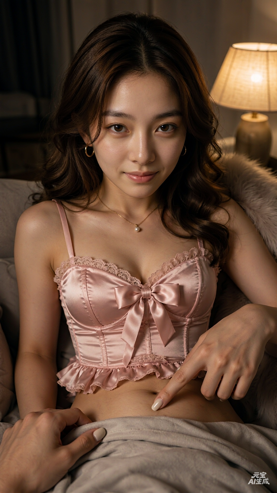

## 终稿提示词

```text
第4张 · 他半躺·眼高约 0.8 米、隔 0.3 米看她凑近只留半张脸、指尖点在他胃上不收回

本张是 0.3 米近景特写，唯一输入图是槽 2 人脸底图、承担骨相五官与发际线以下的脸；槽 1 穿搭实物与槽 3 线稿骨架都在画外，由下面文字锚逐项延续前三张同一套，四张连起来是同一段安静。栗棕中分蓬松披肩大波浪由独立发型参考图与文字锚共同承担，槽 2 人脸底图只留五官与骨相、不锁发际线。

9:16 满幅画面，宽 1080 高 1920，四条边即裁切边，人物与道具铺满整幅、完整落在画内。画顶裁到眉骨以上，全画只她一位清晰成年女性、只留眼尾到嘴角那半张脸、下颌线与一小截颈，正脸完整轮廓在画外；画外的人只以他自己在画面下缘那一小片浅灰薄毯与胃腹那一小块交代，一眼看过去屋里就她一个人。左右各一只手臂各五根手指、两只手各自从肩连续到指尖，一具身体轮廓，胸大腰细靠合身剪裁写实呈现。

穿搭延续逐项实写：樱粉缎面细肩带束身上衣，杯沿一圈细蕾丝花边、胸前系一枚大缎面蝴蝶结，束身衣自上而下收出竖向鱼骨线、下摆一圈细蕾丝荷叶边；同色樱粉缎面层叠荷叶边短裤，腰头两枚小缎带蝴蝶结；外搭一件樱粉长毛绒羽毛短外套，敞襟不系、毛绒蓬松地覆在两肩与上臂，近景里只露出画右一小片毛绒肩头；细哑金锁骨链垂一粒小珍珠、小珍珠耳钉、奶白短圆甲。发型是栗棕中分蓬松披肩大波浪，发根蓬松，中分缝干净，松而大的一缕缕波浪过肩一路披到后背中段以下，不扎不盘，近景里画左一缕垂发从眉骨外滑下来、贴着颊侧落到下颌，四张同一顶。

姿势是她凑到他脸前，上身折得比前三张更低，肩线斜切过画右，脊线收进画外，羽毛外套那片毛绒肩头软软占住画右上角。全画仅此一双手，每只手全篇只出现一次、只做一个动作：右臂从右肩经肘向前下探、经腕收成一根指尖，指尖一条连续链沿画右完整可见，唯一落点是右手食指收成一根、指尖轻轻点在画面下缘他胃腹那一小块上、点完不收回；左臂从左肩经肘向下收、经腕压平，唯一落点是左手五指把画面下缘那片浅灰薄毯往上拉半寸、替他盖好，只做这一个拉毯角的动作。

镜头是他的眼睛：他半躺在浅灰薄毯上，视点实数眼高 0.8 米，与她相隔 0.3 米，略仰看过去，这一眼只装得下她压下来的眼尾、不笑满的嘴角、颊侧那一缕栗棕大波浪、颈上那粒小珍珠，再顺着画右落到点在自己胃上不肯收回的那根指尖。这一眼看不见她的整张正脸，看不见茶几角那罐可乐，看不见纸罩小台灯的灯罩，画外全化进柔软暖灰。

场景是深夜客厅：沙发边一盏纸罩小台灯的暖黄收成最后一点，只落在她眼尾、下唇角、颈上那粒小珍珠与点着的指尖上，薄毯织纹在画底留一小片软绒，其余全暗下去，安静得像这一晚最后一句话被她含住了没舍得说。

神态落点在眼尾压下来、从垂发缝里正对他的眼睛，不躲也不笑满，嘴角只挑起一点点，下唇含住又松开一点，并从那里长出一个可见动作：点在他胃上那根指尖轻轻再点一下、仍旧不收回，就搁在那儿等他先开口，话头归她起。
```

## 一句点评

凑近指尖点着不肯收回
