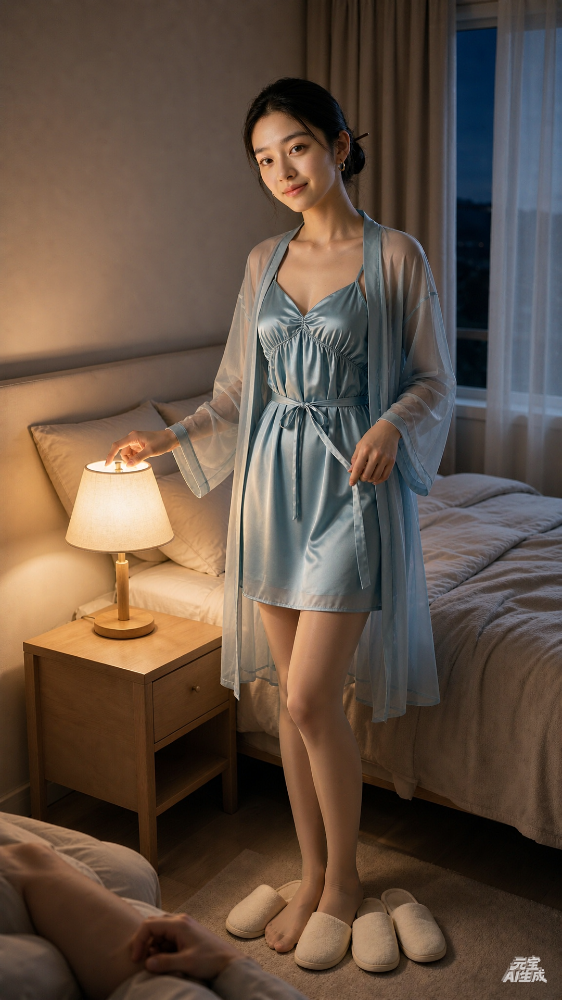

## 终稿提示词

```text
第1张 · 他半躺·眼高约 0.9 米、隔 1.3 米看她站在床尾伸手按灭床头那盏纸罩小灯，暖黄正收拢成一点

三槽分工：第一张输入图定本轮整套穿搭与丝光材质，第二张输入图定她的五官骨相，第三张输入图定本张的站姿骨架与重心；文字只写光位、场景、关系视角、构图调子、神态落点与可见动作。

9:16 竖版满画幅，画面从顶到底由人物、软榻、床头与夜色填满，四条边即裁切边，人物与道具完整落在画内。一位成年女性，一具完整身体轮廓，左右各一只手臂、各五根手指，两只手各自从肩经肘腕到指尖连成一条链、各只做一个动作；两只脚各自连续，胸大腰细腿长由合身剪裁写实呈现。

她穿雾蓝色真丝吊带睡裙，细肩带、心形领口、胸前一道细抽褶、裙长齐大腿中段，外罩同色薄透短睡袍、袍长至臀线、腰间系一道同色细系带；真丝在收拢的暖光里浮出细密丝光层次。腿上是一层从髋部经膝到脚尖连续不断的浅杏色薄透连裤丝袜，袜面无罗纹螺纹松紧收口、无横向袜边分界，脚趾由同色袜面完整包住、五趾在袜面里各自分明，脚背上那层丝光与小腿连成同一片；两只奶白软底包趾绒拖并排摆在床尾短绒地毯上，这一张她赤着丝袜脚站在地毯上，鞋不穿在脚上。奶白短圆甲，细哑银小耳圈各一只。发型是慵懒低盘发：栗棕头发在后颈偏左松松挽成一颗低髻，一枚哑木簪横簪、簪尾从髻侧露出一截，耳后与颈侧散下几缕细碎软发，额前无刘海；四张同一顶发。

她的右手从右肩经肘腕到指尖连成一条链，唯一落点是床头柜上那盏纸罩小灯的圆钮，食指正轻轻按下去、指腹压在钮面、其余四指自然收拢，灯罩里的暖黄正收成最后一小粒；左手从肩经肘腕到指尖连成一条链，唯一落点是垂在身侧的睡袍系带尾梢，指尖虚虚捻着带尾不拉紧。脊线从后颈经腰窝到站立的那只脚踝拉成一道柔和的直，右髋微微送出，重心落在后脚，前脚脚尖朝床那侧轻踏半步。她微微俯身，下巴收一点，眼从低处抬起来正对这一眼，眼角带着一点「我替你关了哦」的得意，下唇含住一点又松开，嘴角只挑起一线，没有笑满。

场景是夜里的卧室：浅灰薄毯铺到床沿，两只枕头并排，床头柜上一只白瓷小杯与一本合起的书，纸罩小灯是屋里最后一点暖黄；窗帘半合，窗外是淡青灰的夜色，窗缝漏进来极薄一线冷光，与将熄的暖黄在她肩头交界。画外人只以他自己那一小片入画：被角近处露出他搁在薄毯上的一只手背，不入头脸、不多出第二个人。远景里这一眼看不清的是他半躺着的整段身体与灯的开关线，近处看得清的是她按灯的指尖、低髻上那截簪尾、丝袜脚背上那层连到趾尖的浅杏丝光。

柔白顶光收成暖黄一点，落在她的眼尾、下唇角、锁骨、按灯的指尖与脚背；其余化进柔软的暖灰里，安静得像一整天被轻轻合上。去除输入参考图右下角的「元宝 AI 生成」水印，画面不保留任何输入参考图自带的文字与边框；成图自带工具水印原样留在右下角。
```

## 一句点评

站姿按灯暖黄收成一点
