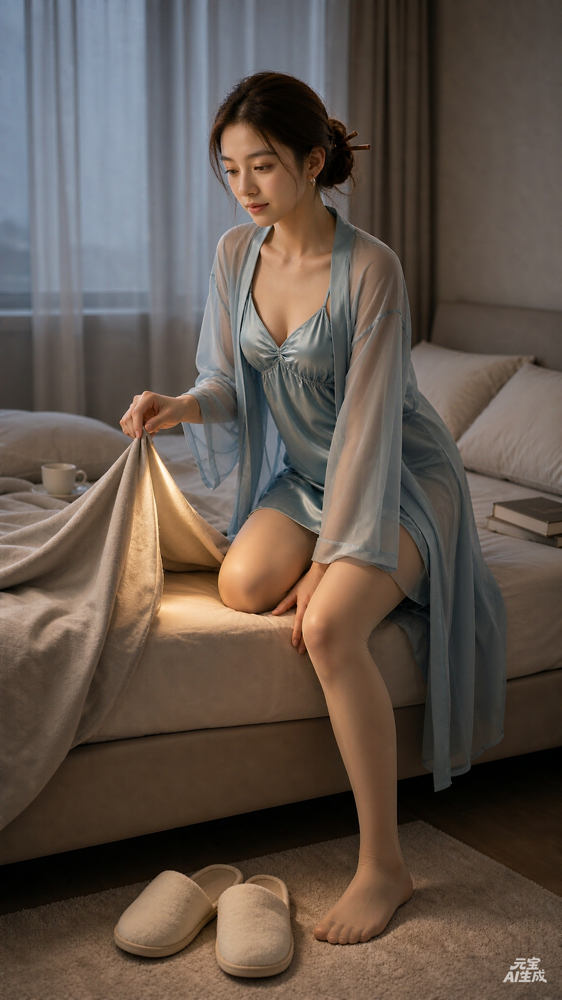

## 终稿提示词

```text
第2张 · 他半躺·眼高约 0.85 米、隔 1.0 米看她单膝跪上床沿把浅灰薄毯掀开一角

三槽分工：第一张输入图定本轮整套穿搭与丝光材质，第二张输入图定她的五官骨相，第三张输入图定本张的跪姿骨架与重心；文字只写光位、场景、关系视角、构图调子、神态落点与可见动作。

9:16 竖版满画幅，画面从顶到底由人物、床沿、薄毯与夜色填满，四条边即裁切边，人物与道具完整落在画内。一位成年女性，一具完整身体轮廓，左右各一只手臂、各五根手指，两只手各自从肩经肘腕到指尖连成一条链、各只做一个动作；两只脚各自连续，胸大腰细腿长由合身剪裁写实呈现。

她穿雾蓝色真丝吊带睡裙，细肩带、心形领口、胸前一道细抽褶、裙长齐大腿中段，外罩同色薄透短睡袍、袍长至臀线、腰间系一道同色细系带；跪姿让真丝在膝头堆出几道软褶，丝光随褶起伏。腿上是一层从髋部经膝到脚尖连续不断的浅杏色薄透连裤丝袜，袜面无罗纹螺纹松紧收口、无横向袜边分界，脚趾由同色袜面完整包住、五趾在袜面里各自分明；跪着的那只脚脚背贴着床沿软垫，另一只脚的丝袜脚尖轻轻点在被褥上，两只奶白软底包趾绒拖并排摆在床尾短绒地毯上作道具。奶白短圆甲，细哑银小耳圈各一只。发型是慵懒低盘发：栗棕头发在后颈偏左松松挽成一颗低髻，一枚哑木簪横簪、簪尾从髻侧露出一截，耳后与颈侧散下几缕细碎软发；四张同一顶发。

她的右手从右肩经肘腕到指尖连成一条链，唯一落点是浅灰薄毯靠她那侧的边角，五指捏住毯角往外掀开一小片、指节微微弯着，毯面被带出一道柔软的斜褶；左手从肩经肘腕到指尖连成一条链，唯一落点是撑在床沿软垫上的掌心，五指分开把身子稳住，腕子压出一点好看的凹。单膝跪上床沿，另一条腿屈着留在床边，脊线从后颈经腰窝到跪着的膝头拉成一道柔弧，肩往他这侧送了半寸，髋留在后，重心稳在跪膝与撑垫的那只手之间。她低头先看自己掀开的那一角毯，再抬眼把目光递过来，下颌收一点，眼尾压下来，眉梢只提起一半就停住，像早知道他一直没出声。

场景是夜里的卧室：床头那盏纸罩小灯刚熄，只剩一点暖黄余晕铺在枕面与她的肩头；浅灰薄毯、两只并排的枕头、白瓷小杯、合起的书都还在原位；窗帘半合，窗外淡青灰夜色，窗缝一线冷光退到画外。画外人只以他自己那一小片入画：被角近处露出他搁在薄毯上的一截手腕与袖口，不入头脸、不多出第二个人。

柔白顶光已收成暖黄一小团，落在她掀毯的指尖、撑垫的手腕、低髻簪尾与丝袜脚背那层连到趾尖的浅杏丝光；其余化进暖灰，屋里静得能听见毯面被掀起的那一声轻响。去除输入参考图右下角的「元宝 AI 生成」水印，画面不保留任何输入参考图自带的文字与边框；成图自带工具水印原样留在右下角。
```

## 一句点评

跪坐掀毯指尖带出软褶
