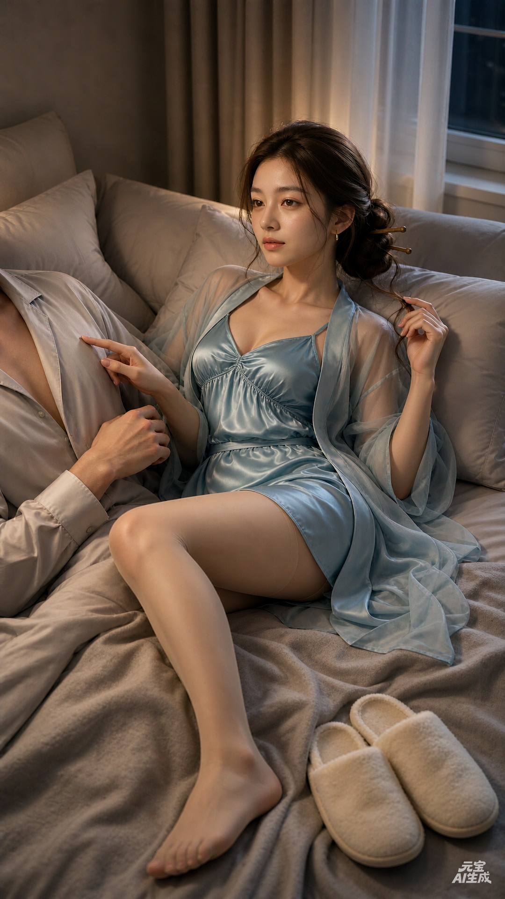

## 终稿提示词

```text
第3张 · 他撑起·眼高约 0.8 米、隔 0.55 米看她侧身躺下把一只手搭到他胸口、指尖在他睡衣前襟点一下

三槽分工：第一张输入图定本轮整套穿搭与丝光材质，第二张输入图定她的五官骨相，第三张输入图定本张的侧卧骨架与重心；文字只写光位、场景、关系视角、构图调子、神态落点与可见动作。

9:16 竖版满画幅，画面从顶到底由人物、枕被、床头与夜色填满，四条边即裁切边，人物与道具完整落在画内。一位成年女性，一具完整身体轮廓，左右各一只手臂、各五根手指，两只手各自从肩经肘腕到指尖连成一条链、各只做一个动作；两只脚各自连续，胸大腰细腿长由合身剪裁写实呈现。

她穿雾蓝色真丝吊带睡裙，细肩带、心形领口、胸前一道细抽褶、裙长齐大腿中段，外罩同色薄透短睡袍、袍长至臀线、腰间系一道同色细系带；侧卧让真丝顺着腰窝与髋线淌成一片软光，睡袍下摆搭在薄毯上。腿上是一层从髋部经膝到脚尖连续不断的浅杏色薄透连裤丝袜，袜面无罗纹螺纹松紧收口、无横向袜边分界，脚趾由同色袜面完整包住、五趾在袜面里各自分明；上侧那条腿微微屈起，丝袜脚背贴着薄毯，下侧那只脚的脚尖轻轻搭在被角，两只奶白软底包趾绒拖并排摆在床尾短绒地毯上作道具。奶白短圆甲，细哑银小耳圈各一只。发型是慵懒低盘发：栗棕头发在后颈偏左松松挽成一颗低髻，一枚哑木簪横簪、簪尾从髻侧露出一截，侧卧时耳后几缕细碎软发垂到枕面上；四张同一顶发。

她的右手从右肩经肘腕到指尖连成一条链，唯一落点是他睡衣前襟靠胸口那一小块，五指自然摊开贴着，食指尖在布面上极轻地点一下就停住、不收回；左手从肩经肘腕到指尖连成一条链，唯一落点是自己枕侧那绺垂下来的软发，指腹虚虚拢着发尾、不拉不扯。侧身朝他躺着，脊线从后颈经腰窝到屈起的膝头拉成一道柔缓的 S，肩往前送、髋留在后，重心落在枕与薄毯之间。她把脸从枕面侧过来一点，眼尾压下来正对这一眼，目光比刚才慢半拍，下唇含住一点又松开，嘴角挑起极轻的一线，像在等他先认一句今天走得有点多。

场景是夜里的卧室：灯熄之后屋里只剩床头一点暖黄余晕，浅灰薄毯拉到两人腰际，两只枕头并排，白瓷小杯与合起的书在床头柜上；窗帘半合，窗外淡青灰夜色，窗缝那线冷光细得像一根头发。画外人只以他自己那一小片入画：他搁在薄毯上的一截手腕与睡衣前襟一小片，就在她指尖底下，不入头脸、不多出第二个人。

暖黄收在她的眼尾、下唇角、锁骨、搭在他胸口的那五根指尖、以及丝袜脚背那层连到趾尖的浅杏丝光上；别处全化进柔软的暖灰，安静得像一句话说完又舍不得收尾。去除输入参考图右下角的「元宝 AI 生成」水印，画面不保留任何输入参考图自带的文字与边框；成图自带工具水印原样留在右下角。
```

## 一句点评

侧卧搭手灯熄只剩余晕
