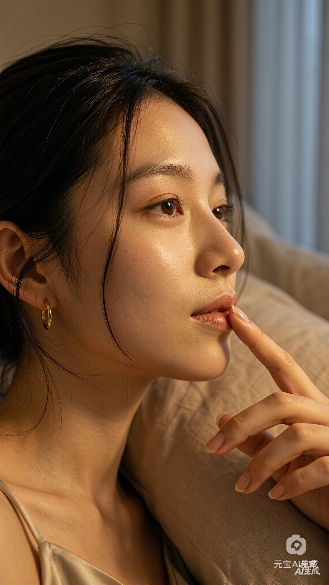

## 终稿提示词

```text
第4张 · 他凑近·眼高约 0.75 米、隔 0.3 米看她只留眼尾到嘴角那半张脸、一根指尖点在他唇边不收回

三槽分工：输入图定她的五官骨相；本张是极近特写，文字只写这一眼看得见的那半张脸、光位、神态落点与可见动作。

9:16 竖版满画幅近景特写，画面从顶到底由她的侧脸、垂发、枕面与一点暖黄填满，四条边即裁切边；画顶裁到眉骨以上，画底收到下颌线以下，全画只留眼尾到嘴角那半张脸，正脸不给全，眉眼以下那道柔和的下颌线只露一线。一位成年女性，一具身体轮廓，脸模五官骨相与前三张是同一个人，皮肤在暖黄里干净柔和、不显老、神情不紧绷；只出现一只手，这只手从肩经肘腕到指尖连成一条链、五根手指各各分明、只做一个动作。

她的右手从画面右下角伸进来，唯一落点是自己唇边偏外那一小片空气与他的唇之间，食指收成一根指尖、指腹朝外，极轻地点在他唇边就停住，点完不收回、也不前推；其余四指自然收拢，腕子松松的，奶白短圆甲在暖黄里反出一点细亮。她的眼尾压下来，从垂下来的几缕栗棕碎发缝里正对这一眼，睫毛一眨一眨扫过那道绒边似的暗影；下唇含住一点又慢慢松开，嘴角只挑起一点点，不笑满，带一点「看够了没呀」的小得意，又留一点不肯先说话的软。

发型仍是慵懒低盘发：后颈偏左那颗松髻与哑木簪尾在这一张里退到画外，只在耳侧留几缕细碎软发垂到枕面，发梢被暖黄勾出一线绒光；细哑银小耳圈在耳垂那一点反一粒极小的亮。雾蓝真丝吊带睡裙的细肩带在画底边缘露出一小截，真丝丝光与浅灰枕面的织纹在同一道暖光里各亮各的。

场景是灯熄之后的枕边：背景全化成柔软的暖灰，只有一点暖黄落在眼尾、下唇角、耳圈与那根不肯收回的指尖上，别处暗下去；窗帘半合，窗外淡青灰夜色一点都不进画。画外人只以他自己那一小片入画：他唇边那一小片轮廓就在她指尖底下，不入头脸、不多出第二个人、不出现带美甲的手。

暖黄收成最后一小粒，安静得像今晚最后一句话被含住了没舍得说。去除输入参考图右下角的「元宝 AI 生成」水印，画面不保留任何输入参考图自带的文字与边框；成图自带工具水印原样留在右下角。
```

## 一句点评

近景半张脸指尖不收回
