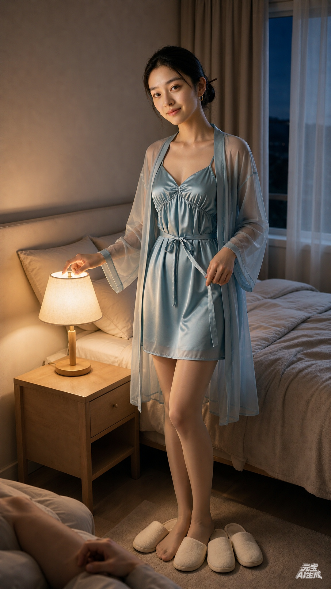
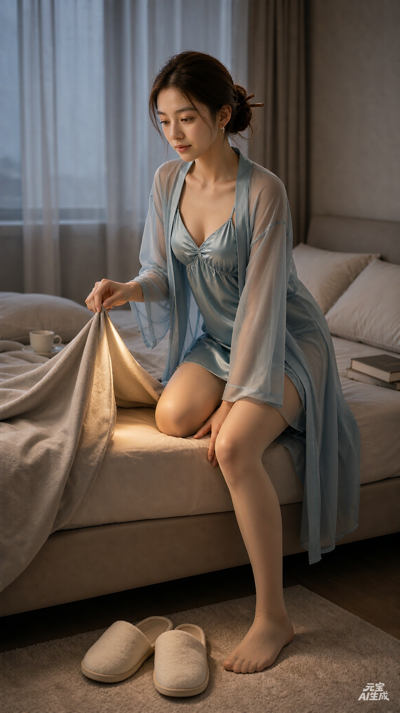
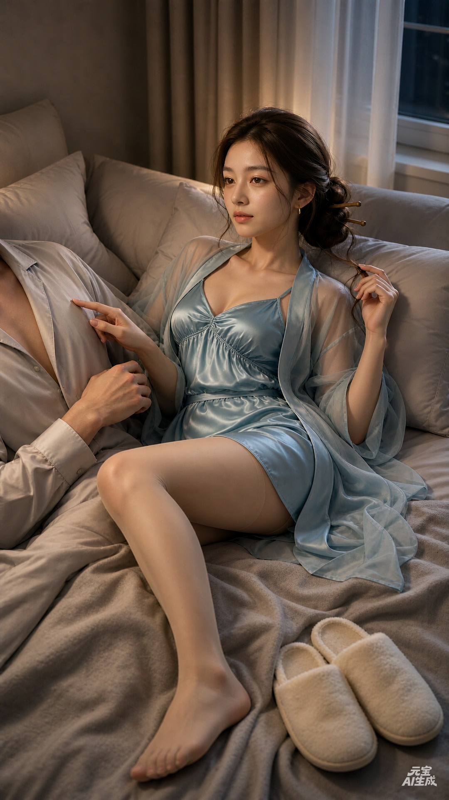
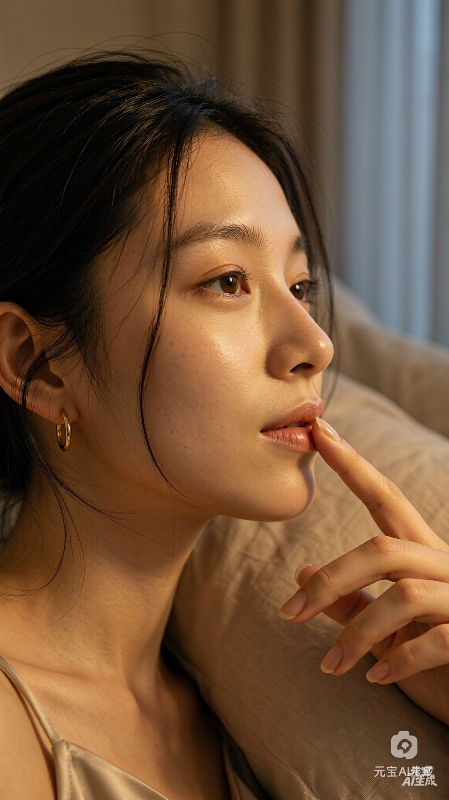

# R026 · 灯关了来睡觉了

- 轮次目录：`20261127z_lightsoff-sleep`
- 日期：2026-11-27
- 来源：`yuanbao`
- 穿搭：`LNG-SLEEP`
- 发型：慵懒低盘发
- 场景标签：卧室、沙发
- 四张线稿：`full_sexy_P001_diagonal`、full_sexy_P004_diagonal`、full_sexy_P028_diagonal`、none`
- 画幅：1080×1920（9:16），纯画面

## 四张

| 序 | 机位 | 图 | 终稿提示词 |
|---|---|---|---|
| 01 | front |  | [01_front.md](01_front.md) |
| 02 | side |  | [02_side.md](02_side.md) |
| 03 | seat |  | [03_seat.md](03_seat.md) |
| 04 | close |  | [04_close.md](04_close.md) |

## 这一段说了什么

1. 灯我替你关啦，别装睡呀，睫毛动一下我都看得见；今晚话头归我起，你只管闭眼。
2. 毯子烘过太阳味，我掀一角给你，先别抢，抢了我明天可不替你叠。
3. 手搭这儿就不许挪了，你心跳比嘴诚实，明早买豆浆你请，我要冰的。
4. 看够了没，指尖还点着呢。明早陪我去挑旧闹钟，敢说不换我自己搬凳子。

## 现场记录

- 01_front：站姿按灯暖黄收成一点
- 02_side：跪坐掀毯指尖带出软褶
- 03_seat：侧卧搭手灯熄只剩余晕
- 04_close：近景半张脸指尖不收回

> 原图 PNG 永不转码、永不覆盖；预览用 `` 缩放原图。
