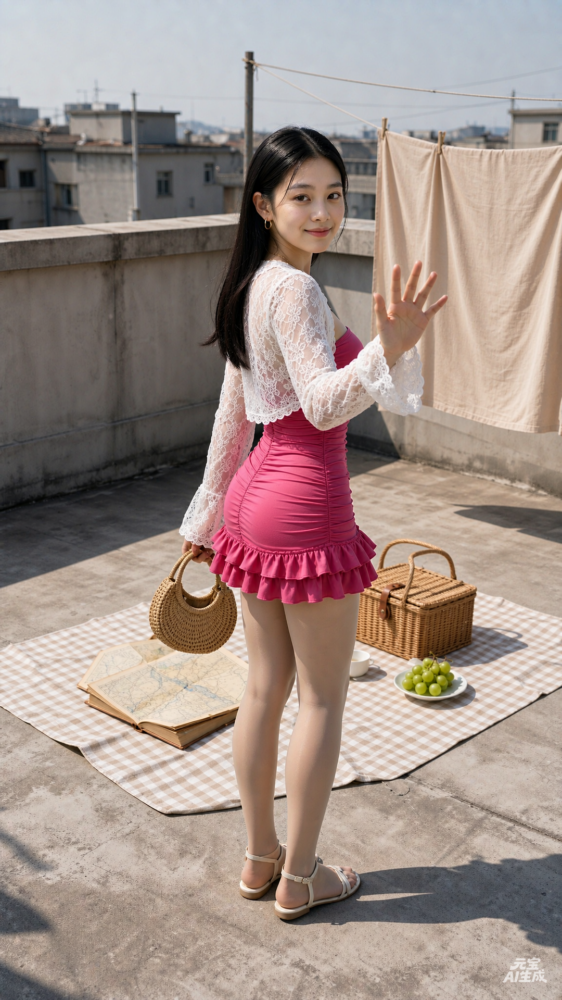

## 终稿提示词

```text
第1张 · 他（站在天台门口）· 视点高度 1.60 米、隔 2.4 米看她在做什么。

9:16 满幅画面，宽 1080 高 1920，人物与天台道具铺满整幅，四条边即裁切边，人物头顶到脚底完整收在画内。

第一张图只定整套穿搭的版型配色面料，第二张图只定骨相五官，第三张图的线稿只定本张的躯干重心、脊线肩髋与两腿骨架；手臂走向完全由下文逐只链写承接。三张参考图与这段文字拼成一份资料，各写各的那一段。

她穿玫粉色抹胸抽褶修身迷你连衣裙，胸口一道横向抽褶，裙摆两层细密荷叶边落在大腿中段；外罩一件白色蕾丝长袖短外搭，蕾丝袖子透出一点手臂轮廓，前襟敞开；一只草编小圆包挂在左腕，草编纹路一圈一圈可辨。她 24 小时穿着一层浅香槟薄透连裤丝袜，从腿根连包到脚趾，脚趾由同色袜面完整包住、五趾在袜面里各自分明，袜面从小腿到脚背连成平顺同一片，脚趾与脚背看得出同色袜面的包覆边界，脚踝与小腿前缘有一道织物折光把袜面与腿肤色分出一层可辨边界。她脚上一双奶白细带露趾平底凉鞋穿在这一层丝袜外面，丝袜脚背连进鞋口，五趾在袜面里各自分明，细带在脚背压出两道浅影。

她梳墨黑长直发垂过肩胛骨、中分缝笔直压到发根，发身顺直、发尾十五厘米处向外翻出一道利落弧线，额前两缕斜扫的弧形长刘海从眉尾划过颧骨、眉眼整片露出，耳侧各垂一缕细碎发丝贴着耳廓前沿落到下颌角、随正午冷白风微微离耳半寸；四张逐字同一顶。

秋日正午的老公寓天台：青灰水泥地被白亮直射天光照得发白，女儿墙在地面投下一道笔直硬影；墙边拉一根晾衣绳，绳上一块浅杏色桌布被风鼓起一道柔弧；地上铺一张米白与浅茶格纹野餐垫，垫上摊开一本旧牛皮纸封面地图册，纸页泛黄、折痕清楚，旁边一只藤编野餐篮、一只白瓷小碟盛着几颗青提、一枚红色小图钉搁在地图册页边；远处楼群与水箱在白亮天光里连成淡淡一层。正午白亮直射天光从她右后上方落下来，女儿墙青灰冷反光与水泥地冷反光顺着腿线落到袜面折光上，白亮天光在脚背、锁骨与地图册纸页上各落一小片亮；整幅是白亮直射的冷白天光，灰青硬影与白亮光面在同一片画面里交界。

她背对这一眼在女儿墙前站定、刚回过身，脊线从后颈到脚踝拉成一道直，重心落在后脚，前脚脚尖朝这一侧轻踏半步。右手从肩经肘腕到指尖一条链，五指分开扶着摊开的地图册外侧纸角，指腹压住纸页折痕；左手从肩经肘腕到指尖一条链，抬到肩侧朝这一眼张开五指轻轻招一下，指尖在白亮天光里各自分明。画面里只落她自己这一位人物，画外人由首行机位与这一眼的取景方向交待、画面四边以内只收她一人的轮廓与她手里那些道具；两条手臂各自从肩经肘腕连到指尖、两条腿各自从髋连到脚趾，全画共两条手臂、两只手、十根手指、两条腿，数与位一一对应她自身躯干两侧。

她回身那一瞬下巴微收、眼尾顺势挑起，唇角只提起靠左手这一侧的一点弧度，笑意落在招手那五指轻轻一收的一顿上，视线越过肩头落向这一眼的取景方向；这一眼的取景落点落在她脚背那一小片白亮、从膝头顺到脚踝的浅香槟折光，以及地图册纸页上那道折痕。
```

## 一句点评

天台门口回身招手把风也招进来
