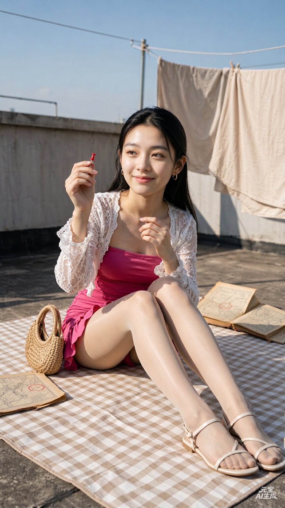

## 终稿提示词

```text
第4张 · 他（凑近到野餐垫前）· 视点高度 1.00 米、隔 0.3 米看她在做什么。

9:16 满幅画面，宽 1080 高 1920，整幅一次成像落在同一个焦平面上，人物、举着图钉那只手与画底一线格纹垫面连成同一片光；四条边即裁切边。

第一张图只定整套穿搭的版型配色面料，第二张图只定骨相五官，第三张图的线稿只定本张的躯干重心、脊线肩髋与两腿骨架；手臂走向完全由下文逐只链写承接。三张参考图与这段文字拼成一份资料，各写各的那一段。

她穿玫粉色抹胸抽褶修身迷你连衣裙，胸口一道横向抽褶，裙摆两层细密荷叶边在画底露出一小截；外罩一件白色蕾丝长袖短外搭，蕾丝袖口在画侧落一道细碎花边；草编小圆包的草编纹在肩侧露一小角。她 24 小时穿着一层浅香槟薄透连裤丝袜，从腿根连包到脚趾，脚趾由同色袜面完整包住、五趾在袜面里各自分明，袜面从小腿到脚背连成平顺同一片，脚趾与脚背看得出同色袜面的包覆边界，脚踝与小腿前缘有一道织物折光把袜面与腿肤色分出一层可辨边界。她脚上一双奶白细带露趾平底凉鞋穿在这一层丝袜外面，丝袜脚背连进鞋口，五趾在袜面里各自分明；画底那一线野餐垫格纹布面映着脚背与五趾的浅香槟折光。

她梳墨黑长直发垂过肩胛骨、中分缝笔直压到发根，发身顺直、发尾十五厘米处向外翻出一道利落弧线，额前两缕斜扫的弧形长刘海从眉尾划过颧骨、眉眼整片露出，耳侧各垂一缕细碎发丝贴着耳廓前沿落到下颌角、随正午冷白风微微离耳半寸；四张逐字同一顶。

秋日正午的老公寓天台：画底一线米白与浅茶格纹野餐垫，垫角露出旧牛皮纸地图册的一角与那个手画小红圈的半弧；晾衣绳上浅杏色桌布被风鼓起的柔弧在画顶远处连成淡淡一道；女儿墙在垫边投下一道笔直硬影。正午白亮直射天光从她右后上方落下来，青灰冷反光顺着腿线落到袜面折光上，白亮天光在脚背、她眼尾、下唇角与指间那枚红图钉上各落一小片亮；整幅是白亮直射的冷白天光，灰青硬影与白亮光面在同一片画面里交界。

她把那枚红色小图钉举到两人视线正中间，右手从肩经肘腕到指尖一条链，拇指与食指捏着图钉的红色玻璃珠、食指尖轻轻点在针尖那一侧，图钉尖朝这一眼，玻璃珠在白亮光里透出一点亮；左手从肩经肘腕到指尖一条链，五指交叠收在锁骨前，指腹贴着白色蕾丝外搭的领口。画面里只落她自己这一位人物，画外人由首行机位与这一眼的取景方向交待、画面四边以内只收她一人的轮廓与她手里那些道具；两条手臂各自从肩经肘腕连到指尖、两条腿各自从髋连到脚趾，全画共两条手臂、两只手、十根手指、两条腿，数与位一一对应她自身躯干两侧。

她眼睑微抬、瞳仁正对红图钉针尖，嘴角向举钉那只手同侧挑起一点，鼻梁与颊侧被冷白天光压出一道清亮高光，像等你看清那一点才肯笑；指尖点完就停住、停在这一眼跟前；这一眼的取景落点落在那枚红图钉的玻璃珠、她点着针尖的指尖，以及画底那一线浅香槟袜面折光上。
```

## 一句点评

往后我圈哪儿你陪我去哪儿
