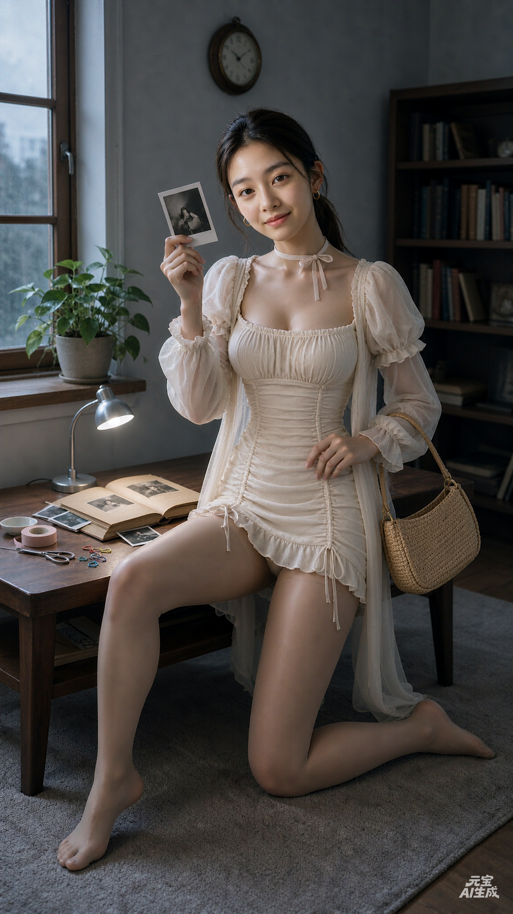

## 终稿提示词

```text
第1张 · 他（站在书房门口）· 视点高度 1.55 米、隔 1.8 米看她在做什么。

9:16 满幅画面，宽 1080 高 1920，人物与书房道具铺满整幅，四条边即裁切边，人物头顶到脚底完整收在画内。

第一张图只定整套穿搭的版型配色面料，第二张图只定骨相五官，第三张图的线稿只定本张的躯干重心、脊线肩髋与两腿骨架；手臂走向完全由下文逐只链写承接。三张参考图与这段文字拼成一份资料，各写各的那一段。

她穿象牙白一字肩泡泡短袖抽褶修身迷你连衣裙，细吊带在颈侧系住，肩口一层横向抽褶，泡泡袖蓬起落到上臂，胸腰一段细密竖向抽褶收到腰线，裙摆两层细密荷叶边落在大腿中段，腰侧两条同色薄纱长飘带垂到膝下；一只米白草编小圆包挂在左腕，草编纹路一圈一圈可辨。她 24 小时穿着一层浅杏薄透连裤丝袜，从腿根连包到脚趾，脚趾由同色袜面完整包住、五趾在袜面里各自分明，袜面从小腿到脚背连成平顺同一片，脚趾与脚背看得出同色袜面的包覆边界，脚踝与小腿前缘有一道织物折光把袜面与腿肤色分出一层可辨边界。她赤足踩在短绒地毯上，两只脚的脚背与五趾各自完整落在画内，浅杏袜面在脚背连成平顺同一片。

她梳栗茶棕及锁骨下八厘米的低束半扎发，头顶发根蓬起一指高、扎点落在后脑正中偏下一寸，右侧三分七的浅弧分缝里露出一线浅肤色头皮；发身自耳下起走大弧度松散波浪、每波约三指宽、波峰朝一字肩泡泡袖鼓起的方向外扬；两片轻薄八字刘海自分缝口斜落到眉弓上方、尾端擦过眉骨、眉眼整片露出；耳侧各留一缕细碎发从耳廓前贴着颧骨弯下、末端在下颌角外一厘米处微微卷回，与草编小圆包的藤纹同向反光；四张逐字同一顶。

秋日傍晚的老公寓书房：深胡桃木矮茶几摆在短绒地毯上，木纹与两道旧划痕清楚；茶几上摊开一本牛皮纸封面旧相册，纸页泛黄、页角卷起一点，几张白边拍立得散在页上，画面里是模糊的窗与灯影；旁边一卷浅粉和纸胶带、一把小剪刀、一只白瓷小碟盛着几枚彩色回形针；一盏冷白鹅颈台灯立在茶几角，金属灯罩把一小圈冷白灯面压在相册纸页上；画左半开的木格窗漏进最后一线灰青暮色，窗玻璃上一道冷反光，窗台一小盆绿萝叶面青着，墙上一只旧圆挂钟，远处书架在灰青光里连成淡淡一层。傍晚灰青暮色散射光从画左窗侧漫进来，窗玻璃冷反光与青灰地毯反光顺着腿线落到袜面折光上，冷白台灯面在相册纸页、她锁骨与脚背各落一小片亮；整幅是灰青散射光与一小圈冷白灯面在同一片画面里交界。

她跪坐在短绒地毯上刚从茶几那侧回过身，一腿屈起贴着地毯、一腿斜斜收在身后，脊线从后颈经腰窝到收在身后的脚踝拉成一道柔缓的弧。右手从肩经肘腕到指尖一条链，拇指与食指捏着一张白边拍立得的下角举到肩侧、照片正面对着这一眼，白边在灰青光里泛出一线亮；左手从肩经肘腕到指尖一条链，五指张开搭在矮茶几的木沿上，指腹压着摊开的相册页边。画面里只落她自己这一位人物，画外人由首行机位与这一眼的取景方向交待、画面四边以内只收她一人的轮廓与她手里那些道具；两条手臂各自从肩经肘腕连到指尖、两条腿各自从髋连到脚趾，全画共两条手臂、两只手、十根手指、两条腿，数与位一一对应她自身躯干两侧。

她回身那一瞬下颌微收、眼尾朝举高的那张拍立得方向轻轻弯起，唇角含一点刚按下快门似的笑意，瞳仁里映出鹅颈台灯那粒冷白光点，像刚把一张只肯给你看的小照片从一整叠里挑了出来；这一眼的取景落点落在她举着的那张白边拍立得、从膝头顺到脚踝的浅杏折光，以及冷白灯面压在相册纸页上的那一小片亮。
```

## 一句点评

回身举一张白边拍立得先给你看这一眼
