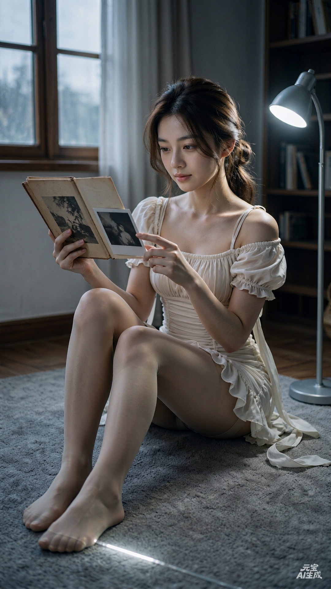

## 终稿提示词

```text
第4张 · 他（凑近到茶几前）· 视点高度 0.95 米、隔 0.3 米看她在做什么。

9:16 满幅画面，宽 1080 高 1920，整幅一次成像落在同一个焦平面上，人物、举着相册那一页的手与画底一线短绒地毯连成同一片光；四条边即裁切边。

输入图是一张三栏拼版：左栏对应下文「第一张图」（衣装层）、中栏对应「第二张图」（人脸）、右栏对应「第三张图的线稿」，按三栏分工取用。第一张图只定整套穿搭的版型配色面料，第二张图只定骨相五官，第三张图的线稿只定本张的躯干重心、脊线肩髋与两腿骨架；手臂走向完全由下文逐只链写承接。三张参考图与这段文字拼成一份资料，各写各的那一段。

她穿象牙白一字肩泡泡短袖抽褶修身迷你连衣裙，细吊带在颈侧系住，肩口一层横向抽褶，泡泡袖蓬起落到上臂，胸腰一段细密竖向抽褶收到腰线，裙摆两层细密荷叶边在画底露出一小截，腰侧一条同色薄纱长飘带垂到画侧；米白草编小圆包的草编纹在肩侧露一小角。她 24 小时穿着一层浅杏薄透连裤丝袜，从腿根连包到脚趾，脚趾由同色袜面完整包住、五趾在袜面里各自分明，袜面从小腿到脚背连成平顺同一片，脚趾与脚背看得出同色袜面的包覆边界，脚踝与小腿前缘有一道织物折光把袜面与腿肤色分出一层可辨边界。她赤足踩在短绒地毯上，画底那一线短绒地毯映着脚背与五趾的浅杏折光。

她梳栗茶棕及锁骨下八厘米的低束半扎发，头顶发根蓬起一指高、扎点落在后脑正中偏下一寸，右侧三分七的浅弧分缝里露出一线浅肤色头皮；发身自耳下起走大弧度松散波浪、每波约三指宽、波峰朝一字肩泡泡袖鼓起的方向外扬；两片轻薄八字刘海自分缝口斜落到眉弓上方、尾端擦过眉骨、眉眼整片露出；耳侧各留一缕细碎发从耳廓前贴着颧骨弯下、末端在下颌角外一厘米处微微卷回，与草编小圆包的藤纹同向反光；四张逐字同一顶。

秋日傍晚的老公寓书房：画底一线短绒地毯，茶几角露出牛皮纸封面旧相册的一角与刚贴好的一张白边拍立得的半幅；画侧那盏冷白鹅颈台灯的金属灯罩边缘露一道细亮；画左半开的木格窗漏进最后一线灰青暮色，窗玻璃上一道冷反光；画顶远处书架在灰青光里连成淡淡一层。傍晚灰青暮色散射光从画左窗侧漫进来，窗玻璃冷反光与青灰地毯反光顺着腿线落到袜面折光上，冷白台灯面在她眼尾、下唇角、相册那一页与画底袜面各落一小片亮；整幅是灰青散射光与一小圈冷白灯面在同一片画面里交界。

她把摊开的旧相册那一页举到两人视线正中间，右手从肩经肘腕到指尖一条链，拇指托着相册页底、食指尖轻轻点在刚贴好那张白边拍立得的白边上，白边在冷白灯面里泛出一线亮；左手从肩经肘腕到指尖一条链，五指交叠收在锁骨前，指腹贴着一字肩抽褶领口。画面里只落她自己这一位人物，画外人由首行机位与这一眼的取景方向交待、画面四边以内只收她一人的轮廓与她手里那些道具；两条手臂各自从肩经肘腕连到指尖、两条腿各自从髋连到脚趾，全画共两条手臂、两只手、十根手指、两条腿，数与位一一对应她自身躯干两侧。

她眼睫微垂、视线落在自己食指尖点住的那张白边拍立得上，嘴角向举相册这只手的同侧轻轻提起一点，下颌微收让相册页正对两人视线中间，鼻梁与颊侧被冷白灯面压出一道清亮高光，像等你看清这一格才肯笑；指尖点完就停住、停在这一眼跟前；这一眼的取景落点落在那张白边拍立得、她点着白边的指尖，以及画底那一线浅杏袜面折光上。
```

## 一句点评

整页贴稳了往后每回出门都给你留一格
