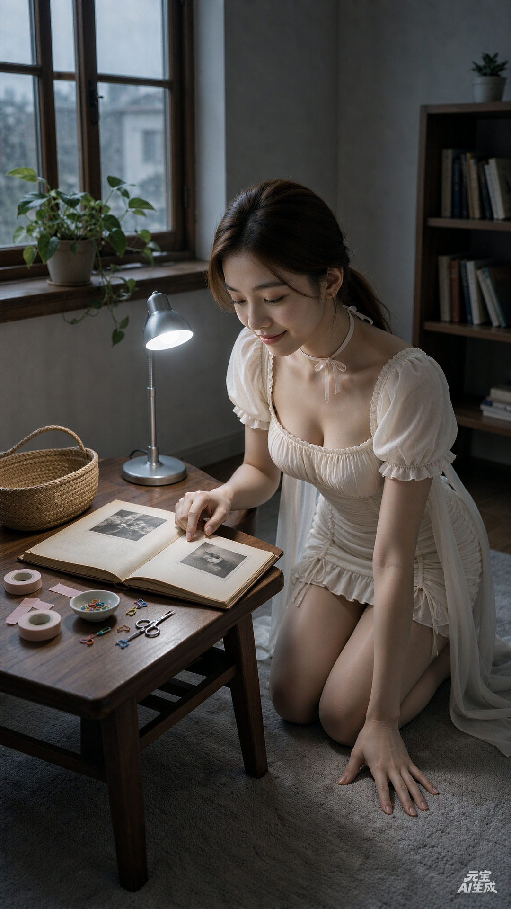

# R051 · 傍晚书房把拍立得贴进旧相册

- 轮次目录：`20261128ar_dusk-scrapbook`
- 日期：2026-11-28
- 来源：`yuanbao`
- 穿搭：`SPR-0025`
- 发型：半扎发
- 场景标签：其它
- 四张线稿：`full_sexy_P035_diagonal`、full_sexy_P032_low`、full_sexy_P029_side`、full_sexy_P028_diagonal`
- 画幅：1080×1920（9:16），纯画面

## 四张

| 序 | 机位 | 图 | 终稿提示词 |
|---|---|---|---|
| 01 | front |  | [01_front.md](01_front.md) |
| 02 | side |  | [02_side.md](02_side.md) |
| 03 | seat |  | [03_seat.md](03_seat.md) |
| 04 | close |  | [04_close.md](04_close.md) |

## 这一段说了什么

1. 你回来得正好，这叠照片我摊了一茶几，最上头这张先给你看，别急着翻下一页呀。
2. 喏，就贴这儿，我指尖按着白边角呢，胶带撕歪了也算我排的版，你不许笑我。
3. 这卷粉胶带剩最后一小截了，我举半天等你点头，你光看我呀，那我就自己贴满这一格。
4. 看清楚啦，这一页归我，往后每回出门都给你留一格，敢说麻烦我就把胶带头粘你袖口上。

## 现场记录

- 01_front：回身举一张白边拍立得先给你看这一眼
- 02_side：指尖按住右页那一小格冷白灯面
- 03_seat：浅粉胶带卷的圆口正好瞄见你
- 04_close：整页贴稳了往后每回出门都给你留一格

> 原图 PNG 永不转码、永不覆盖；预览用 `` 缩放原图。
