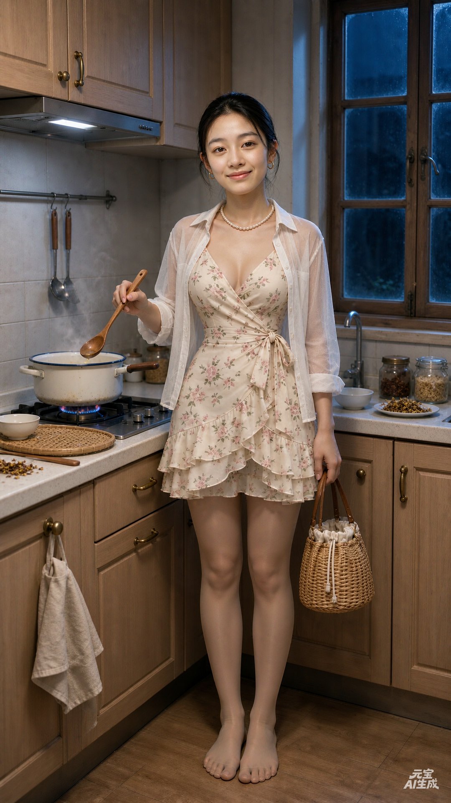

## 终稿提示词

```text
第1张 · 他（倚在厨房门框上）· 视点高度 1.55 米、隔 1.6 米看她在做什么。

9:16 满幅画面，宽 1080 高 1920，人物与灶台道具铺满整幅，四条边即裁切边，人物头顶到脚底完整收在画内。

第一张图只定整套穿搭的版型配色面料，第二张图只定骨相五官，第三张图的线稿只定本张的躯干重心、脊线肩髋与两腿骨架；手臂走向完全由下文逐只链写承接。三张参考图与这段文字拼成一份资料，各写各的那一段。

她穿米白底细碎暖粉小花茶歇短连衣裙，交叉 V 领在胸前叠出两道斜襟、细肩带在肩头系住、腰间一条同色细布带松松打结、裙摆两层细褶落在大腿中段、碎花在裙褶里一朵一朵可辨；外搭一件奶白透视薄纱短袖开衫，欧根纱袖笼蓬起落到上臂中段、敞襟垂在腰侧；一只草编小圆包挂在左腕，藤编一圈一圈的纹路清楚。她 24 小时穿着一层浅杏薄透连裤丝袜，从腿根连包到脚趾，脚趾由同色袜面完整包住、五趾在袜面里各自分明，袜面从小腿到脚背连成平顺同一片，脚趾与脚背看得出同色袜面的包覆边界，脚踝与小腿前缘有一道织物折光把袜面与腿肤色分出一层可辨边界。她赤足站在浅木地板上，两只脚的脚背与五趾各自完整落在画内，浅杏袜面在脚背连成平顺同一片。

她梳深可可棕混几缕蜜糖浅棕挑染的长发，发长垂到肩胛骨下缘三厘米处收成齐口内扣，正中一条笔直中分缝从头顶裂到发旋后收拢；通体大波浪松卷每卷约两指宽、自耳下起卷，卷峰贴着奶白薄纱开衫的袖笼一道一道落下去；两缕弧形帘刘海自中分缝两侧斜扫过眉尾再没入鬓角，整片额头中央露出来；耳侧各留一绺比主发浅半度的小卷碎发贴着颧骨弯出去、搭在开衫薄纱边缘上；四张逐字同一顶。

入夜后的老公寓厨房：浅木橱柜与黄铜小拉手沿墙排开，台面上立着一只白搪瓷带蓝边小锅，锅沿一圈蓝漆、锅身一小片暖黄油光；灶眼上一圈小小的蓝火苗贴着锅底；旁边一块竹编隔热垫、一只白瓷小碗、一把长柄木勺搁在垫上、一小碟干桂花、一只玻璃糖罐盛着半罐冰糖；墙挂钩上一件奶白棉布围裙垂着两根系带；画右半开的木格窗上一线冷蓝夜色与一层薄薄水汽，窗玻璃一道冷反光；吸顶灯把一片冷白光压在浅木台面与她肩头。光色是冷白吸顶灯与窗侧冷蓝夜色铺满整幅，灶台那一小圈暖黄油光只在锅底、她握勺的指节与脚背各落一点；冷白与冷蓝顺着腿线落到袜面折光上，三色在同一片画面里交界。

她站在灶台前刚从锅那侧回过身，脊线从后颈经腰窝到并拢的两脚拉成一道柔缓的弧，重心落在两只踩实的脚上。右手从肩经肘腕到指尖一条链，拇指与四指合握那把长柄木勺的勺柄中段、勺头还留在锅里，木纹在指节下露出一段；左手从肩经肘腕到指尖一条链，五指张开扶在浅木台面边沿，指腹压着竹编垫的一角。画面里只落她自己这一位人物，画外人由首行机位与这一眼的取景方向交待、画面四边以内只收她一人的轮廓与她手里那些道具；两条手臂各自从肩经肘腕连到指尖、两条腿各自从髋连到脚趾，全画共两条手臂、两只手、十根手指、两条腿，数与位一一对应她自身躯干两侧。

她回身那一瞬下颌微收、眼尾朝灶台那圈暖黄油光轻轻弯起，木勺尖还挂着一颗小圆子，唇角含一点刚尝到甜意的笑，瞳仁里映着灶火那一粒暖黄光点；这一眼的取景落点落在她握着的木勺柄、从膝头顺到脚踝的浅杏折光，以及窗玻璃那道冷蓝反光压在她肩头的薄纱袖笼上。
```

## 一句点评

回身举勺先替你数了三颗小圆子
