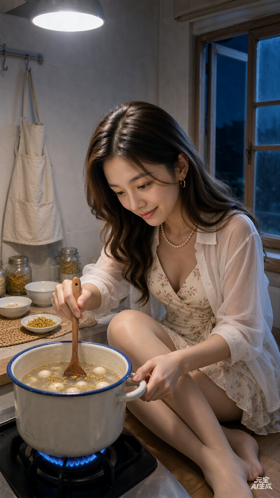

## 终稿提示词

```text
第2张 · 他（俯身到她肩侧）· 视点高度 1.30 米、隔 0.5 米看她在做什么。

9:16 满幅画面，宽 1080 高 1920，人物与锅沿道具铺满整幅，四条边即裁切边，人物头顶到脚底完整收在画内。

第一张图只定整套穿搭的版型配色面料，第二张图只定骨相五官，第三张图的线稿只定本张的躯干重心、脊线肩髋与两腿骨架；手臂走向完全由下文逐只链写承接。三张参考图与这段文字拼成一份资料，各写各的那一段。

她穿米白底细碎暖粉小花茶歇短连衣裙，交叉 V 领在胸前叠出两道斜襟、细肩带在肩头系住、腰间一条同色细布带松松打结、裙摆两层细褶落在大腿中段、碎花在裙褶里一朵一朵可辨；外搭一件奶白透视薄纱短袖开衫，欧根纱袖笼蓬起落到上臂中段、敞襟垂在腰侧；草编小圆包搁在台面角。她 24 小时穿着一层浅杏薄透连裤丝袜，从腿根连包到脚趾，脚趾由同色袜面完整包住、五趾在袜面里各自分明，袜面从小腿到脚背连成平顺同一片，脚趾与脚背看得出同色袜面的包覆边界，脚踝与小腿前缘有一道织物折光把袜面与腿肤色分出一层可辨边界。她赤足踩在浅木地板上，两只脚的脚背与五趾各自完整落在画内，浅杏袜面在脚背连成平顺同一片。

她梳深可可棕混几缕蜜糖浅棕挑染的长发，发长垂到肩胛骨下缘三厘米处收成齐口内扣，正中一条笔直中分缝从头顶裂到发旋后收拢；通体大波浪松卷每卷约两指宽、自耳下起卷，卷峰贴着奶白薄纱开衫的袖笼一道一道落下去；两缕弧形帘刘海自中分缝两侧斜扫过眉尾再没入鬓角，整片额头中央露出来；耳侧各留一绺比主发浅半度的小卷碎发贴着颧骨弯出去、搭在开衫薄纱边缘上；四张逐字同一顶。

入夜后的老公寓厨房：白搪瓷带蓝边小锅正搁在灶眼上，锅沿一圈蓝漆、锅里几颗白玉似的小圆子浮在微冒热气的清汤里、汤面浮着两三点干桂花；灶眼一圈小小的蓝火苗贴着锅底；台面上一块竹编隔热垫、一只白瓷小碗、一小碟干桂花、一只玻璃糖罐；墙挂钩上一件奶白棉布围裙垂着两根系带；画右半开的木格窗上一线冷蓝夜色与一层薄薄水汽，窗玻璃一道冷反光；吸顶灯把一片冷白光压在锅面与她俯下来的额前。光色是冷白吸顶灯与窗侧冷蓝夜色铺满整幅，灶台那一小圈暖黄油光只在锅沿、汤面浮起的白气与她握勺的指节各落一点；冷白与冷蓝顺着腿线落到袜面折光上，三色在同一片画面里交界。

她朝锅面柔柔折下身，脊线从后颈经腰窝拉成一道柔缓的弧、肩往前送、鼻尖离汤面一掌远，两腿骨架与重心由第三张图的线稿承担。右手从肩经肘腕到指尖一条链，拇指与食指捏着长柄木勺的柄尾、勺头在汤里贴着锅沿慢慢划出半圈、三颗小圆子随那道水纹轻轻转，这整条右臂只落在握勺搅汤这一件事上；左手从肩经肘腕到指尖一条链，五指并拢扶在白搪瓷锅的蓝边锅耳上、指腹压着那一圈蓝漆，这整条左臂只落在扶锅耳这一件事上；两条手臂各自贴着她自己的躯干两侧收拢，发梢与耳侧碎发顺着肩线垂在开衫薄纱上。画面里只落她自己这一位人物，画外人由首行机位与这一眼的取景方向交待、画面四边以内只收她一人的轮廓与她手里那些道具；两条手臂各自从肩经肘腕连到指尖、两条腿各自从髋连到脚趾，全画共两条手臂、两只手、十根手指、两条腿，数与位一一对应她自身躯干两侧。

她俯身时眼睑微垂、视线顺着木勺落进小圆子打转的汤面，嘴角朝扶锅耳那侧轻轻提一下，鼻尖与下颌线被灶台那圈暖黄油光描出一道细亮边，腮边因俯身挤出一点软肉，像先替你尝过一口才肯抬眼；这一眼的取景落点落在勺头拨动的那三颗小圆子、她扶着蓝边锅耳的指尖，以及从膝弯顺到脚背那一道平顺的浅杏折光上。
```

## 一句点评

坐灶前地板上把桂花搅进这一锅
