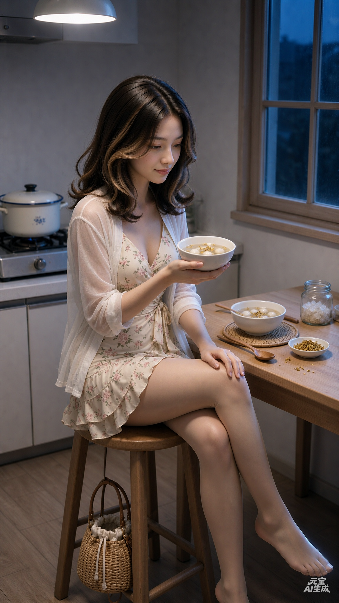

## 终稿提示词

```text
第3张 · 他（侧坐在小餐桌另一头）· 视点高度 1.00 米、隔 1.15 米看她在做什么。

9:16 满幅画面，宽 1080 高 1920，人物与餐桌道具铺满整幅，四条边即裁切边，人物头顶到脚底完整收在画内。

第一张图只定整套穿搭的版型配色面料，第二张图只定骨相五官，第三张图的线稿只定本张的躯干重心、脊线肩髋与两腿骨架；手臂走向完全由下文逐只链写承接。三张参考图与这段文字拼成一份资料，各写各的那一段。

她穿米白底细碎暖粉小花茶歇短连衣裙，交叉 V 领在胸前叠出两道斜襟、细肩带在肩头系住、腰间一条同色细布带松松打结、裙摆两层细褶落在大腿中段、碎花在裙褶里一朵一朵可辨；外搭一件奶白透视薄纱短袖开衫，欧根纱袖笼蓬起落到上臂中段、敞襟垂在腰侧；草编小圆包搁在膝侧凳脚边。她 24 小时穿着一层浅杏薄透连裤丝袜，从腿根连包到脚趾，脚趾由同色袜面完整包住、五趾在袜面里各自分明，袜面从小腿到脚背连成平顺同一片，脚趾与脚背看得出同色袜面的包覆边界，脚踝与小腿前缘有一道织物折光把袜面与腿肤色分出一层可辨边界。她赤足踩在浅木地板上，两只脚的脚背与五趾各自完整落在画内，浅杏袜面在脚背连成平顺同一片。

她梳深可可棕混几缕蜜糖浅棕挑染的长发，发长垂到肩胛骨下缘三厘米处收成齐口内扣，正中一条笔直中分缝从头顶裂到发旋后收拢；通体大波浪松卷每卷约两指宽、自耳下起卷，卷峰贴着奶白薄纱开衫的袖笼一道一道落下去；两缕弧形帘刘海自中分缝两侧斜扫过眉尾再没入鬓角，整片额头中央露出来；耳侧各留一绺比主发浅半度的小卷碎发贴着颧骨弯出去、搭在开衫薄纱边缘上；四张逐字同一顶。

入夜后的老公寓厨房：一张浅木小餐桌配一只圆面高凳，桌上一只白瓷小碗盛着半碗清汤与几颗白玉似的小圆子、汤面浮着两三点干桂花、碗边搭着那把长柄木勺、一块竹编隔热垫压在碗底；桌角一小碟干桂花、一只玻璃糖罐盛着半罐冰糖；身后灶台那只白搪瓷带蓝边小锅还搁着、锅沿一圈蓝漆；画右半开的木格窗上一线冷蓝夜色与一层薄薄水汽，窗玻璃一道冷反光；吸顶灯把一片冷白光压在碗口与她端碗的手背上。光色是冷白吸顶灯与窗侧冷蓝夜色铺满整幅，碗里那一小圈暖黄油光只在汤面、她指尖与伸出去那只脚的脚背各落一点；冷白与冷蓝顺着腿线落到袜面折光上，三色在同一片画面里交界。

她侧坐在圆面高凳上，髋留在后、肩往前送，脊线拉成一道柔缓的弧，一条腿屈起贴着凳边、另一条腿斜斜伸出去，伸出去那只脚的脚背整片落进窗侧那道冷蓝光里。右手从肩经肘腕到指尖一条链，四指托着白瓷小碗的碗底、拇指搭在碗沿，碗口正对这一眼、汤面那两三点桂花随碗轻轻晃；左手从肩经肘腕到指尖一条链，五指并拢搭在自己屈起的膝头，指腹压着茶歇裙摆一道细褶。画面里只落她自己这一位人物，画外人由首行机位与这一眼的取景方向交待、画面四边以内只收她一人的轮廓与她手里那些道具；两条手臂各自从肩经肘腕连到指尖、两条腿各自从髋连到脚趾，全画共两条手臂、两只手、十根手指、两条腿，数与位一一对应她自身躯干两侧。

她侧坐时低眼看着碗里小圆子浮起的那一点白汽，嘴角只往左提起一个浅弧，下巴微微朝斜伸那条腿的方向偏半寸，像把这句甜话先含在嘴里不说完；这一眼的取景落点落在她托着的白瓷碗口、伸出去那只脚从膝头顺到脚背的浅杏折光，以及窗侧冷蓝光在脚背上那一小片亮。
```

## 一句点评

端碗坐高凳把脚背伸进窗侧冷蓝里
