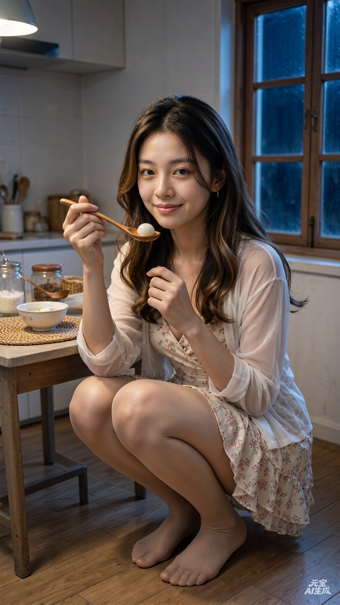

## 终稿提示词

```text
第4张 · 他（凑近到小餐桌前）· 视点高度 0.95 米、隔 0.3 米看她在做什么。

9:16 满幅画面，宽 1080 高 1920，整幅一次成像落在同一个焦平面上，人物、举到两人中间的木勺与画底一线浅木地板连成同一片光；四条边即裁切边。

输入图是一张三栏拼版：左栏对应下文「第一张图」（衣装层）、中栏对应「第二张图」（人脸）、右栏对应「第三张图的线稿」，按三栏分工取用。第一张图只定整套穿搭的版型配色面料，第二张图只定骨相五官，第三张图的线稿只定本张的躯干重心、脊线肩髋与两腿骨架；手臂走向完全由下文逐只链写承接。三张参考图与这段文字拼成一份资料，各写各的那一段。

她穿米白底细碎暖粉小花茶歇短连衣裙，交叉 V 领在胸前叠出两道斜襟、细肩带在肩头系住、腰间一条同色细布带松松打结、裙摆两层细褶在画底露出一小截、碎花在裙褶里一朵一朵可辨；外搭一件奶白透视薄纱短袖开衫，欧根纱袖笼蓬起落到上臂中段、敞襟垂在画侧；草编小圆包的藤编纹在肩侧露一小角。她 24 小时穿着一层浅杏薄透连裤丝袜，从腿根连包到脚趾，脚趾由同色袜面完整包住、五趾在袜面里各自分明，袜面从小腿到脚背连成平顺同一片，脚趾与脚背看得出同色袜面的包覆边界，脚踝与小腿前缘有一道织物折光把袜面与腿肤色分出一层可辨边界。她赤足踩在浅木地板上，画底那一线浅木地板映着脚背与五趾的浅杏折光。

她梳深可可棕混几缕蜜糖浅棕挑染的长发，发长垂到肩胛骨下缘三厘米处收成齐口内扣，正中一条笔直中分缝从头顶裂到发旋后收拢；通体大波浪松卷每卷约两指宽、自耳下起卷，卷峰贴着奶白薄纱开衫的袖笼一道一道落下去；两缕弧形帘刘海自中分缝两侧斜扫过眉尾再没入鬓角，整片额头中央露出来；耳侧各留一绺比主发浅半度的小卷碎发贴着颧骨弯出去、搭在开衫薄纱边缘上；四张逐字同一顶。

入夜后的老公寓厨房：画底一线浅木地板，桌角露出白瓷小碗的半幅碗口与碗里两颗白玉似的小圆子、汤面一点干桂花；画侧那块竹编隔热垫压着碗底、一只玻璃糖罐的玻璃边露一道细亮；画右半开的木格窗上一线冷蓝夜色与一层薄薄水汽，窗玻璃一道冷反光；画顶吸顶灯把一片冷白光压下来。光色是冷白吸顶灯与窗侧冷蓝夜色铺满整幅，碗里那一小圈暖黄油光只在勺头、她眼尾与画底袜面各落一点；冷白与冷蓝顺着腿线落到袜面折光上，三色在同一片画面里交界。

她把那把长柄木勺举到两人视线正中间，勺头盛着一颗白玉似的小圆子与半勺清汤、汤面浮着一点干桂花；右手从肩经肘腕到指尖一条链，拇指与食指捏着勺柄尾端、右臂朝这一眼的方向稳稳伸出去、勺头平平稳稳停在离她自己下唇一掌远的半空里、正对这一眼停住，木纹在指节下露出一段；左手从肩经肘腕到指尖一条链，五指交叠收在锁骨前、指腹贴着薄纱开衫的敞襟边，这整条左臂只落在收于锁骨前这一件事上。画面里只落她自己这一位人物，画外人由首行机位与这一眼的取景方向交待、画面四边以内只收她一人的轮廓与她手里那些道具；两条手臂各自从肩经肘腕连到指尖、两条腿各自从髋连到脚趾，全画共两条手臂、两只手、十根手指、两条腿，数与位一一对应她自身躯干两侧。

她眼尾随木勺抬起来微微弯住，视线越过勺尖那颗小圆子稳稳落在这一眼上，嘴角只提起一侧、下唇轻抿出一点要把圆子喂过来的得意，下颌微收让勺头正对两人视线中间，鼻梁与颊侧被冷白灯面压出一道清亮高光；勺头举完就停住、停在这一眼跟前；这一眼的取景落点落在勺头那颗小圆子、她捏着勺柄的指尖，以及画底那一线浅杏袜面折光上。
```

## 一句点评

勺举到你眼睛正中间等你张嘴
