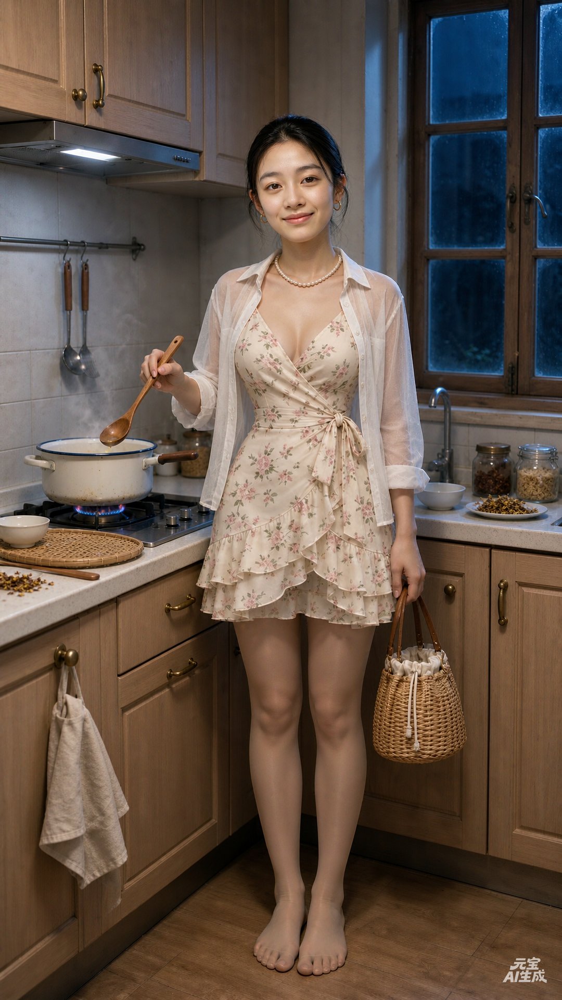
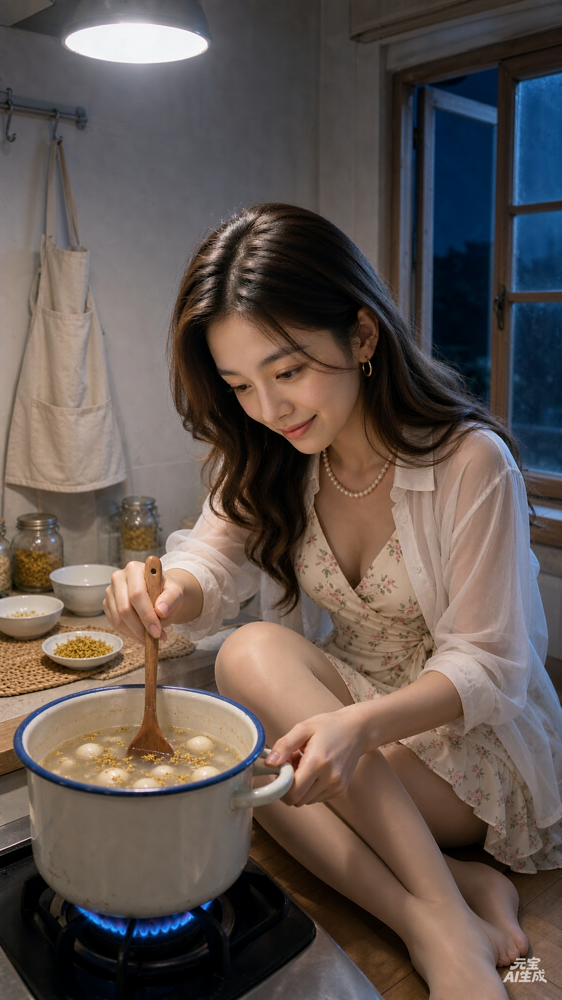
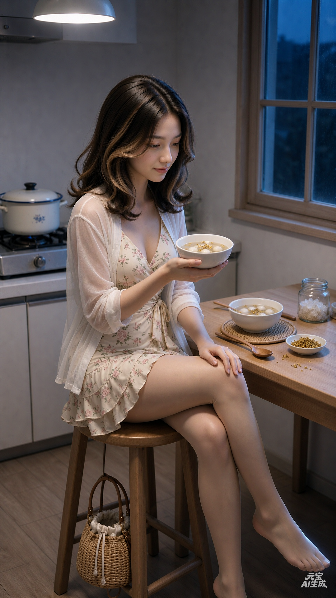

# R052 · 入夜厨房给你煮一碗小圆子

- 轮次目录：`20261128as_kitchen-tangyuan`
- 日期：2026-11-28
- 来源：`yuanbao`
- 穿搭：`SUM-0025`
- 发型：未标注
- 场景标签：洗漱
- 四张线稿：`full_single_P067_front`、full_single_P046_low`、full_single_P045_side`、full_single_P066_diagonal`
- 画幅：1080×1920（9:16），纯画面

## 四张

| 序 | 机位 | 图 | 终稿提示词 |
|---|---|---|---|
| 01 | front |  | [01_front.md](01_front.md) |
| 02 | side |  | [02_side.md](02_side.md) |
| 03 | seat |  | [03_seat.md](03_seat.md) |
| 04 | close |  | [04_close.md](04_close.md) |

## 这一段说了什么

1. 你回来得正巧，锅里小圆子刚浮起来，我握着勺先替你数了三颗，别急着伸手呀。
2. 喏，就这一勺，我搅得慢是等你凑近看，桂花撒歪了也算我排的味，你不许笑。
3. 碗我端稳了，腿也伸给你看了，你光盯着人呀，那最圆这颗我可自己先吃咯。
4. 吹一吹再张嘴，勺就停在这儿，往后每回夜里饿了都归我煮，敢说麻烦我把糖罐搁你枕边。

## 现场记录

- 01_front：回身举勺先替你数了三颗小圆子
- 02_side：坐灶前地板上把桂花搅进这一锅
- 03_seat：端碗坐高凳把脚背伸进窗侧冷蓝里
- 04_close：勺举到你眼睛正中间等你张嘴

> 原图 PNG 永不转码、永不覆盖；预览用 `` 缩放原图。
