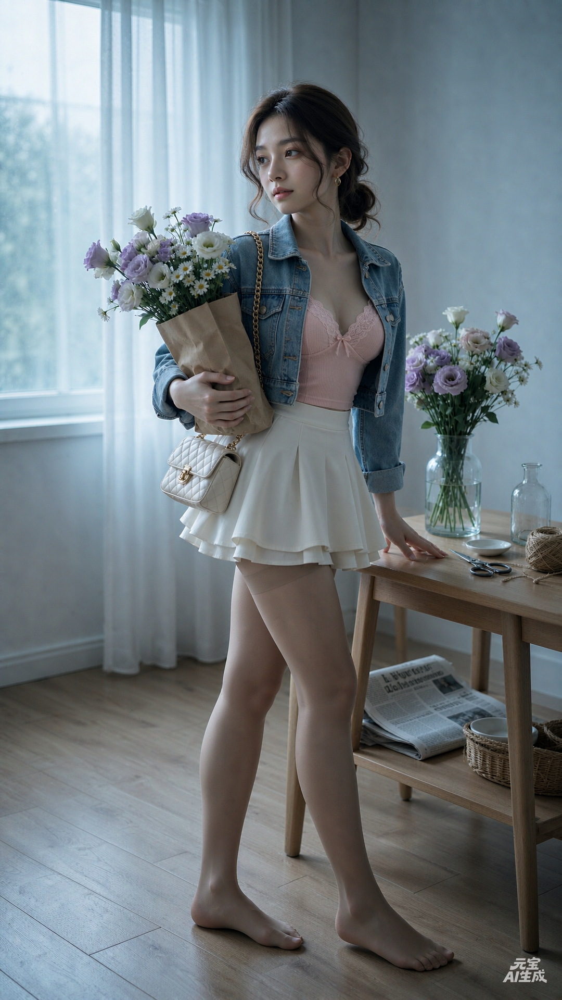

## 终稿提示词

```text
第1张 · 他（倚在客厅门框上）· 视点高度 1.50 米、隔 1.8 米看她在做什么。

9:16 满幅画面，宽 1080 高 1920，人物与茶几道具铺满整幅，四条边即裁切边，人物头顶到脚底完整收在画内。

第一张图只定整套穿搭的版型配色面料，第二张图只定骨相五官，第三张图的线稿只定本张的躯干重心、脊线肩髋与两腿骨架；手臂走向完全由下文逐只链写承接。三张参考图与这段文字拼成一份资料，各写各的那一段。

她穿一件粉蓝水洗短牛仔外套，翻领、铜扣、袖口卷起一道、衣长刚落到腰线；里头一件藕粉细针织吊带，领口一道细褶；下身奶油白高腰伞裙，裙摆两层细褶落在大腿中段、褶峰一道一道可数；一只奶白小方包斜挎在身侧、金链在腰侧压出一道细亮。她 24 小时穿着一层浅茶薄透连裤丝袜，从腿根连包到脚趾，脚趾由同色袜面完整包住、五趾在袜面里各自分明，袜面从小腿到脚背连成平顺同一片，脚趾与脚背看得出同色袜面的包覆边界，脚踝与小腿前缘有一道织物折光把袜面与腿肤色分出一层可辨边界。她赤足踩在浅木地板上，两只脚的脚背与五趾各自完整落在画内，浅茶袜面在脚背连成平顺同一片。

她梳雾栗棕里透一线灰粉光的及锁骨松螺旋卷长发，三七偏分的分缝用指尖拨出一道不规则浅弧；两缕长短错开的八字帘刘海从眉尾斜扫到颧骨上方，耳侧各留一撮细碎发贴着耳廓往外翘一小截、随侧坐低头滑到颊边露出一只小金豆耳钉；发尾卷峰不齐、外层几缕被朝东窗的冷青白天光勾出细亮边，卷势与粉蓝铜扣翻领和奶油白伞裙的细褶走向一顺；四张逐字同一顶。

清晨薄雾里的老公寓客厅：朝东长窗挂着一层白纱帘，天光透过纱帘散成一片冷青白；一张浅木矮茶几摆在窗前，茶几上一只透明玻璃花瓶盛着半瓶清水、瓶身一道冷白折光，摊开一张旧报纸、报纸上落着两片带水珠的叶与一小截剪下的枝，一把园艺小剪、一小卷麻绳、一只白瓷小碟、一只藤编小托盘；一只牛皮纸花袋立在茶几角，袋口探出几枝淡紫与奶白的洋桔梗和三两枝小雏菊，花瓣上还挂着早市的细水珠；窗台一只空玻璃小瓶静静立着；浅木地板映着窗那片冷青白反光。光色是清晨薄雾冷青白漫射天光铺满整幅，白纱帘把光滤得软而匀，玻璃花瓶与水珠上各落一点冷白高光，浅木地板一层青灰反光顺着腿线铺到袜面折光上，整幅没有第二色温。

她刚从早市回来站在茶几前、侧身朝门框这一眼回过来，脊线从后颈经腰窝到并拢的两脚拉成一道柔缓的弧，重心落在两只踩实的脚上。右手从肩经肘腕到指尖一条链，五指拢着那只牛皮纸花袋的袋口、把一捧洋桔梗连同袋身稳稳抱在胸前，纸袋的折痕在指腹下压出一道浅影；左手从肩经肘腕到指尖一条链，五指张开扶在浅木茶几的边沿，指尖压着摊开的旧报纸一角。画面里只落她自己这一位人物，画外人由首行机位与这一眼的取景方向交待、画面四边以内只收她一人的轮廓与她手里那些道具；两条手臂各自从肩经肘腕连到指尖、两条腿各自从髋连到脚趾，全画共两条手臂、两只手、十根手指、两条腿，数与位一一对应她自身躯干两侧。

她回身那一瞬下颌微收、眼尾朝门框这一眼轻轻提起，唇角只挑起靠花袋那一侧的一点弧度，瞳仁里映着纱帘那片冷青白；这一眼的取景落点落在她抱着的纸袋口那几枝淡紫洋桔梗、从膝头顺到脚踝的浅茶折光，以及玻璃花瓶那一道冷白高光上。
```

## 一句点评

抱一纸袋洋桔梗回身等你先夸
